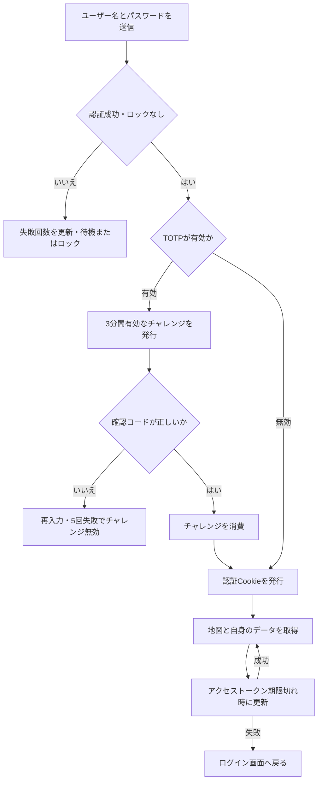

# アカウントと認証の利用・検証

ユーザーごとに地図データを管理する。ログインはパスワード認証を基本とし、TOTPを有効にしたアカウントには追加認証を求める。アカウントの自己作成とパスワードの自己変更はサーバ設定に従う。

## 現在の処理フロー

JWTはHttpOnly Cookieで返す。アクセストークンとリフレッシュトークンには認証世代番号`auth_version`を含め、DBの値と一致することとロック状態を検証する。ログアウトは世代番号を更新するため、同じアカウントの既存トークンも無効となる。

## 必要な構成・サーバ設定

PostgreSQLと既存の認証テーブルを使用する。既存環境の更新では[マイグレーション](../migrations/)を適用し、認証世代番号とTOTPチャレンジのテーブル・列を揃える。

| 設定 | 用途 |
|---|---|
| `SECRET_KEY` | JWT署名。実際の秘密はGitへ登録しない |
| `ACCESS_TOKEN_EXP_MINUTUES` | アクセストークンの有効期間・分 |
| `REFRESH_TOKEN_EXP_MINUTUES` | リフレッシュトークンの有効期間・分 |
| `SECURE_COOKIE` | HTTPS用のSecure属性 |
| `ALLOW_USER_CREATE_ACCOUNT` | 自己登録APIと画面の利用可否 |
| `ALLOW_USER_UPDATE_PASSWORD` | 自分のパスワード変更APIと画面の利用可否 |
| `FAILED_ACCOUNT_LOCK` | 初期のロック閾値設定 |
| `NEXT_CHALLENGE_MINUTES` | 初期の再試行待機時間設定 |
| `CHALLENGE_LIMIT_TIME_FAILEDCOUNT` | 初期の待機開始閾値設定 |
| `SERVICE_NAME` | TOTP用サービス名 |

上記は起動に必要な設定であり、未設定時の既定値を前提にしない。`MINUTUES`は現行の環境変数名。認証失敗の制御値は`application_settings`を参照するため、初期投入後の環境変数変更だけでDBの設定が更新されるとは扱わない。

Cookieは`SameSite=Strict`とし、リフレッシュ用CookieのPathは`/account/refresh`。プロキシ経由のHTTPSとCookie設定を合わせる。

## 利用手順

1. 管理者が作成したアカウント、または自己登録を許可された環境で作成したアカウントでログインする。
2. アカウント設定からプライバシーを確認する。必要に応じてパスワードを変更する。
3. TOTPを利用する場合はセットアップし、認証アプリへQRコードを登録して確認コードを入力する。コードの検証完了後に有効となる。
4. 利用終了時はログアウトする。ログインできない場合は待機表示に従い、ロック時は管理者へ解除を依頼する。

PC・モバイルとも認証を使用する。トークン期限切れ時はフロントエンドが更新要求を共有し、更新成功後に元の要求を再送する。権限不足など、すべての401応答を同じ更新処理で回復できるわけではない。

## API

| メソッド・パス | 認証と用途 |
|---|---|
| POST `/account/signup` | 自己登録。有効設定時のみ登録するルート |
| POST `/account/token` | パスワード認証 |
| POST `/account/totp/token` | チャレンジとTOTPコードの検証 |
| POST `/account/refresh` | リフレッシュCookieによる更新 |
| GET `/account/auth` | アカウント認証の確認 |
| GET `/account/info` | 認証済みアカウント情報 |
| PUT `/account/privacy` | 自身のプライバシー設定 |
| POST `/account/password-update` | 自身のパスワード変更。有効設定時のみ |
| POST `/account/totp/setup` | 自身のTOTPセットアップ |
| POST `/account/totp/verify` | 設定時の確認コード検証 |
| POST `/account/totp/disable` | 自身のTOTP無効化 |
| POST `/account/token/disable` | ログアウト・既存トークン無効化 |

## 権限と公開範囲

マーカー・図形・レイヤ・ファイルの更新は所有者に限定する。管理者向けAPIは別途管理者権限を確認する。アカウント作成時のプライバシー設定は有効。ファイルの匿名閲覧可否にも関係するため、公開URLの発行だけで添付ファイルまで必ず閲覧可能になるとは扱わない。

一時共有URL、公開フォーム、ライブマップにはそれぞれの公開認証がある。アカウントのログインCookieと同じ認証方式ではない。詳しくは[共有文書の索引](README.md)と[ファイル管理](FILE_MANAGEMENT.md)を参照する。

## 検証手順

- 自己登録・パスワード変更の許可を切り替え、UIとAPIの両方の利用可否を確認する。
- パスワード誤り、再試行待機、ロック、管理者による解除を確認する。
- TOTPの設定、成功、誤り、5回失敗、3分経過、成功済みチャレンジの再使用を確認する。
- 認証更新の成功と失敗、複数要求の同時更新、ログアウト後の別端末の既存トークン拒否を確認する。
- プライバシー設定を変更し、ログアウトしたブラウザでファイル閲覧の差を確認する。

## 関連する実装

[認証ハンドラー](../src/handler/account.rs)、[TOTP](../src/handler/totp.rs)、[認証ミドルウェア](../src/middleware/)、[設定](../src/config.rs)、[PCの認証通信](../src_frontend/frontend/src/axiosClient.ts)、[管理者機能](ADMINISTRATION.md)。
