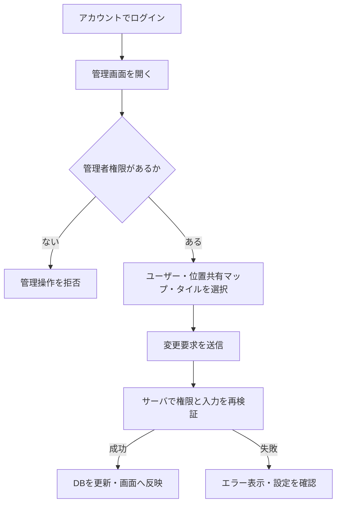

# 管理者機能の利用・検証

管理者は`/admin`からユーザー管理、現在位置共有マップ、重ね合わせタイルの定義を管理する。`is_superuser=true`のアカウントだけが利用できる。一般ユーザーの自己登録とは別に、管理者から一般ユーザーを作成できる。

## 現在の処理フロー

画面を表示できることだけで操作を許可せず、管理APIでも権限を検証する。

## 必要な構成・初期管理者

`ADMIN_USERNAME`と`ADMIN_PASSWORD`をサーバ環境へ設定する。初期データ作成の手順と起動オプションは[ルートREADME](../README.md)を参照する。既存アカウントのパスワードを変更する目的で初期設定を変更せず、管理画面の再設定を使用する。

管理者用フロントエンドを通常の配布成果物へ含める。ビルド・統合は[フロントエンド全体構成](../src_frontend/SPECIFICATION.md)に従う。

## 利用手順

1. 管理者でログインし、`/admin`を開く。
2. ユーザー管理で一般ユーザーを作成する。既存ユーザーはパスワード再設定、ロック解除、位置共有許可の変更を行う。
3. 位置共有マップでは、許可したユーザーを選んで公開マップを作成・更新する。
4. タイル追加設定では、ユーザーが登録できる重ね合わせタイルの定義を管理する。

位置共有許可を取り消すと対象アカウントの共有セッションを削除する。公開マップの作成・失効・URL再発行・公開レイヤの選択は[現在位置共有](LIVE_LOCATION_SHARING.md)、タイル定義の入力条件と無効化は[重ね合わせタイル](TILE_OVERLAYS.md)に記載する。

## API

いずれもアカウント認証と管理者権限を必要とする。

| メソッド・パス | 用途 |
|---|---|
| GET `/admin` | 管理画面 |
| GET `/admin/users` | ユーザー一覧 |
| POST `/admin/user/create` | 一般ユーザー作成 |
| POST `/admin/user/password-reset/{update_user_id}` | パスワード再設定 |
| POST `/admin/user/unlock/{unlock_user_id}` | アカウントロック解除 |
| PUT `/admin/users/{user_id}/live-location-permission` | 位置共有許可の変更 |
| GET `/admin/live-locations` | 位置共有対象の情報取得 |

マップ・タイルの管理APIはそれぞれの機能文書を参照する。ユーザーの認証情報は`user_model`、位置共有許可は`can_share_live_location`に保存する。

## 検証手順

- 管理者は画面とAPIを利用でき、一般ユーザーは管理APIを利用できないことを確認する。
- 一般ユーザーの作成後にログインできること、パスワード再設定とロック解除が反映されることを確認する。
- 共有中のユーザーの位置共有許可を取り消し、既存セッションが使用できなくなることを確認する。
- 管理者を切り替えてライブマップを編集し、公開レイヤの所有者とタイルの参照元の違いを確認する。

## 関連する実装

[管理者ハンドラー](../src/handler/admin.rs)、[初期データ](../src/db/seed.rs)、[管理UI仕様](../src_frontend/frontend-admin/SPECIFICATION.md)、[アカウントと認証](ACCOUNT_AUTHENTICATION.md)。
