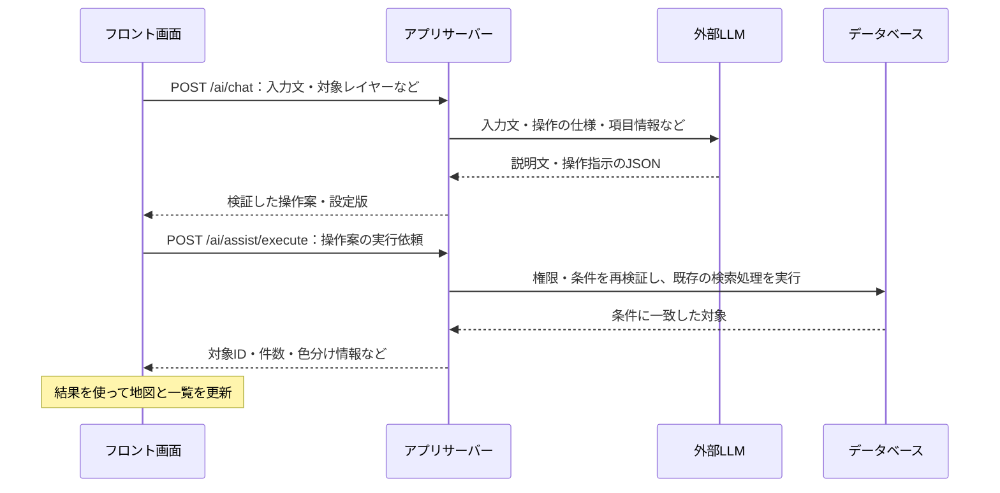
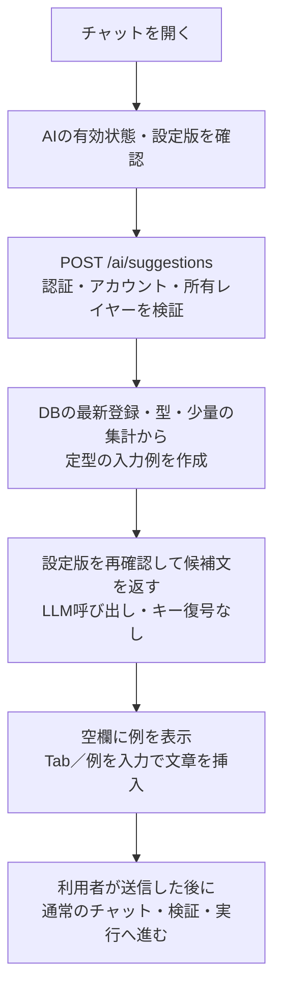
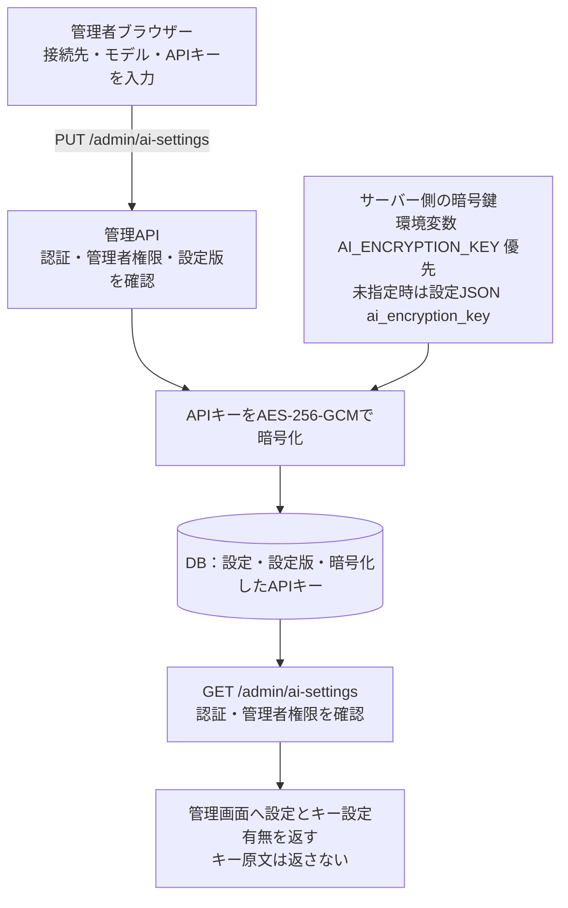
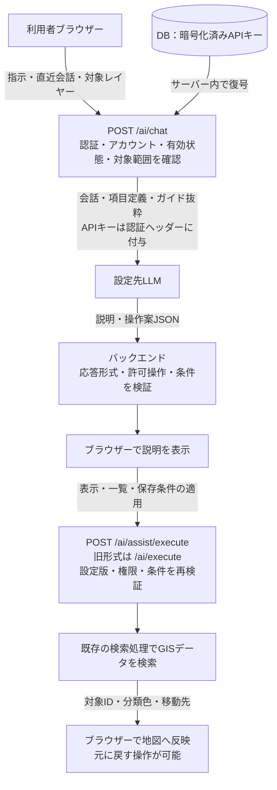
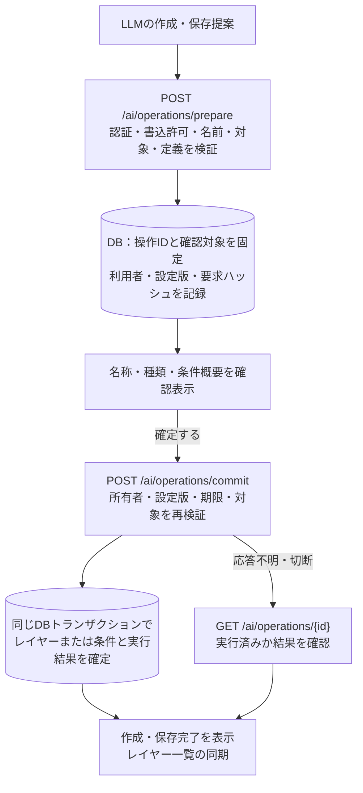

# AIアシスタント

管理者が指定したLLMを使い、自然言語による検索、関連語による絞り込み、地図の色分け、緯度経度への移動、分析方法の提案、操作方法の案内を利用する。レイヤー（グループ）の作成、検索・色分け条件の保存、保存条件の一覧・適用にも対応する。対象はGeoCode-Web-Single（SQLite版1.14.0）のPC・モバイル・別画面地図。Tauriの通常画面とサーバー単体モードで同じバックエンドを利用する。AI・音声入力・作成保存の許可は初期無効で、管理者が設定する。利用時の検索・保存対象はログイン中のユーザーの所有データに限定する。

## 利用する

実サービスでの日本語指示の品質確認には、[受入評価](AI_EVALUATION.md)を使う。以下の機能説明と、実際のモデルの解釈精度の確認は分けて行う。

1. 管理者が「AI設定」でLLMの接続先、モデル、キーを設定し、接続確認後にAI機能を有効にして保存する。
2. 地図画面のAIアシスタントアイコンからチャットを開く。表示中のレイヤーを対象として、抽出・色分け・操作方法などを入力する。
3. 指示を送信すると、AIが解釈した内容を表示し、実行可能な検索・表示操作を地図へ反映する。属性や対象範囲が曖昧な場合は、追加の質問に回答する。
4. 必要に応じて「さらに絞って」などの指示を続ける。「元に戻す」で直前のAI表示操作へ戻し、AIの条件解除を指示して検索・分類色を外す。
5. 音声入力が有効な場合は「音声入力」を押して話し、「録音を終了」で文字へ変換する。認識結果を確認・編集し、「送信」を押す。
6. 「『防災調査』というレイヤーを作成して」「この検索条件を『古い施設』として保存して」などを指示する。管理者が作成・保存を許可している場合、名称と内容の確認欄を表示する。「確定する」で初めて永続変更を行う。「取り消す」は未確定の場合だけ操作を取り消す。
7. 「絞り込み条件の一覧を出して」「色分け条件の一覧を出して」で保存済みの実データを一覧表示する。一覧の「呼び出し」で「詳しい検索と色分け」へ復元し、確認・編集してから実行する。「『条件名』を適用して」と自然言語で明示した場合は、従来どおり直接適用する。
8. 「このレイヤーに有効な分析方法を考えて」で、利用中のフォーム構成に基づく検索・分類方法を相談する。

検索・色分けは表示に適用し、元データの属性や保存色を書き換えない。手動の文字列検索・属性検索・レイヤー表示条件も併用される。チャットの「検索条件に一致」の件数はAI条件の一致件数であり、他の条件を重ねた実際の表示件数とは異なる場合がある。通常地図と別画面地図の状態は独立している。

AIの検索・分類は実行時点の対象IDと色割当、および適用成功した検索式・色分け定義を保持する。検索と色分けは独立して更新し、「元に戻す」では表示と定義を同時に復元する。地物やフォーム登録を編集してもAI条件を自動再実行せず、再指示・保存条件の再適用で更新する。手動の属性検索の再判定とは独立している。会話と一時表示状態は地図画面の再読み込み・レイヤー切替・ログアウト等で破棄する。

レイヤー作成後は一覧を更新し、新レイヤーへ自動切替しない。作成や保存は「元に戻す」の対象ではなく、表示操作の取り消しで作成物を自動削除しない。作成成功後に一覧更新が失敗した場合は、作成を再送せず一覧の更新だけを再試行する。

### 保存した条件を呼び出して編集する

「詳しい検索と色分け」の「保存した検索条件」と、AIチャット内の保存条件一覧は、どちらも「呼び出し」で編集用の下書きを開く。呼び出し・編集だけでは地図の表示、AIの適用済み状態、保存元の条件を変更しない。チャット一覧から呼び出した場合も、編集には既存の検索モーダルを使い、AIチャットを自動で開いて実行する処理は行わない。

version 1は従来の入力欄へ、version 2は完全な定義を保持する編集欄へ復元する。絞り込みでは「すべて」、文字列、属性条件、AND・OR・NOTの入れ子、複数フォームを表示・保持し、検索語・属性条件・既存の組合せを編集できる。色分けは単一フォーム内の分類条件（AND）を扱い、分類ID・名称・色・順序を保持する。複数の分類に一致した場合は先に並んだ分類を使う。色分けへOR・NOTや複数フォームを追加する仕様ではない。

呼び出し後の条件行・分類カード・ボタンは手動設定と同じ配置と名称を使う。絞り込みは全幅の「絞り込み実行」の下に「属性条件を解除」「検索条件を保存」を並べ、色分けは共通フォームの直下に分類の追加・解除、分類カードの下に全幅の実行・保存を配置する。分類名と色、項目と比較方法を横に並べ、狭い画面では折り返す。OR・NOT・複数フォームのための入れ子と組合せ操作を残し、見た目を合わせるために検索式を平坦化しない。

項目情報は呼び出し時と実行直前に自動取得する。常設の「項目情報」や再読み込み操作は設けず、取得失敗時だけ警告と「再試行」を表示する。再試行は項目名・型・選択肢を取り直すだけで、編集下書きや地図を変更しない。取得成功後はボタンを消す。項目・型・選択肢の不整合だけの場合は、元の条件を保持した警告に従って修正する。

「条件の種類・組合せを変更」、条件の種類の切替、新しいAND・OR・NOTでまとめる操作、「組合せに条件を追加」は設けない。既存のOR・NOT・複数フォームの入れ子と値をそのまま読み込み、値・比較方法・既存のAND／ORの切替・NOTの解除などを編集できる。通常の「条件を追加」「分類を追加」「分類条件を追加」は引き続き利用できる。単純な条件へ変換して読み込まないため、未編集の条件は失われない。

「その他の操作」から手動設定へ切り替えると、呼び出した編集下書きを破棄する。地図に反映済みの条件は維持するため、適用を外す場合は解除ボタンを使う。

呼び出したAI条件の「属性条件を解除」「色分け解除」は、該当するAIの適用済み条件だけを外し、手動条件と他方のAI条件を維持する。下書きは保持するため、内容を確認して再実行できる。既存の表示実行APIへresetを送り、アカウントと設定版を照合した後、画面上では指定した片側だけを解除する。解除も地図反映が成功してから適用済み定義とUndoへ反映し、追加のLLM通信を行わない。

数値と範囲の上下限は文字列のまま扱い、大きな整数や小数をブラウザーの数値へ変換しない。フォーム・項目・選択肢を解決できない場合も元の定義を保持して警告し、条件を削除・単純化せず実行を拒否する。下書きがversion 2なら、単純な条件へ編集してもversion 1へ降格しない。

編集した条件を地図へ反映するのは、利用者が編集欄の実行ボタンを押したときだけ。現在の所有レイヤー・最新登録を再検索し、サーバーの検証と地図の完了応答が成功してから適用済み定義と「元に戻す」の状態を更新する。失敗・取消・対象変更・遅延応答では直前の地図を維持する。検索モーダルからの実行と、次回チャットに渡す適用済み条件・取り消し後の条件を一致させる。

「検索条件を保存」から名前を入力すると、利用者による手動保存として新しいIDで条件を作成する。保存元を自動上書きせず、version 2の定義・精度・順序を保持して既存の保存APIへ送る。これはAIチャットへ「保存して」と指示する自動保存と異なり、AIの作成保存許可 `writeEnabled` の対象外となる。チャットからの保存は引き続き許可設定・確認・操作IDによる準備／確定を必要とする。

呼び出し、手動編集、編集後の実行、名前付き手動保存では追加のLLM通信・料金は発生しない。能力取得・実行時の設定とキーのバックエンド内読込み・復号は既存同様であり、APIキーをブラウザーへ返すことはない。自然言語での再適用を含む通常チャットは、従来どおりLLMを利用する。

### ボタンとチャット画面

起動ボタンには `ai_assistant.png` を使い、虹色グラデーションの直径77pxの円形ボタンに64pxの画像を収める。アイコン画像には外枠線・影を付けない。初期位置はPCでテーブル開閉ボタンの上、モバイルと別画面地図で右下とする。ボタンはマウス・タッチでドラッグでき、最後に移動した位置をPC・モバイル・別画面地図ごとに `localStorage` へ保存する。ドラッグ終了・保存位置の復元・画面サイズの変更時は、表示範囲内で既存の操作ボタンに重ならない近くの空き位置へ補正する。空きがない極小画面では重なりが最小の位置に留め、画面拡大時に再配置する。保存値が不正な場合や保存を利用できない場合でも起動・移動できる。AIの無効化、認証や利用可否の確認失敗時は表示しない。常時LLMを呼び出して接続を監視するものではない。

チャットの背景・ボタン・角丸・背面の暗幕を既存画面へ合わせ、PCでは右側の配置を維持する。タイトルはモーダル全体の水平中央に揃え、入力欄と操作ボタンの間に16pxの余白を設ける。PCの閉じるボタンは高さ36pxとし、モバイルではタップしやすい従来の大きさを維持する。見出しの下線と入力欄上の区切り線は表示しない。通信や地図反映の待機中は既存の共通スピナーを画面全体の中央に表示し、待機テキストは表示しない。完了・エラー・確認の案内は引き続き表示する。全画面の待機表示中も中止・閉じるを操作できる。閉じるボタン、Esc、チャット外側のクリック・タップで閉じられる。画面内から外側へドラッグしただけでは閉じない。

横向きやソフトキーボード表示などで可視高さが600px以下になった場合は、チャット全体をスクロールして履歴・確認欄・操作ボタンに到達できる。閉じる見出しは上端に残す。ブラウザーの `visualViewport` がある場合は、そのサイズと位置に追従してキーボードに隠れる領域を避ける。

閉じると進行中の通信と録音を中止し、遅れて届いた表示操作は反映しない。会話と未完了の確定操作IDは、同じ画面内で開き直す間は保持する。送信済みの確定要求はサーバーで完了している場合があるため、開き直して「結果を確認」を使う。閉じる操作で作成・保存を取り消せるとは限らない。

### 実データに基づく入力例

チャットを開くと、現在の対象レイヤーの最新登録から、実在するフォーム・項目・登録値に合う入力例を取得する。候補は最大3件、1件300文字以内。項目や選択肢の定義があるだけでは入力済みと扱わず、投稿時の型と実値を確認して、選択・真偽・数値・日付・未入力の抽出や色分けの例を定型生成する。同名項目はフォーム名を添え、区別できないものや不正な値は候補から除く。

空の入力欄に表示された実データの例は、修飾キーなしのTab、または「例を入力」で文章として入力できる。「例：」などの表示用の接頭辞は入力しない。候補を挿入しても送信せず、利用者が確認・編集して「送信」を押す。入力済み、IME変換中、Shift＋Tab、実データ候補がない場合のTabでは通常の入力・フォーカス移動を維持する。入力欄に結び付ける読み上げ用の案内も、例を入力できる空欄時に限定する。モバイルでも「例を入力」を使え、操作案内の一般例はこのボタンから入力できる。入力後に空欄へ戻すと、取得済みの次の例を表示する。

候補取得中も通常の文字入力を続けられ、全画面スピナーを表示しない。後から候補が届いても、入力済みの文章や音声認識結果を上書きしない。空データ・件数や定義の上限超過・取得失敗・旧バックエンドでは、操作案内の一般例へ戻る。認証やアカウント・AI設定が変わった場合は、その安全確認を優先し古い候補を破棄する。

候補は画面内のメモリーに60秒保持し、アカウント・対象レイヤー・設定版・データ更新状態で分離する。地物やフォームの更新通知では候補だけを失効させ、会話・元に戻す状態を消さない。同時に複数の更新通知を受けた場合は取得をまとめる。有効期限を過ぎると表示とTab案内を一般例へ戻し、次回開いた時などの再取得で別タブや外部の更新にも追随する。キー入力・Tab・通常の再フォーカスでは再取得しない。候補の有効性は取得時点のものであり、通常の送信・実行時に既存の権限・条件チェックを改めて通す。

候補の対象は選択レイヤーで、画面の表示矩形や手動検索条件は含まない。手動条件もANDで併用されるため、候補どおりに送信しても表示結果が0件となる場合がある。候補生成はDB内の読み取り処理だけで、LLM呼び出し、APIキーの復号、追加のLLM料金は発生しない。候補を送信した後の通常チャットは従来どおりLLMを利用する。入力例機能のための追加の管理設定・環境変数・DBマイグレーションは不要。AI本体の導入時には、後述する起動時マイグレーションが適用される。

「APIキーの復号なし」は候補API単体の説明である。チャット起動時に呼ぶ既存の `/ai/capabilities` は、従来どおり保存設定とキーをバックエンドで読み込む。候補取得のための追加復号や、ブラウザーへのキー配布は行わない。

## LLMとアプリの役割分担

この実装では、LLMが入力文を「アプリが理解できる操作指示」に変換し、アプリがその指示を検証して実行する。従来の検索画面で利用者が選んでいた検索条件を、自然言語から組み立てる部分にLLMを使っている。

| 担当 | 役割 |
| --- | --- |
| LLM | 文章の意味を解釈し、説明文と決められた形式の操作案を生成する |
| アプリサーバー（Rust） | 認証・所有権・許可操作・条件を検証し、対応する既存処理を呼ぶ |
| データベース | アプリが実行する検索処理に従い、条件に一致する実データを返す |
| フロント画面 | 入力を送信し、操作案の実行を依頼する。実行結果を地図・一覧へ反映する |

APIキーはサーバーが外部LLMを利用するための認証に使う。アプリ内で操作を実行できるかどうかは、ログイン中の利用者・データの所有者・管理設定などをサーバーが検証して決める。

### 文章を操作指示のJSONへ変換する

フロントが指示を `POST /ai/chat` へ送ると、サーバーは利用可能な操作、フォーム名・項目ID・型・選択肢、対象レイヤー、直近会話、適用済み条件、必要なガイド抜粋をLLMへ渡す。たとえば「建設年月日が2010年以前」なら、渡された日付項目を使って「2010-12-31以下」という条件を組み立てるよう指示する。

返答の設計図としてJSON Schemaも渡す。JSONは項目名と値を組にしたデータ形式で、Schemaは返せる操作名や必要な項目を定める。今回の実装は、LLMの返答をJSON形式のテキストとして受け取り、アプリ側で解析・検証する方式である。施設本文・登録値一覧・検索結果の対象ID一覧をLLMへ渡して検索させる処理ではない。ただし、利用者の入力や会話には、その人が書いた値や挿入した提案例文が含まれ得る。

「『学校』を含む地図オブジェクトを抽出して」に対するLLMの返答は、たとえば次の形になる。

```json
{
  "outcome": "action",
  "message": "名前・本文・図形メモに「学校」を含む対象を抽出します。",
  "action": {
    "type": "filter",
    "expression": {
      "op": "text",
      "query1": "学校"
    }
  }
}
```

`message` は利用者向けの説明、`outcome` は回答・確認・拒否・操作提案の区分、`action` はプログラムが読み取る操作案である。この例の `type:filter` は抽出、`op:text` は文字列検索、`query1` は検索語を表す。サーバーはこの返答を検証し、その時点の設定版 `revision` を付けてフロントへ返す。LLMが設定版を生成することはない。説明だけの回答や聞き返しでは `action:null` とし、地図操作を実行しない。

### 操作指示から関数実行・地図反映へ進む

JSONは操作内容を表すデータであり、受け取っただけでは関数は動かない。Rustのコードに、`filter` なら検索、`color` なら分類色の割り当て、`reset` ならAI条件の解除、`focus` なら指定座標への移動、という対応をあらかじめ定義している。許可した型へ読み取った後、`match` で分岐し、既存APIと共通の処理を呼び出す。

抽出の場合は、次の順序で進む。



`/ai/chat` は解釈と操作案の検証までを行う。続いてフロントが、操作案・対象範囲・同じ設定版を `POST /ai/assist/execute` へ送る。実行APIは許可操作、利用者とデータの所有者、項目の型・条件・上限、AI有効状態・設定版を再検証する。LLMへの形式指定や説明文だけを、実行許可の根拠にはしない。

抽出ではサーバーがDB検索で確定した対象IDと件数を返し、フロントが既存の絞り込み状態へ設定する。色分けでは対象ごとの分類色を反映する。PC・モバイルの通常画面は、地図側へ反映を依頼して完了応答を待ってから成功として扱う。検索結果や件数はDB処理で確定し、検索・色分けでは元の施設データや保存色を変更しない。

同じ指示の中で実行結果をLLMへ送り直して再推論させる処理はない。フロントが実行の成功・失敗を履歴へ記録し、次の利用者送信時に直近の会話と適用済み条件を渡す。「さらに絞って」などの指示では、その情報を手掛かりに条件を組み立てる。自然言語の解釈を誤る可能性はあるため、表示された説明と結果を確認する。

レイヤー作成・条件保存は、操作案を `prepare` で確認対象として固定し、利用者が確定した後に `commit` で保存する別経路である。入力例の提案とTab入力はチャット送信の前段で、候補生成はLLMを呼ばず、文章の挿入だけでは検索を実行しない。詳しい制御は後述の[処理フロー](#処理フロー)と[APIと権限](#apiと権限)を参照する。

コード上の入口は [LLMへの問い合わせ](../src/handler/ai.rs)、[操作案の検証・振り分け](../src/ai/assistant.rs)、[検索・表示操作の実行](../src/ai/actions.rs)、[共通チャットの実行依頼](../src_frontend/template-scripts/src/ai/chat.ts)、[PC画面への反映](../src_frontend/frontend/src/composables/useAiAssistant.ts)に分かれる。

## 検索と色分けの意味

対応する主な指示は以下のとおり。特定の例文に固定せず、実在するフォーム・項目定義を取得して条件を組み立てる。

| 種類 | 内容 |
| --- | --- |
| 文字列検索 | マーカー名・本文、図形名・メモの部分一致。各検索語は100文字以内で、2語の指定はAND |
| 数値・日付 | 等値、以上、以下、範囲。範囲は両端を含む |
| 選択・真偽 | セレクト・ラジオの選択値、チェックボックスの真偽 |
| 入力の有無 | 入力あり、未入力、項目なし。画像は入力の有無を扱う |
| 条件の組合せ | AND、OR、NOTによる対象オブジェクト集合の組合せ |
| 色分け | 共通フォームの属性条件で分類し、分類名と色を地図へ反映 |
| 地図移動 | 利用者が指定した緯度・経度・ズームへの移動 |
| 操作案内 | 組み込まれた機能文書の抜粋に基づく回答 |
| 関連検索 | 関連語・同義語を展開し、使用する語と根拠を説明して文字列・属性条件のOR等で絞り込む |
| 分析方法の提案 | 対象レイヤーで使用するフォーム・項目名・型・選択肢を優先し、実行可能な検索・分類方法を提案する |
| レイヤー作成 | 通常のレイヤー（グループ）を自分のアカウントに作成。名前は制御文字なしの1〜100文字 |
| 条件保存 | 適用成功した検索式または色分け定義を種類別に保存。保存名と対象種類が曖昧なら確認する |
| 保存条件の一覧・適用 | 所有する既存条件と新形式のAI条件を一覧・名前・IDから選択し、現在の対象レイヤーで再検索する |

属性検索は、対象・共通フォームごとの最新登録を選んでから条件を適用する。過去の登録が一致していても、最新登録が不一致なら含めない。同じ登録内で成立させるANDは、一つの属性条件群にまとめる。複数の共通フォームをまたぐANDは、それぞれに一致したオブジェクト集合の共通部分となる。

NOTは、指定したレイヤー内の全所有オブジェクトから、条件一致対象を除いた集合である。そのため、フォーム登録自体がない対象も含む。「項目なし」「未入力」「登録なし」は別の意味として扱う。ORは集合の和、ANDは集合の共通部分であり、同一オブジェクトの重複は除く。

対象はレイヤー単位であり、現在の画面に見える矩形だけを意味しない。マスターの選択は全所有レイヤー、個別レイヤーの選択はそのレイヤーを対象とする。他人の公開・共有レイヤーのデータを、AIの所有データ検索へ追加するものではない。

数値の「耐用年数」が登録されていれば10年刻みの分類へ変換できる。建設日からの経過年数・残存年数の計算、本文だけに記載された日付の属性化、距離・空間交差・表示矩形による検索、任意の集計は未対応。データの編集・削除・共有発行もAI実行操作には含めない。未対応条件を勝手に省略して実行しない。

関連検索は既存の所有データが対象で、外部Webからのデータ取得や別レイヤーへの移動・複製は行わない。意味の近さの順位付けや網羅性を保証する検索ではない。分析提案には実際の登録値・分布・相関を渡していないため、フォーム構成から考えられる方法を提案し、統計結果を断定しない。

色分けは1〜10分類、各分類の条件は最大10件。先に一致した分類を優先し、分類に一致しない対象は元の色を使う。数値・日付に厳密な `lt` / `gt` はなく、`gte` / `lte` / 両端を含む `between` を使う。実数の10年刻みは、高年数から「90以上、80以上、…、10以上、10以下」と並べる方法などで境界を表現する。分類数が足りない場合は、階級や対象を調整する。

## 処理フロー

### 入力例の取得



入力例APIは設定版・有効状態の参照だけを行い、LLM接続先の検証や通信はしない。SQLiteの読み取りトランザクションで `PRAGMA query_only=ON` にし、取得開始から5秒の期限で負荷を抑える。SQLiteワーカースレッドのSQL実行にも `progress_handler` を設定し、1,000命令ごとに期限を確認して中断する。ロック待ちは一時的に100msへ短縮し、Busy・Lockedも候補なしのタイムアウトへ戻す。HTTP待機が中断されても専用タスクでSQL停止・コールバックの除去・待ち時間と `query_only` の復元・ロールバックまで行い、その間は候補用の実行枠を保持する。数値の候補生成ではSQLiteのREALや `f64` に丸めず、既存の十進数比較処理で境界を選ぶ。

対象・フォームごとの最新登録は合計50,000件まで、フォーム一覧は200件までとし、登録件数の多い上位3フォームの最大8項目ずつを調べる。候補用の共通フォーム履歴と、対象の最新登録に含まれる固有の投稿時項目定義は、フォームごとにそれぞれ200件・120,000バイトまでとする。JSONをアプリへ読み込む前にDB内で件数と容量を確認し、超過したフォームを候補対象から除く。この追加制限は従来の手動検索へ適用しない。

候補取得の回数・同時実行枠は通常チャットから分離し、候補取得だけでチャットの送信枠を消費しない。応答には候補文と種類、設定版・基準日時、候補がない理由だけを含め、施設本文・登録値の一覧・対象ID一覧を返さない。候補文には必要なフォーム名・項目名・実在する選択値等を含むため、機密情報を含む可能性がある。

### 管理設定の保存と接続確認

管理画面で入力したAPIキーは、ブラウザーまたはTauriのWebViewから内蔵サーバーの管理APIへ送る。標準のTauri画面は `http://localhost:3000/index` を使う。サーバー単体モードをLANや外部へ公開する場合は、HTTPSで配信して通信路を保護する。



「LLM接続確認」は `POST /admin/ai-settings/check` へ入力中の設定を送り、バックエンドから指定先LLMを呼ぶ。キー入力を省略した場合は、同じ接続方式・接続先の保存済みキーを利用できる。接続確認だけでは設定を保存せず、返されたreset操作も実行しない。AIが無効でも管理者による接続確認は実行でき、外部通信と料金が発生する場合がある。

### チャットから地図への反映



LLMは条件を組み立て、データの検索と分類はアプリ内で行う。LLMへDB接続情報や利用者の認証Cookieを渡さない。説明だけの応答は表示のみとし、検索・色分け等は検証を通った操作を自動反映する。作成・保存には次の確認経路を使う。地図への反映前にも、有効状態と設定版を確認する。

### レイヤー作成・条件保存の確認と確定



準備は確認対象の記録だけを作り、レイヤーや保存条件を作成しない。確認内容は操作IDへ固定し、確定要求で別の名前・定義へ差し替えられない。同じ利用者・操作ID・内容の再送は同じ結果を返し、異なる内容への流用は409、他者のIDは404となる。

未確定の確認対象は10分で期限切れとなり、同一利用者の有効な未確定記録は最大100件。操作の記録は、次のprepare時にその利用者の作成後30日を超えたものを整理する。定期的な完全削除を保証する処理ではない。確定済みの結果は現在AIや作成保存が無効でも、認証済みの所有者が再取得できる。確定後の設定変更を理由に成功を失敗扱いにしない。

確定要求を送った後の中止や切断では、サーバーで作成済みの場合がある。「結果を確認」で同じ操作IDを照会し、不明なまま新しい操作IDで作成し直さない。結果記録には名称・条件定義・作成ID等を保存するが、会話全文・録音・APIキーは保存しない。同じ操作IDの画面内保持はチャット状態が残っている間に限る。再読み込み・アカウントや対象範囲の切替で画面内のIDを破棄しても送信済みの確定要求は撤回されないため、同じ作成・保存を改めて指示する前に一覧を確認する。

AIによる作成後の `GET /layer/read/all` には元の `X-AI-Account-ID` を付け、サーバーがCookieの利用者と照合する。画面でも取得後・ストア反映前にアカウント・対象世代・応答の所有者を確認する。ヘッダーのない従来クライアントの取得は従来どおり利用できる。レイヤー一覧の応答は `no-store` とする。

### 音声入力

録音 → `POST /ai/transcribe` → バックエンドから音声認識APIへ音声を送信 → 認識結果を入力欄へ表示 → 利用者が確認・編集して「送信」 → チャット処理、の順で進む。

文字の「送信」を押す前でも、文字起こしのために音声データは外部へ送信される。音声認識だけで地図操作を実行することはない。音声認識の接続先・モデル・キーはLLM用と独立した設定である。

## 管理者による導入

### DBと配備鍵

通常起動と `-s` のサーバー単体起動では、DB接続時に [実行時マイグレーション](../src/db/pool.rs) が未適用の変更を自動実行する。AI設定はバージョン26（[SQL](../migrations/20261116120000_add_ai_settings.sql)）、操作確認・保存条件の拡張は27（[SQL](../migrations/20261117120000_ai_operations.sql)）で追加する。実行時処理はSQLx用と同じ2つのSQLファイルを参照する。利用中のDBへ手動で `sqlx migrate run` を行う導入手順ではない。

実行時移行は `BEGIN IMMEDIATE` で既適用版を読む前に書き込み権を確保する。同じDBへの同時起動では移行を直列化し、未確定の途中状態を別接続へ公開しない。

`ai_settings` はアプリ全体で1行の設定、設定版UUID、更新者・更新日時、暗号化したLLM・音声認識のキーを保存する。レコードがない初期状態ではAI・音声入力はともに無効。操作IDと確認対象・確定結果は `ai_operation_model` へ記録する。UUIDの設定版・操作IDはDBではTEXT、設定JSONはTEXT、暗号文はBLOBで保存する。APIのUUID文字列とJSON形式は共通版と同じで、既存の文字列ユーザーIDをUUIDへ変更しない。

既存環境の更新ではAPIキーとその暗号化に使った鍵を引き継ぐ。従来の `AI_ENCRYPTION_KEY` も引き続き使用できる。既存設定に `writeEnabled` がない場合はfalseとして読み、更新しただけで作成・保存を有効にしない。設定保存は `BEGIN IMMEDIATE` で書き込み権を確保してから設定版を再確認し、同じ初期状態や設定版からの競合保存を409で拒否する。

設定保存では、同じ書き込みトランザクション内で利用者の存在・ロック状態・トークンの認証版・スーパーユーザー権限も再検証する。書き込み待機中の認証失効は401、管理権限の解除は403で拒否し、設定と暗号文を更新しない。

配布時はバックエンドとPC・モバイル・別画面地図・管理画面を同じ機能世代にそろえ、アプリ起動時のマイグレーションと動作確認後に、管理者が「AIによるレイヤー作成・条件保存を許可」を有効にして保存する。旧クライアントには旧4操作だけを返す。戻し先にも新形式の条件を旧一覧へ返さない互換処理が必要で、version 2を扱わない旧バックエンドへそのまま戻さない。新形式が旧画面へ混入すると一覧全体が失敗し得るため、ロールバックは互換版を使うか、事前に新形式のデータを安全に退避する手順を用意する。

標準の設定JSONは `%USERPROFILE%\.geocode-web-single\geocode-web-single.env.json`、本体DBの既定位置は同じディレクトリの `geocode-web.sqlite`。設定JSONの `database_url` / `sqlite_database_path` で変更した場合は、その本体DBにAI設定も保存する。画像・ローカル地図用の別DBへAI設定を保存するものではない。

AI用の暗号鍵は初回セットアップ・通常起動・`-s` のサーバー単体起動で準備する。設定JSONの `ai_encryption_key` が省略または `null` なら、次の順序で補完して保存する。管理者による手動生成は通常不要。

1. 起動プロセスに有効な `AI_ENCRYPTION_KEY` がある場合は、既存の暗号文を使えるよう同じ鍵をJSONへ保存する。
2. 環境変数もない場合は、暗号学的乱数で32バイトの鍵を生成し、Base64文字列としてJSONへ保存する。

保存済みのJSON鍵は再起動後も維持する。実行時の優先順位は **環境変数 `AI_ENCRYPTION_KEY` → JSONの `ai_encryption_key`** とし、環境変数が異なっていても既存のJSON鍵を自動で上書きしない。LLMの接続先・モデル・実際のAPIキーは従来どおり管理画面で設定し、暗号化したAPIキーを本体DBへ保存する。

空文字列を含む不正な鍵は起動時に拒否し、別の鍵へ自動で置き換えない。また、両方の鍵がなく、既存の本体DBにLLM用・音声用のどちらかの暗号化APIキーがある場合は、自動生成せず起動を止める。バックアップしたJSON、または従来の環境変数から、暗号化に使った元の鍵を復元する。DBを確認できない場合も新しい鍵の生成へ進まない。読み取り専用のタイルCLI・管理ツールは不足するAI鍵を生成・保存しない。

DBの確認には `database_url` が指す実ファイルを使い、新規DBの作成やマイグレーションは行わない。接続先を安全に特定できない `file:` URIや独自VFSでは自動生成を拒否するため、既存のJSON鍵または環境変数の鍵を明示して起動する。

| 設定 | 内容 |
| --- | --- |
| JSONの `ai_encryption_key` | 通常は起動時に自動生成・保存する32バイトのBase64暗号鍵。APIキーそのものとは別の秘密 |
| 環境変数 `AI_ENCRYPTION_KEY` | 従来の設定方法を維持する任意の上書き指定。JSON鍵より優先する |
| `AI_ALLOWED_ORIGINS` | HTTP・LAN・キーなし接続などを例外許可するオリジン。通常の公開HTTPSだけなら空欄 |

`AI_ALLOWED_ORIGINS` は引き続き親プロセスから継承する環境変数で、JSONの項目ではない。配布exeはカレントディレクトリの `.env` を自動読込しない。環境変数を使う場合は起動用PowerShellやOS・サービスで設定し、変更後はアプリの全プロセスを終了して再起動する。通常の設定JSONや利用中のDBを、検証用の値で書き換えない。

通常は暗号鍵の環境変数を設定せずに起動できる。既存の環境変数を継続利用する場合の起動例は次のとおり。実際の鍵はアクセス権を制限した管理場所から設定し、起動ごとに新しく生成しない。

```powershell
$env:AI_ENCRYPTION_KEY = '<保管した同じBase64暗号鍵>'
$env:AI_ALLOWED_ORIGINS = ''
& '.\geocode_web_single.exe'
# サーバー単体モードでは、最後の行を次に置き換える。
# & '.\geocode_web_single.exe' -s '127.0.0.1:3000'
```

JSONは平文の復号鍵を含む秘密ファイルになる。Git・配布アセット・利用者へ配るファイルへ含めず、設定ディレクトリとバックアップの読み取り権限を制限する。DBと鍵は対応を保ち、保管先を分けてバックアップする。同じDBを利用するプロセスには同じ鍵を供給する。移行時の `geocode-web-single.env.json.bak` は移行前のJSONであり、新しく生成・採用したAI鍵を含むとは限らない。導入後の最新JSONに含まれる鍵、または実際に優先利用している環境変数の鍵を安全に保管する。

補完が必要な設定はファイルごとのロックを取得して再読込し、一時ファイルの書込み・同期が完了してから置換する。保存に失敗した鍵は実行時へ反映しない。Windowsでは既存設定のDACLを平文書込み前の一時ファイルとバックアップへ引き継ぎ、置換後も既存設定のACLを保持する。新規ファイルは設定ディレクトリのACLを継承するため、共有ディレクトリへ置く場合も先に保存先のアクセス権を制限する。Unixでは新たに保存するJSON・バックアップ・ロックを所有者だけが読み書きできる権限（0600）で作成する。設定JSON・バックアップ・ロックにシンボリックリンクやWindowsの再解析ポイントは使用できない。

環境変数の上書きは鍵ローテーション機能ではなく、既存のAPIキーを新しい鍵で暗号化し直さない。異なる鍵への変更後は保存済みキーを復号できず、AI無効時の設定取得でも復号エラーになる。既存JSONと異なる環境変数を使ってAPIキーを保存した場合、環境変数を削除するとJSON鍵へ戻るため、そのAPIキーを復号できなくなる。環境変数を変更・削除する前に、保存済みAPIキーに対応する鍵を確認する。DBだけでは鍵を復元できない。

Windowsの設定置換は、ファイル名が維持される共有違反・ロック違反・置換元削除不能（32・33・1175）だけを50ms間隔、最大6回まで再試行する。待機の合計は最大250msとし、ACLエラーや部分的に名前が変わり得る1176・1177は再試行しない。既存のACL、設定保存の排他、原子的置換を維持し、最終的に保存できない場合は起動へ鍵を反映しない。

APIキーはAES-256-GCMで暗号化してDBに保存する。取得APIは接続先やモデル等の設定を返すが、キーについては原文を返さず設定有無だけを返す。管理画面でキーの維持・置換・削除を選び、接続先や接続方式を変更する場合は、キーを置換または削除する。新しい接続先へ古いキーを自動送信しない。

### 接続先とモデル

管理画面の「AI設定」で以下を指定する。URLはAPIのベースURLであり、操作ごとのパスを含めない。

| 接続方式 | ベースURLの例 | アプリが使用するAPI |
| --- | --- | --- |
| OpenAI / OpenAI互換 | `https://api.openai.com/v1` | `chat/completions` |
| Claude | `https://api.anthropic.com/v1` | `messages` |
| Gemini | `https://generativelanguage.googleapis.com/v1beta` | `models/{model}:generateContent` |
| OpenAI互換のローカルサービス | `http://127.0.0.1:11434/v1` | `chat/completions`。下記の配備許可が必要 |

モデル名は接続先で利用できるIDを入力する。英数字と `- _ . : /` に対応する。JSON形式の操作指定を返せるモデルが必要であり、OpenAI互換という名称だけで全モデルの互換性を保証しない。「LLM接続確認」は入力中の設定に対し短い試験要求を送り、接続とJSON応答を確認する。保存とは独立し、サービスの利用料金が発生する場合がある。保存後の実検索・色分けまで確認した結果ではない。

公式OpenAIへの送信は、モデル名の列挙に依存せず `max_completion_tokens` で出力上限を指定する。互換APIは従来の `max_tokens` を基本とし、GPT-5以降や対応するo系モデルでは `max_completion_tokens` を使う。公式OpenAIのGPT-6 Lunaによる接続確認では、短いreset操作だけのスキーマを送り、`reasoning_effort:none` を指定する。通常チャットや他モデル・他接続先の推論設定は変更しない。

### 接続確認が失敗した場合

管理画面は、固定の案内に加えてサーバーが安全な文言へ変換した失敗理由を表示する。上流の生の応答本文や認証ヘッダー、入力中のAPIキーは表示しない。

| 表示内容 | 確認すること |
| --- | --- |
| HTTP 400／422 | モデルが受け付けるパラメーター、接続方式、JSON応答への対応。既知のパラメーター不一致ではその名前を案内する |
| HTTP 401／403 | APIキー、プロジェクト、利用権限 |
| HTTP 404 | ベースURL、モデルID、モデルの利用権限 |
| HTTP 429 | 利用上限。利用枠不足の場合はAPIの請求設定・残高も確認する |
| タイムアウト | サービスの混雑、アプリサーバーの通信経路、設定したタイムアウト秒数 |
| 接続できない | アプリサーバーからのDNS・TLS証明書・外向き通信。この接続は環境変数のHTTPプロキシを使用しない |
| 出力上限 | 最大出力トークン数を4096〜8192へ増やす。推論モデルでは推論分も上限に含まれる |
| 本文なし／JSON不正／reset確認不可 | 応答形式とモデルの対応。接続確認では実際の地図操作は行わない |

HTTP 200でも、終了理由が出力上限や回答拒否の場合は成功扱いしない。失敗した要求を自動で繰り返して課金を増やすことはせず、内容を確認してから再度接続確認を行う。

通常は公開HTTPS接続先を使用する。HTTP、localhost、LAN内アドレス、キーなしのOpenAI互換サービスは、配備側で明示的に許可したオリジンだけ使用できる。

```text
AI_ALLOWED_ORIGINS=http://127.0.0.1:11434,http://192.168.1.20:8000
```

許可先は `scheme://host[:port]` の正規形で、カンマ区切りにする。パス、末尾の `/`、認証情報、クエリ、フラグメント、ワイルドカードを含めない。許可先に登録してもモデルやキーの設定は別途必要。許可していないHTTP・非公開IPへの通信は拒否し、通常のHTTPS名前解決でも公開IPだけを使用する。上流リダイレクトには追従しない。

`AI_ALLOWED_ORIGINS` はLLM・音声認識の両方に適用され、パス単位ではなくオリジン全体を許可する。通常の公開HTTPSを指定先だけに限定する許可リストではなく、未設定でも公開HTTPSへの通信は可能である。ブラウザー向けCORS設定の `ALLOW_ORIGINS` とは別の設定である。

### 音声認識と利用制限

音声入力にはLLMとは独立したベースURL・モデル・APIキーを設定する。文字起こしはOpenAI互換の `audio/transcriptions` を使用する。チャットのLLMが音声非対応でも、このサービスを設定すれば音声入力を利用できる。音声認識の動作は、設定保存後にチャットから実際に録音して確認する。

| 設定 | 既定値・範囲 |
| --- | --- |
| AI機能 | 無効 |
| AIによるレイヤー作成・条件保存 | 無効（`writeEnabled:false`）。AI全体とは別に許可する |
| 音声入力 | 無効 |
| 通信タイムアウト | 60秒、5〜120秒 |
| 最大出力トークン数 | 2048、128〜8192 |
| ユーザーごとの要求上限 | 毎分20回、1〜60回 |

同時実行数はサーバープロセスごとに全体4件、1ユーザーあたり2件。要求回数はチャット・表示実行・条件一覧／適用・確認準備／確定／結果照会・文字起こし・接続確認で共通に数え、複数プロセス全体での共通カウンターではない。操作付きの会話ではチャットと操作実行を別要求として数える。制限に達した場合は429を返す。

ブラウザーの録音は最長60秒、サーバーへ送る音声は最大10MiB。録音時間の制限はチャットUIで適用し、サーバーでは容量と音声ファイルの先頭シグネチャを検査する。対応形式はWebM・Ogg・WAV・MP4・MP3で、接続先の文字起こしサービス側でもその形式に対応している必要がある。

サーバーでの音声受信は、multipartのヘッダーや後続データの待機を含めて全体60秒で打ち切る。未完了のアップロードで同時実行枠を保持し続けることを防ぐ制限であり、録音時間や外部音声認識APIの通信タイムアウトとは別である。

録音にはHTTPSまたはlocalhostと、ユーザーによるマイク許可が必要。Tauri標準のlocalhost画面でもWebView・OS側のマイク許可が必要で、対応形式は実端末で確認する。LAN内でHTTP配信する通常のホスト名・IPからは、文字入力を利用する。マイクはPC・モバイルの親画面 `/index` と別画面地図 `/map-another` で取得する。両経路だけ `Permissions-Policy: microphone=(self)` を返し、地図iframeの `/map` や公開・共有画面では `microphone=()` とする。地図iframeへマイク権限を委譲しない。チャットを閉じたとき、画面が非表示になったとき、中止・画面遷移時に録音を停止し、取得したトラックを解放する。認識結果だけでは検索を実行せず、入力欄で編集後に送信する。

## APIと権限

以下はすべてアカウント認証が必要。管理APIではサーバーがスーパーユーザー権限を再検証する。一般クライアントへ接続先やキーを配布しない。

`POST /ai/chat`・`/ai/execute`・`/ai/assist/execute`・`/ai/transcribe` と操作確認・確定・結果照会は、会話を開いた画面のアカウントID文字列を `X-AI-Account-ID` ヘッダーに付ける。Cookieで認証された利用者との不一致・未指定は409と `{"error":"ai_account_changed"}` を返し、外部LLM・音声認識への送信や永続変更を行わない。クライアントは会話・録音・AIの一時状態を破棄し、再読み込みを案内する。別タブでログイン先が変わった場合に、以前の会話を新しいアカウントとして送らないための照合である。SQLite版の既存ユーザーIDは文字列として完全一致で比較し、UUIDへ強制変換しない。設定版と新規の操作IDはUUIDのまま扱う。

| メソッド・パス | 内容 |
| --- | --- |
| `GET /admin/ai-settings` | 管理設定、設定版、キー設定有無、配備鍵が有効に設定済みかを取得 |
| `PUT /admin/ai-settings` | 設定とキーを保存。`revision` が不一致なら409 |
| `POST /admin/ai-settings/check` | 入力中のLLM設定で接続・応答形式を確認。保存しない |
| `GET /ai/capabilities` | `enabled`、`voice_enabled`、`revision`、`protocol_version:2`、`write_enabled` を取得 |
| `POST /ai/suggestions` | 設定版と対象レイヤーを受け取り、LLMを使わず実データに基づく入力例を最大3件返す |
| `POST /ai/chat` | 指示と直近会話をLLMへ渡し、説明・検証済み操作案・設定版を返す |
| `POST /ai/execute` | 旧4操作の表示実行。新しい作成・保存操作は拒否 |
| `POST /ai/assist/execute` | protocol 2の表示操作、保存条件一覧・適用。作成・保存はこの経路では拒否 |
| `POST /ai/operations/prepare` | 操作ID・設定版・提案・対象範囲・適用済み定義を受け取り、確認対象を記録 |
| `POST /ai/operations/commit` | 操作ID・設定版・対象範囲を照合し、確認済み内容だけを確定 |
| `GET /ai/operations/{id}` | 所有する操作のprepared・expired・completed状態と結果を確認 |
| `POST /ai/transcribe` | multipartの `audio` 1件を文字起こしし、`text` を返す |

管理設定はcamelCase、チャット・操作は以下の例のとおりsnake_caseの対象情報を使う。設定のキー更新では `apiKey` / `speechApiKey` で置換、`clearApiKey:true` / `clearSpeechApiKey:true` で削除し、どちらも省略すると同じ接続先のキーを維持する。置換と削除の同時指定は拒否する。

新クライアントはcapabilitiesでprotocol 2の対応を確認してから `protocol_version:2` を送る。未指定はprotocol 1で、LLMに渡すスキーマと返却可能な操作を旧4操作に限定する。クライアントの申告だけで権限を与えず、各APIが有効状態・許可操作・所有者を再検証する。旧バックエンドとの接続では旧表示操作へフォールバックする。

入力例は `POST /ai/suggestions` に次の内容を送り、他のAI操作と同じ `X-AI-Account-ID` を付ける。設定版はcapabilitiesで取得したUUIDを指定する。

```json
{
  "revision": "設定版UUID",
  "context": { "layer_ids": null }
}
```

応答の `suggestions` は `{ "text": "候補文", "kind": "filter" }` または `kind:"coloring"` の配列で、`revision` と `as_of` も返す。候補なしでは空配列と `reason:"empty"|"limit"|"timeout"` を返す。`Cache-Control:no-store` を付け、ブラウザーの永続保存や共有キャッシュへ残さない。候補取得の失敗は通常チャットの利用を妨げない。

通常チャットの要求例:

```json
{
  "protocol_version": 2,
  "message": "名前に学校を含む施設を抽出して",
  "history": [],
  "context": { "layer_ids": null },
  "state": { "filter": null, "color": null }
}
```

`layer_ids:null` は全所有レイヤー、空配列は対象なし、配列はその所有レイヤーを対象とする。存在しない・所有しないレイヤーは404。`/ai/chat` の応答例:

```json
{
  "message": "名前・本文・図形メモに「学校」を含む対象を抽出します。",
  "outcome": "action",
  "action": { "type": "filter", "expression": { "op": "text", "query1": "学校" } },
  "revision": "設定版UUID"
}
```

チャット応答は操作案であり、まだ実行結果ではない。protocol 2は `outcome` をanswer・clarify・denied・actionに分け、actionの場合だけ操作を扱う。表示・一覧・保存条件適用では、`protocol_version:2`、`action`、同じ `context`・`revision` を `/ai/assist/execute` へ渡す。表示結果の `definition` を適用済み状態へ保持し、地図への反映完了を待って成功を表示する。旧クライアントは `/ai/execute` を利用する。任意のAPI URL、SQL、スクリプトは受け付けない。

実行時も有効状態・設定版・所有権・型・演算子・上限を検証する。設定変更中の古い要求は409、無効化後の操作は403、認証切れは401、実行制限は429となる。LLMの文章だけで件数や成功を確定せず、サーバーの実行結果と地図の完了応答を使用する。操作が失敗・中断した場合や、途中でアカウント・レイヤーが変わった場合に古い結果を適用しない。

### 許可操作の管理場所

表示操作は [actions.rs](../src/ai/actions.rs)、新しい提案と読み取り操作は [assistant.rs](../src/ai/assistant.rs)、確認済みの永続操作は [operations.rs](../src/ai/operations.rs) で管理する。

| 定義・処理 | 役割 |
| --- | --- |
| `AiAction` | `filter`（抽出）、`color`（分類色）、`reset`（AI検索・分類色の解除）、`focus`（座標移動）の4種類だけを定義 |
| `Expression` | 全対象、文字列、属性、AND・OR・NOTの検索式を定義 |
| `tool_schema()` | LLMへ返答形式と利用可能な操作を伝える |
| `validate_action()` / `AiAction::validate()` | 応答を型として読み取り、未知の操作・余分な項目・不正な値・過剰な条件を拒否 |
| `execute_action()` | 所有レイヤー・フォーム等を検証し、既存の検索処理を呼ぶ。任意のAPI URL・SQL・スクリプトを実行しない |
| `Command` / `parse_command()` | 旧4操作と `create_layer`・`save_preset`・`list_presets`・`apply_preset` を型で限定。作成保存の許可も検証 |
| `PreparedAction` | 確認済みのレイヤー作成、または適用済み検索式・色分けの保存だけを記録。確定要求で内容の差し替えを拒否 |

LLMへの指示文は解釈を助けるものであり、権限制御の代わりではない。許可範囲はサーバー側の型・検証・実行処理で制限する。通常のAPIと同様、ブラウザーやLLMから渡された操作案を信頼せず、実行時に再検証する。

### 許可外操作の固定メッセージ

未許可の操作は「要求された操作は許可されていません。」へ統一する。LLMがdeniedを返した場合はモデルの自由文や付属actionを使わず、サーバーが固定文と `action:null`・`code:ai_operation_not_allowed` を返す。未知の操作や許可されていない書き込みをAPIへ直接送った場合は、403と同じ固定文・コードを返す。

認証切れ401、他者データ404、設定競合409、回数制限429、通信失敗、不正JSONは別に扱う。自然言語を常に正しく許可・不許可へ分類できる保証はなく、曖昧な要求は確認し、許可外を含む複合要求は一部だけ実行しないよう指示する。実行禁止はサーバーの型・許可リスト・権限検証で担保する。

### 保存条件の形式と互換性

編集下書きはブラウザーのメモリーに保持し、適用済みの定義や保存元のレコードと分離する。AI操作の対象識別は手動検索の再評価世代とも分け、同じ対象のデータ更新で下書きを消さない。アカウント・レイヤー・読込対象が変わった場合は、古い応答を反映せず編集画面を閉じる。地図反映・巻き戻し・Undoの完了まで次のAI表示操作を排他し、同じ対象で完了したUndoは、途中で画面を閉じたり中止した場合も適用済み定義・履歴へ確定する。

保存先は既存の `answer_map_saved_condition_model` と `GET/POST /form-answers/map-presets` を利用する。version 1は従来の単一フォームの属性AND／分類条件を維持する。version 2は種類に対応する `AiAction::Filter` または `AiAction::Color` のtype付き定義だけを扱う。Filterはall・text・attribute・AND／OR／NOTと複数フォームの検索式を保持し、Colorは単一フォームの分類と各分類のAND条件を保持する。作成・保存等の操作を保存定義経由で呼び出すことはできない。今回の編集対応でDBマイグレーションや形式変更は行わない。

version 2の定義は128KiB以内とし、数値条件の値・上限は精度を保つため文字列へ正規化して、確認表示・保存・再適用で同じ定義を使う。検索と色分けは別種類で保存し、結果ID・件数・実行日時・固定レイヤー範囲は保存しない。適用時に現在の対象レイヤーで再検索し、フォーム・項目・選択肢・所有権を検証する。項目が使えない場合に条件を勝手に削除しない。

一覧APIはversion指定なしではversion 1だけを返し、`total` とページングにも同じ条件を適用する。新しいチャット一覧と共通の保存条件一覧は `versions=1,2` を指定して両方を扱う。`kind=filter|coloring` と名前の完全一致 `name` で絞り込める。同名の候補が複数なら一覧から選ぶ。一覧の「呼び出し」はversionにかかわらず下書きだけを復元し、version 2は検索式全体を保持する専用編集欄を使う。自然言語の `apply_preset` はIDで既存定義を直接適用する互換動作を維持する。

編集後の明示実行は `POST /ai/assist/execute` にprotocol 2・設定版・対象範囲・Filter／Color定義を渡し、LLMを呼ばずに行う。直接送られた定義も、保存条件と共有する検証で所有権・フォーム・項目・型・選択肢・精密数値を確認してから検索する。既存の有効性・設定版・レート制限・時間と件数の上限を維持する。名前付き手動保存の `POST /form-answers/map-presets` はversion 2を新規作成し、保存元の更新APIを追加しない。

新しい編集画面は、保存条件の一覧・新規保存・削除にも表示時の `X-AI-Account-ID` を付ける。ヘッダーがある場合はCookie利用者との一致を処理前に検証し、不一致・不正値を409の `ai_account_changed` と `no-store` で拒否する。別タブでCookieが変わっても、新しい利用者の条件を読み出したり、古い下書きを保存・削除したりしない。ヘッダーを省略する従来の手動クライアントは、既存のCookie認証・所有者制限で利用できる。

AIが無効な場合、AI経路によるversion 2の適用はできない。既存の手動version 1の機能は維持する。`writeEnabled:false` はAIからの新しい作成・保存を禁止する設定で、許可された表示操作や既存条件の適用を禁止するものではない。

## APIキーの扱い

APIキーの原文を扱うのはバックエンドだけではない。新しいキーを入力した管理者のブラウザー、アプリサーバー、接続先のAIサービスで原文を扱う。LLM用と音声認識用の両方に、以下の扱いが適用される。

| 場所 | キーの状態・見える条件 |
| --- | --- |
| 管理画面の入力欄・JavaScriptメモリー | 入力した原文が存在する。`password` 入力は画面を伏字にする機能で、入力値そのものの暗号化ではない |
| 管理者ブラウザーの開発者ツール | 保存・接続確認のリクエスト本文から、入力したキーを確認できる。ブラウザー拡張やブラウザーの侵害も保護範囲外 |
| ブラウザーから管理APIへの通信 | 新規入力・置換したキーをJSON本文に含める。Tauriではlocalhostの内蔵サーバーへ送り、ネットワーク公開時はHTTPSで通信路を保護する |
| DBの `ai_settings` | AES-256-GCMによる暗号文を保存する。APIキー原文を平文の設定JSONへ含めない |
| バックエンドのメモリー | 保存時の入力や、外部APIを呼ぶために復号した原文が存在する |
| LLM・音声認識サービス | HTTP認証ヘッダーで受け取る。OpenAI系はBearer、Claudeは `x-api-key`、Geminiは `x-goog-api-key` を使用する |
| 管理設定の取得レスポンス | 接続先・モデル等は返すが、キー原文は返さず `hasApiKey` / `hasSpeechApiKey` の設定有無を返す |
| 通常利用者のチャット・地図 | キーを配布しない。外部APIはバックエンドから呼び、キーをプロンプトやURLクエリへ含めない |

管理画面では保存成功、設定の再取得、設定競合、認証・権限エラー、画面破棄などで入力キーを消去する。接続確認成功後や通常の入力・通信エラー後は、保存・再試行のため入力を残す。入力を空にしても、JavaScriptメモリーの確実な消去や、開発者ツールに記録済みの要求の消去を保証するものではない。

暗号化には毎回ランダムなnonceを使い、AAD（追加認証データ）でLLMの接続方式・接続先、または音声認識の接続先に結び付ける。暗号文の改ざんや、異なる設定との組合せを検出する。JSONの `ai_encryption_key` と環境変数 `AI_ENCRYPTION_KEY` はサーバー側だけで扱い、管理APIは配備鍵が有効に設定済みかだけを返す。自動生成への変更で暗号文形式・AAD・DBマイグレーションは変更しない。

DBと配備鍵の両方を取得されると、保存済みAPIキーを復号され得る。保存時の暗号化は、サーバー管理者やサーバーメモリーの侵害に対する保護ではない。DB、環境変数・設定ファイル、バックアップの権限をそれぞれ管理する。

上流の誤応答への追加防御として、正常なLLM応答・操作案・文字起こしの文字列値に、設定済みの16文字以上のLLM用または音声用キー原文が含まれる場合は、その応答を破棄して固定エラーを返す。JSON解析後に照合するためJSONエスケープにも対応する。短い互換API用の仮キーとの衝突を避けるため、16文字未満のキーは対象外とする。任意の秘密や、別形式に符号化されたキー一般を検出する機能ではない。

## 情報の送信と保存

入力例の生成にはLLMや音声認識サービスを呼ばない。候補文は利用者のブラウザーへ返し、メモリー内に一時保持する。候補の取得・表示・Tabによる挿入だけでは、外部AIへ送信しない。利用者が文章を送信した時点で、その内容が通常チャットの送信対象になる。

LLMへ送るものは、利用者の指示、直近会話、対象範囲、フォーム名・項目ID・項目名・型・選択肢などの定義、関連する機能文書の抜粋。protocol 2では、現在適用済みの検索式・色分け定義を `state` として追加する。施設本文・登録値・位置・形状の一括送信は行わず、検索と分類はアプリ内で既存の処理を使って判定する。入力や条件値に利用者自身が含めた情報は送られる。

フォーム名や選択肢自体に機密情報が含まれていれば、それも送信対象となる。参照情報には対象レイヤーで利用したフォームに加え、利用者が所有する現行フォームの候補も含む。利用者が入力したAPIキー・個人情報・機密情報を自動検出して伏せる機能はない。利用者の認証CookieやDB接続情報を外部AIへ転送する処理はない。

音声はアプリサーバーを経由して、設定された音声認識サービスへ送る。アプリは会話・録音をDBやファイルへ永続保存せず、会話と取り消し状態は画面内で保持する。外部LLM・音声認識サービスによる保管や取扱いは、利用するサービスの設定・契約を確認する。APIキー、入力、音声認識結果をURLクエリへ入れない。

LLM送信用の会話履歴はブラウザーメモリー内に最大12件保持し、要求には直近6件を渡す。チャット画面に表示するメッセージ件数を12件に制限するものではない。会話を `localStorage` 等へ保存しない。起動ボタンの位置だけは、座標と保存時の画面サイズを `geocode.ai-launcher.position.v1.{desktop|mobile|standalone}` に保存し、APIキー・会話・アカウント情報を含めない。チャットを閉じるだけでは会話を消さず、通信・録音を停止する。再読み込み・対象レイヤーやアカウントの変更などで会話と取り消し状態を破棄する。管理設定には最終更新者・更新日時を保存する。

会話全文・録音は永続保存しないが、確認対象の名称・条件定義、利用者・設定版・要求ハッシュ・期限、確定結果は `ai_operation_model` へ保存する。明示的に保存した条件定義は既存の保存条件テーブルへ保存し、レイヤーはレイヤーテーブルへ作成する。検索・色分け等のすべての表示操作を記録する監査履歴ではない。条件中の検索語や値にも機密情報が含まれ得るため、DBとバックアップの取扱いを確認する。

アプリの標準アクセスログはメソッド・URI・応答ステータス・処理時間を記録し、本文・APIキー・認証ヘッダーを記録しない。ブラウザーの開発者ツール、リバースプロキシ、追加の監視製品、外部サービス側による記録・保管は、この制御の対象外である。

## セキュリティ対策一覧

現行コードで実施している対策を以下に示す。既存アプリの認証やセキュリティミドルウェアも利用する。

| 対策 | 実施内容 |
| --- | --- |
| 認証・管理権限 | 全AI APIでアカウント認証を要求し、トークンの有効性を確認する。管理APIではスーパーユーザー権限を検証する |
| アカウント混同の防止 | `X-AI-Account-ID` と認証Cookieの利用者を照合する。このヘッダー単独で認証するものではない |
| キーの保存・再配布防止 | AES-256-GCM、ランダムなnonce、設定に結び付けたAADを使用する。取得APIに原文を返さず、接続先変更時に保存キーを自動流用しない |
| 操作・検索範囲の制限 | 許可操作を型で限定し、所有レイヤー・フォーム・項目型・演算子・座標・検索条件の上限を検証する |
| 永続変更の分離 | 管理者の作成保存許可を初期無効にし、確認・確定を表示実行経路から分離する。保存定義は検索・色分けだけに限定する |
| 確認内容・二重実行の保護 | 操作IDを所有者・設定版・対象・正規化した定義のハッシュへ固定し、業務変更と結果を同一トランザクションで確定する |
| 旧クライアントの保護 | protocol 1へ新操作を返さず、version未指定の保存条件一覧は従来形式だけにする |
| 外部接続先の制限 | URL内の認証情報・クエリ・フラグメント等を拒否する。通常は公開HTTPSのみとし、DNS結果も公開IPに限定する。HTTP・内部接続等は配備側の明示許可を必要とする |
| 外部通信の保護 | HTTPSの証明書検証を行う。リダイレクトには追従せず、環境変数のHTTPプロキシも使用しない |
| 負荷・利用量の制限 | 要求回数、同時実行数、通信時間、出力トークン数、応答512KiB、音声10MiB、条件の複雑さ、検索対象件数等を制限する |
| 設定競合・古い結果の防止 | 設定版UUIDで競合保存を拒否する。チャット・音声・表示実行の前後と地図反映前に設定を確認する。永続変更は確定前に設定をロックして検証し、確定済み結果は後の設定変更で失敗扱いにしない |
| ログ・エラーの漏えい抑制 | 標準アクセスログへ本文・ヘッダーを出力しない。上流の生のエラー本文を返さず、既知の状態から固定の案内へ変換する。キーのヘッダー値には機密扱いを指定する |
| 正常応答へのキー反射の抑制 | 設定済みの16文字以上のキー原文を正常応答の文字列値から検出した場合、応答を破棄し、キーを含まない固定エラーを返す |
| キャッシュ・履歴の抑制 | AI APIの応答に `Cache-Control: no-store` を設定する。会話・録音をアプリのDBやファイルへ永続保存しない |
| Cookie・外部サイト対策 | 認証CookieにHttpOnly・SameSite=Strictを設定する。更新系要求のOriginを確認し、CORSを適用する。Secure属性とHSTSは `SECURE_COOKIE=true` の場合に設定する |
| LLM出力の描画 | 説明を文字として描画し、HTMLやJavaScriptとして実行しない。既存のCSP等のセキュリティヘッダーも適用する |
| 入力例の取得 | 認証・設定版・所有範囲を検証し、読み取り専用の集計で定型生成する。APIキーを復号せず外部通信しない。取得と送信を分離し、古い候補や遅延応答を別範囲へ混ぜない |
| マイクの制御 | 利用者の許可で録音し、閉じる・非表示・中止・遷移時にトラックを停止する。録音可能な画面をPermissions-Policyで限定する |

認証・制限は [AIハンドラー](../src/handler/ai.rs) と [Cookie検証](../src/middleware/cookie_validator.rs)、通信先検証は [provider.rs](../src/ai/provider.rs)、ログは [print_req_res.rs](../src/middleware/print_req_res.rs)、ブラウザー向け保護は [security.rs](../src/middleware/security.rs) と [auth.rs](../src/auth.rs) を参照する。

## 運用上の注意点

1. **ネットワーク公開時の通信路をHTTPSで保護する。** Tauri標準画面はlocalhostの内蔵HTTPサーバーを使う。LAN・外部から使う管理APIへ入力キーを送る通信も保護対象とし、HTTPSで配信したうえで設定JSONの `secure_cookie` を `true` にする。この値は起動時に `SECURE_COOKIE` へ反映され、設定自体がTLSを提供するわけではない。`AI_ALLOWED_ORIGINS` で許可したHTTP接続のキーや送信内容には、TLSによる保護がない。
2. **配備鍵とバックアップを保護する。** `ai_encryption_key` を含む設定JSON、`AI_ENCRYPTION_KEY` やAPIキーをGit・配布ファイル・チャットへ含めない。復元にはDBと対応する配備鍵の両方が必要であり、保管先を分けて各保存先のアクセス権を管理する。配備鍵だけを差し替えると既存キーを復号できない。
3. **接続先と送信データを確認する。** 設定したサービスはキーと入力を受け取る。フォーム名・選択肢・入力文・音声を送信してよいか、提供元の保管・学習利用等の契約や設定を確認する。秘密情報の自動除去は行わない。
4. **キーの削除と失効を区別する。** アプリ内のキー削除・AI無効化は、提供元でのキー失効ではない。更新時は新しいキーで接続確認・保存を行い、旧キーを提供元で失効させる。漏えい時は提供元での失効・再発行も必要となる。
5. **AIの解釈と表示結果を確認する。** 許可された形式でも、意図と違う条件になる可能性がある。項目名や入力文などによる悪意ある誘導（プロンプトインジェクション）や誤解釈を、LLMへの指示文だけで完全に防ぐことはできない。サーバーの許可操作・権限制御で影響範囲を限定している。表示操作は自動反映されるため条件・件数を確認し、必要に応じて「元に戻す」を使う。作成・保存は確認内容を読んで確定する。
6. **中止・取り消し・無効化の範囲を理解する。** 「元に戻す」は地図表示を戻す機能であり、作成物・保存条件・外部へ送信済みの情報・発生済みの料金を取り消さない。確定要求後に中止しても、DB変更が完了している場合があるため操作IDで結果を確認する。AIを無効化しても開始済みの外部処理を取り消す保証はなく、管理者の接続確認は無効時でも外部APIを呼ぶ。
7. **回数制限と料金上限を区別する。** 回数・同時実行制限はサーバープロセスごとであり、複数プロセス全体で共有しない。操作付きの会話ではチャットと操作実行を別々に数える。本アプリには月額料金を強制停止する予算上限はない。接続確認も利用量に含まれ得る。
8. **利用可能なユーザーの範囲を把握する。** 有効化・接続設定・APIキーはアプリ全体で共通で、認証済み利用者が各自の所有データに対して利用する。利用者別・グループ別のAI利用許可や課金配分は設けていない。
9. **操作ごとの変更範囲を把握する。** 検索・色分け・解除・座標移動は表示操作であり、レイヤー作成・条件保存は永続変更となる。施設の登録値の編集・削除・共有発行・レイヤーへの移動は許可しない。検索範囲は選択レイヤーで、画面内の地理的範囲だけには限定されない。

## 上限と未対応事項

- 1指示は4000文字以内。APIの会話履歴は12件以内、合計64KiB以内。画面は直近の会話を送信する。
- protocol 2の適用済み `state` は全体128KiB以内。保存する新形式の1定義も128KiB以内。長い定義を会話履歴から復元せず、構造化した状態を使う。
- 検索式の入れ子は5段以内、AND・ORの子条件は1〜10件、末端条件は合計24件以内。一つの属性条件群は最大10件。
- 明示する対象レイヤーは重複なしで64件以内。検索結果・各検索の中間集合と色分け対象は最大50,000件。NOT・全対象を含む検索では母集団も50,000件以内とし、超過時は対象レイヤーを絞る。通常の属性検索では全所有対象を先に取得しない。
- 候補の共通フォームは最大200件。定義情報が多い場合はレイヤーを絞る。項目定義を取得していないフォームは、フォーム名を指示へ含めて再質問する。
- 属性検索はフォーム登録値を対象とする。任意のGeoJSON propertiesや本文中の数値・日付を、自動で属性として解析する機能ではない。
- 属性検索の要求には同じ基準日時を使うが、文字列検索を含む複数要求全体が一つのDBスナップショットになるわけではない。検索中の同時編集に対する完全な時点固定を保証しない。
- AIの検索・色分けは画面上の状態であり、データ更新後に常に同じ自然言語指示を自動再実行するものではない。更新後は必要に応じて指示を再送する。

## 検証手順

自動試験は [貢献ガイド](../CONTRIBUTING.md) の環境設定とビルド準備に従い、SQLite版のルートで実行する。

```powershell
cargo fmt --check
cargo check --locked --all-targets -j 2
cargo test --locked -j 2 --test ai_features --test ai_provider_flow --test ai_operations --test ai_suggestions --test answer_map_presets -- --test-threads=1
npm --prefix src_frontend/template-scripts test -- tests/ai-condition-editor.spec.ts tests/advanced-map-search.spec.ts tests/map-preset-dialog.spec.ts tests/ai-chat.spec.ts
cargo test --locked -j 2 --no-fail-fast -- --test-threads=1
```

AI結合試験は `tests/common::test_pool()` のメモリーDB、競合・再接続試験は `file_test_pool()` の `target/` 配下の一時ファイルDBと、ローカルの模擬HTTPサーバーを使う。起動設定の試験は専用の一時ディレクトリ・一時DBを使い、環境変数を変えるケースは子プロセスへ分離する。通常利用のDB・設定JSON・ `.env` へテスト値を書き込まず、実LLMを呼ばない。暗号化・接続先保護のユニット試験も含める。これらの成功は、実サービスでの日本語解釈精度やTauri・ブラウザーの録音動作を確認したことにはならない。

以下は受入で確認する項目であり、実サービス・実端末での実施結果を示すものではない。実施日・接続先・モデル・端末・結果を分けて記録する。

- 更新前のコピーDBと新規一時DBの両方でマイグレーション26・27の適用・再実行と既存データ保持を確認する。本番DBへ検証用マイグレーションを試さない。
- AI鍵の生成・保存・再読込、従来の環境変数からの引き継ぎと優先順位、不正鍵・鍵紛失時の拒否を確認する。読み取り専用のタイルCLIでは鍵・JSON・バックアップ・DBを変更しないことを確認する。
- 同時の初回保存・同じ設定版の更新が一方だけ成功すること、再接続後の暗号鍵復号、接続先改変時の拒否、既存の非UUID文字列ユーザーIDの照合を確認する。
- 設定なし・無効時のAIボタン非表示、直接API拒否、一般ユーザーの設定変更拒否を確認する。
- 作成保存の初期無効、確認前にはレイヤー・条件を作成しないこと、確認内容の差替え・他者操作ID・設定変更・期限切れを拒否することを確認する。
- 同じ操作IDの同時確定・切断後の再送で1件だけ作成され、無効化後も所有者が確定結果を照会できることを確認する。
- version 1と2の混在で旧一覧の件数・ページングがversion 1に限定され、新一覧は両方を扱うことを確認する。OR／NOT・複数フォーム・数値の精度・検索語中の空白を保存後も維持する。
- 保存一覧とチャット一覧の「呼び出し」では下書きだけを復元し、明示実行前に地図・適用済み状態・Undoを変更しないことを確認する。欠けたメタデータの保持、分類ID・順序、version 2の別名保存、手動保存とAI自動保存の権限区分、外部実行と次回会話の定義の一致を確認する。
- 一覧・名前指定は保存済みの実データだけを表示し、同名候補を選択できること、保存後にフォームや選択肢が変わった場合に再検証することを確認する。
- 許可外・作成保存の禁止・許可外を含む混合要求が固定文となり、通信エラーや設定競合と混同されないことを確認する。
- キー原文を取得できないこと、保存後の入力消去、維持・置換・削除、接続先変更と設定競合、暗号鍵未設定時の案内を確認する。
- 上流がHTTP 200で16文字以上の設定キーを説明・操作案・文字起こしへ反射した場合も、原文を返さず固定エラーとなることを確認する。
- 公開HTTPSと、明示許可したLAN内の接続先を確認し、未許可のHTTP・非公開IP・リダイレクトで秘密を送信しないことを確認する。
- 文字列、数値・日付の境界、0件、未入力、項目なし、登録なし、最新登録の順序、AND・OR・NOTを手動検索の期待値と比較する。
- 対応外の条件、同名項目、モデルの不正JSON、上限超過、タイムアウトを成功扱いしないことを確認する。
- PC・モバイル・別画面地図で、対象範囲、既存手動条件との併用、検索・色分け、元に戻す、無効化・画面切替中の旧応答破棄を確認する。
- 起動ボタンのドラッグ後にチャットが開かないこと、既存の操作ボタンと重なる位置への移動・復元後も起動できること、画面回転後の補正、既存モーダルの背後に配置されること、無効時の非表示を確認する。外側クリック・タップで閉じられること、待機中の共通スピナー、閉じた後の旧応答破棄、再度開いた際の確定結果照会を確認する。
- 音声有効時の狭い画面・横向き・ソフトキーボード表示でも、履歴・保存確認を読めること、スクロール後に中止・送信・閉じるを操作できることを確認する。
- 入力例が最新登録の実在値に対応すること、取得だけではLLMを呼ばないこと、Tab・例を入力では自動送信しないこと、入力や音声結果を上書きしないことを確認する。取得失敗・空データ・旧バックエンドの一般例、対象変更・更新時の失効、IME・Shift＋Tab・モバイル操作も確認する。
- PC Chrome/Edge、Android Chrome、iPhone Safariでマイク許可、拒否、無音、形式差、60秒、容量超過、中止、画面非表示、認識結果の編集を確認する。
- 未完了の音声アップロードが受信期限で終了すること、同一ユーザーの同時3件目が拒否され、終了・中止後に枠が戻ることを確認する。回数制限の窓が切り替わっても実行中の枠が維持されることを確認する。
- 実LLMでは、例文以外の評価用質問集を使い、解釈・実行結果・待ち時間・利用量を記録する。接続確認だけで実検索の品質確認を完了した扱いにしない。

関連実装: [設定](../src/ai/settings.rs)、[接続・文字起こし](../src/ai/provider.rs)、[入力例](../src/ai/suggestions.rs)、[検索・表示操作](../src/ai/actions.rs)、[提案・一覧・適用](../src/ai/assistant.rs)、[確認・確定・結果照会](../src/ai/operations.rs)、[保存条件](../src/handler/answer_map_presets.rs)、[API](../src/handler/ai.rs)、[共通チャット](../src_frontend/template-scripts/src/ai/chat.ts)、[フォーム更新通知](../src_frontend/template-scripts/src/ai/suggestion-events.ts)、[管理UI](../src_frontend/frontend-admin/src/views/AiSettings.vue)。

起動時の鍵管理: [設定読込](../src/init.rs)、[鍵の継承・生成と既存DB確認](../src/init/ai_key.rs)、[ロック・権限・原子的保存](../src/init/persistence.rs)、[再起動とAPI非公開の回帰試験](../src/ai_key_settings_tests.rs)。
