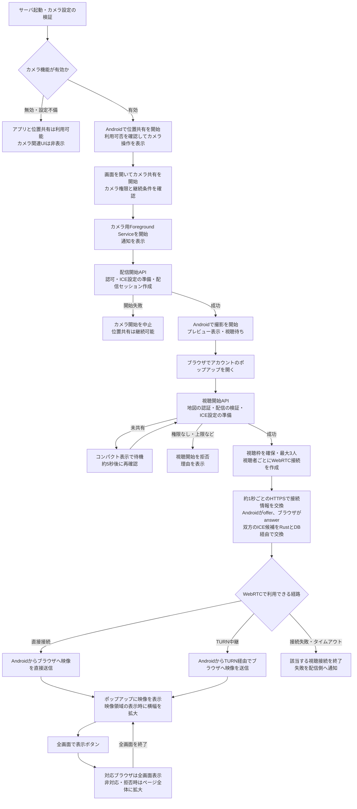
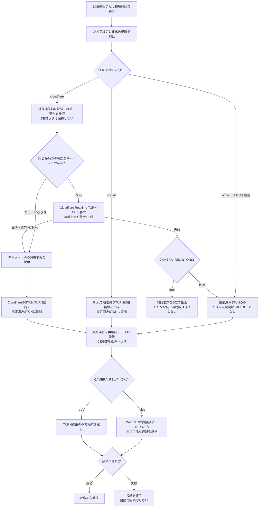
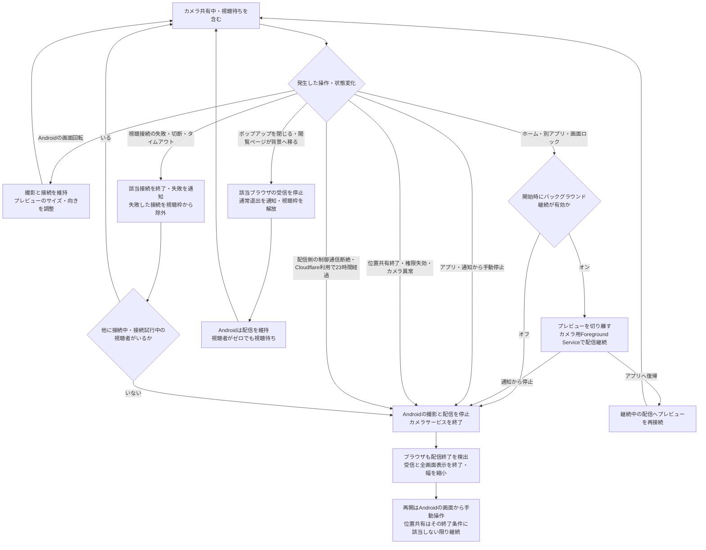

# カメラ共有の導入・検証

Androidアプリからライブマップのメンバーポップアップへ、映像のみをWebRTCで配信する。1配信につき最大3接続。初期設定では無効。

Androidのカメラ操作・説明・状態表示は、サーバで利用可能と確認できた場合のみ表示する。ログイン、位置共有開始、画面復帰時などに再確認し、未設定・無効・未対応・確認中・通信失敗時は非表示にする。位置共有の操作は引き続き利用できる。

アカウントのポップアップは映像未表示時に幅250pxとし、映像領域の表示時にPCで幅500px、スマートフォンで最大400pxへ広げる（画面左右に32pxの余白）。縦向き映像は切り取らず、長い内容はスクロールできる。全画面表示への切り替えでも、映像と接続を維持する。

## 現在の処理フロー

配信開始・視聴開始、接続先の準備、配信中の状態変化を分けて示す。設定名とDBはPostgreSQL版を基準とする。SQLite版も同じ通信方式と画面を使用するが、設定元は `geocode-web-single.env.json`、接続情報の保存先はSQLiteとなる。SQLite版の設定手順は[こちら](../GeoCode-Web-Single/CAMERA_SHARING.md)を参照。

### 1. 配信開始から映像表示まで



RustサーバとDBが扱うのは認証・有効期限・SDP/ICEなどの接続情報であり、映像は通さない。全画面表示は同じ映像要素と接続を使い、視聴枠を追加しない。ポップアップを開いていても配信が未開始なら待機するため、配信開始とポップアップを開く操作の順序は逆でもよい。

### 2. STUN・TURNとCloudflareの分岐

次の処理は配信開始と視聴開始の両方で行う。毎秒の接続情報交換ではTURN資格情報を再発行しない。



TURN未設定で`CAMERA_RELAY_ONLY=true`にするなど、設定自体が不正な場合は最初の検証でカメラ機能を無効にする。通常モードでは直接接続に失敗してからRustがTURNへ切り替えるのではなく、WebRTCが候補の接続性を確認して経路を選ぶ。Cloudflareの資格情報取得失敗時は、設定済みSTUN/P2Pへ戻り、coturnには切り替えない。APIトークン・coturn共有秘密はサーバに保持し、端末へは期限付きの接続資格情報のみを渡す。

### 3. バックグラウンド継続・復帰・停止



バックグラウンド継続は、画面から開始し、カメラ用Foreground Serviceへの移行を完了した配信が対象。移行前に画面を離れた開始要求は中止する。継続中の配信は復帰しても停止せず、すでに停止した配信は復帰だけでは再開しない。

サーバの有効期限は15秒。クライアントの制御通信監視は12秒、視聴接続の成立・映像受信待ちは20秒を上限とする。地図の期限切れ・失効・パスワードやURL変更・メンバー削除も継続して検証し、対象の視聴を拒否する。停止通知が届かない場合も有効期限で回収し、通信情報は定期削除する。停止と画面反映には通信周期や受信バッファ分の遅延がある。

## 必要な構成

- 新しいGeoCode-WebサーバとWebアセット、DB migration `20260925000000_camera_sharing.sql` と `20260926000000_camera_peer_failure.sql`。
- CAMERA権限とWebRTCを組み込んだGeoCode-Web-ShareCli。
- STUN/TURNサービスは任意。TURN未設定でもP2Pを試し、接続に失敗した場合は終了する。TURN（coturn等）を設置する場合は既存サーバと同じホストでもよいが、HTTPプロキシとは別の待受・ポート・帯域が必要。

接続情報は認証済みHTTPSの短いPOST要求で約1秒ごとに交換する。映像はこのAPIを通らない。計画時のWSS＋Redis Pub/Subは、既存Cloudflare Access認証の再利用と複数Rustプロセス間の一貫性を優先し、PostgreSQLの有効期限付き接続管理へ変更した。カメラ機能はRedisに依存せず、WebSocket用のプロキシ変更も不要。接続開始には複数回のHTTP往復が必要になる。

## サーバ設定

以下をGeoCode-Webの環境変数へ設定する。実際の秘密はGitへ登録しない。

```dotenv
CAMERA_SHARING_ENABLED=false
CAMERA_STUN_URLS=
CAMERA_TURN_URLS=
CAMERA_TURN_SECRET=
CAMERA_RELAY_ONLY=false
```

`CAMERA_SHARING_ENABLED=true`にすると、STUN/TURNが未設定でもカメラ共有を開始できる。STUNを使用する場合は`CAMERA_STUN_URLS=stun:stun.example.com:3478`のように設定する（複数はカンマ区切り）。外部STUNサービスは自動追加しない。両方とも未設定の場合は取得できる接続候補で直接接続を試すため、異なるネットワーク間では接続できない場合がある。

TURNを使用する場合は`CAMERA_TURN_URLS=turn:turn.example.com:3478?transport=udp,turns:turn.example.com:5349?transport=tcp`と32文字以上の`CAMERA_TURN_SECRET`を設定し、coturnの`static-auth-secret`と一致させる。サーバはHMAC-SHA1による期限付きTURN資格情報を生成する。有効期間は24時間。サーバとTURNの時計を同期する。クライアントへ発行用の共有秘密は送らない。

URL・秘密の片方のみ、不正なURL、TURN未設定で`CAMERA_RELAY_ONLY=true`の場合はカメラ機能のみ利用不可となる。TURNへの接続可否でアプリ全体の起動を制限しない。

`CAMERA_RELAY_ONLY=true`はTURN経由の検証、または端末間の直接接続を避けたい環境で利用できる。TURNの疎通は設定文字列からは判断できないため、必ず実通信で確認する。

coturnのたたき台は[設定例](../docker/turn/turnserver.conf.example)を参照。公開IP、証明書、ファイアウォール、NATとリレーポート範囲を環境に合わせる。TURN/TLSを443にする場合は既存HTTPSとのポート競合を避ける。Cloudflare Access/通常のHTTPトンネルで映像も中継できるとは扱わない。

Linuxホストでcoturnを導入する場合も、既存の位置共有用コンテナや本番DBを移し替える必要はない。この変更にはcoturnの実配備、証明書発行、ルーター設定変更を含めない。

## Cloudflare Realtime TURNを利用する場合

既存のSTUN/P2PにCloudflareの中継を追加できる。自前のTURNサーバや新しいDBマイグレーションは不要。今回の追加だけならAndroid APK・Web側の変更は不要で、既存のプロトコル2対応版を利用する。

1. CloudflareダッシュボードのRealtime TURNでTURNキーを作成し、キーIDと、そのキー用のAPIトークンを取得する。Cloudflare AccessのService Tokenや一般のアカウントAPIトークンとは別物。
2. Rustサーバへ以下を設定し、全プロセスを再起動する。Dockerでもアプリの環境変数として渡す。

```dotenv
CAMERA_SHARING_ENABLED=true
CAMERA_STUN_URLS=stun:stun.cloudflare.com:3478
CAMERA_TURN_PROVIDER=cloudflare
CAMERA_CLOUDFLARE_TURN_KEY_ID=<TURNキーID>
CAMERA_CLOUDFLARE_TURN_API_TOKEN=<TURNキー用APIトークン>
CAMERA_RELAY_ONLY=false
```

`CAMERA_TURN_URLS`と`CAMERA_TURN_SECRET`はCloudflare方式では使用しない。APIトークンはRustサーバだけに保存し、ブラウザやAPK、Gitへ含めない。サーバから`https://rtc.live.cloudflare.com`へHTTPS接続できる必要がある。

| CAMERA_TURN_PROVIDER | 動作 |
|---|---|
| 未設定・空 | 従来互換。TURN URLと共有秘密があればcoturn、両方なければP2P/STUN |
| `none` | P2P/STUNのみ。残っているcoturn設定は使わない |
| `coturn` | 既存のTURN URLと共有秘密を必須とする |
| `cloudflare` | Cloudflare TURNキーIDとAPIトークンを必須とする |

キー未設定・設定形式の誤り・未知のproviderではカメラ機能だけを無効化する。起動時ログには秘密を含まない理由を出す。形式が正しくてもトークン失効等による認証エラーは接続開始時に判明する。カメラ機能が無効でもサーバと位置共有は起動・利用できる。

Rustは配信者・視聴者の認可後、Cloudflareの資格情報発行APIを呼び出す。外部通信中はDBロックを保持せず、完了後に再検証する。APIの応答から検証済みのICEサーバと期限付き資格情報だけを端末へ返す。毎秒の接続情報交換ではCloudflareを呼び出さない。同じ接続IDの再試行用キャッシュはプロセス内で30秒有効、最大512件。同時発行は16件に制限し、待機・接続・応答取得全体を1.5秒で打ち切る。複数プロセス間のキャッシュ共有は行わない。

- 取得失敗時、`CAMERA_RELAY_ONLY=false`なら設定したSTUN/P2Pで接続を試す。そちらも失敗した場合は既存のタイムアウト処理で終了する。既存coturnへの切り替えは行わない。
- `CAMERA_RELAY_ONLY=true`なら取得失敗時はカメラ開始・視聴開始を502で拒否する。失敗した要求で配信・視聴枠を新規作成しない。位置共有は継続できる。
- Cloudflareから取得できた場合は、Cloudflareが返すSTUN/TURN候補を設定済みSTUNに追加する。通常はWebRTCが直接接続と中継から利用可能な経路を選ぶ。
- 資格情報の有効期間は24時間。Cloudflare設定では連続共有を23時間で停止し、Android側で手動再開する。途中の資格情報更新・自動再接続は行わない。
- ログへAPIトークン、資格情報、上流レスポンス本文を出さない。サーバ応答は`Cache-Control: no-store`。

導入時はまず`CAMERA_RELAY_ONLY=true`にして再起動し、Pixel 7aと別回線のブラウザで映像が表示されることを確認する。この状態で映ればTURN経由の接続を確認できる。UDPが使えない環境でのTURN/TLS、複数視聴者も確認した後、通常運用は`false`に戻して再起動する。設定反映後はAndroidを画面復帰させ、地図を再読み込みする。トークン不正やネットワーク遮断による失敗時も、位置共有が継続することを検証する。

Cloudflareでのキー作成・本番設定・実機による映像中継確認は別途必要。利用状況・料金はCloudflare側で確認する。

公式仕様: [Generate TURN Credentials](https://developers.cloudflare.com/realtime/turn/generate-credentials/)

## API

全応答はキャッシュ禁止。制御通信のみに利用する。

| メソッド・パス | 認証と用途 |
|---|---|
| GET `/live-camera/capabilities` | アカウント認証。機能可否・プロトコル版・人数上限 |
| POST `/live-location/session/{id}/camera` | 所有者認証。本文`id`は配信世代のUUID。同じIDの再送は有効な間だけ冪等 |
| POST `/live-camera/sessions/{id}/exchange` | 所有者認証。接続一覧・SDP/ICE交換・配信lease更新 |
| DELETE `/live-camera/sessions/{id}` | 所有者認証。配信停止 |
| POST `/live-api/maps/{public}/members/{member}/camera/viewers` | 地図の閲覧認可。本文`id`と`key`は各ブラウザで生成したランダムUUID |
| POST `/live-api/maps/{public}/camera/viewers/{id}/exchange` | 地図の再認可と本文の`key`。視聴lease更新・SDP/ICE交換 |
| DELETE `/live-api/maps/{public}/camera/viewers/{id}` | 本文の`key`でその接続のみ終了。地図失効後も枠解放可能 |

exchangeの本文は`after`（最後に処理した信号ID）と`messages`。各信号には`message_id`、`viewer_id`、`kind`、`data`を付ける。送信側は応答成功まで同じmessage_idで再試行し、受信側は処理済みのカーソルを進める。offerはAndroid、answerは閲覧者のみ送信可能。再交渉は接続の作り直しで行う。

接続失敗通知に対応するプロトコル版は2。Androidとサーバを合わせて更新する。配信者は`failed_viewers`で失敗した接続IDを通知できる。ブラウザのDELETEは`failed: true`で接続失敗、`false`または省略で通常退出を通知する。失敗した接続は視聴枠から除外し、既存の有効期限まで`failed_peers`として返すため、応答喪失時にも再取得できる。失敗時のSDP/ICEは削除する。

信号は接続ごとに最大256件、要求ごとに最大32件。SDPは64KiB以下。映像・音声の保存機能はない。ネットワーク情報を含むSDP/ICEは信号テーブルに一時保持し、接続削除時に消去する。30秒周期の清掃で期限切れ接続を回収し、再送防止用の配信IDは1日保持する。APIの本文をプロキシ等のログへ記録しない。

## 停止と認可

- 視聴者ごとに20秒で接続を打ち切る。接続失敗・切断は該当接続だけを終了し、他に接続中・接続試行中の視聴者がいなければAndroidの撮影と配信も停止する。サーバへの通知・取得周期分の遅延がある。位置共有は継続し、カメラの再開は手動。
- 共有開始後に誰も視聴していない間や、最後の視聴者がポップアップを閉じて通常退出した場合は視聴待ちを継続する。
- 手動停止では撮影を停止。Androidのバックグラウンド継続設定（初期値オフ）がオフなら、画面を離れる、ロック、最前面の操作対象でなくなる場合にも停止する。オンなら画面から開始したカメラ用Foreground Serviceが撮影と配信を継続し、アプリまたは通知から停止できる。画面回転・サイズ変更では撮影と接続を維持し、プレビューだけを映像の縦横比に合わせる。復帰しても自動再開しない。
- カメラ開始中の停止や遅れた応答は世代番号で無効化する。
- 位置セッション終了/置換、位置送信許可取消し、アカウントロックは配信の継続を拒否する。
- 地図の期限、失効、パスワード/URL変更、メンバー削除を継続して検証する。地図のパスワードCookieも視聴要求ごとに再検証する。
- サーバleaseは15秒。クライアントは成功応答の要求開始時刻から12秒で制御通信の断絶を検出し、ローカル接続を閉じる。権限失効の反映には通常の取得周期、または最大でlease期限程度を要する。すでに送信済みの映像には受信バッファ分の遅延があり、瞬時の全画面消去を保証しない。
- カメラAPIは3秒で打ち切る。Androidの既存API認証ロックを共有するため、その時間内で位置要求が待つ場合がある。負荷試験で位置送信成功間隔も確認する。
- 回線切替等でWebRTC自体が切れた場合は、閲覧者がポップアップを開き直す。カメラの制御接続が期限切れになった場合はAndroid側で再度オンにする。

## 配備順と戻し方

1. テスト環境でDB migrationを適用し、サーバとtemplate-scriptsのビルドを配備する。通常のビルド工程で更新されたアセットを`dist`へ含める。
2. TURNを使用する場合は配置し、資格情報、UDP、TURN/TLSを確認する。P2Pのみの場合はTURNのURLと秘密を両方空にする。
3. Androidの検証用APKを導入する。旧サーバではカメラ操作が未対応表示になり、位置共有は利用できる。
4. 限定環境で`CAMERA_SHARING_ENABLED=true`としてRustの全プロセスを再起動する。
5. 下記実機試験を実施後に正式配布版を確定する。

無効化は`CAMERA_SHARING_ENABLED=false`として全プロセスを再起動する。既存カメラ接続も次の交換失敗/lease期限で閉じる。位置APIは継続利用できる。追加テーブルをすぐ削除する必要はない。

## 本番有効化前の実機試験

- STUN/TURNとも未設定、STUNのみ、TURNありで接続を確認する。同一Wi-Fi・異なる回線での成功と失敗、20秒タイムアウト後の撮影停止、位置共有の継続、複数視聴者の一部だけ失敗した場合の継続を確認する。
- Pixel 7a等で1台→1/2/3ブラウザ。4接続目の満員表示と離脱後の枠再利用。
- Wi-Fiと携帯回線、`CAMERA_RELAY_ONLY=true`、UDP制限環境でTURN/TLS。
- Androidのホーム・他アプリ・画面ロック・画面回転・分割画面・カメラ権限拒否/取消し・共有開始中の停止。
- ポップアップ切替、タブ背景化、地図更新、ページ離脱で接続解放。Chrome/Edgeおよび利用するSafari。
- 地図期限切れ、URL更新、パスワード変更、メンバー削除、位置送信許可取消し、別端末での位置共有開始。
- Cloudflare AccessとGeoCode-Webの認証更新、通信全断、サーバ停止、TURN停止、遅延応答。
- 3視聴接続で30〜60分：発熱、電池、通信量、初回表示時間、映像遅延、停止時間、位置送信の最大成功間隔を記録。

実機・実ネットワーク試験は自動テストと別の合格条件。初期画質は640×360/15fps、各接続の映像上限500kbps。3人への個別配信負荷が許容できなければ、SFU方式を再検討する。

## 開発環境での確認結果（2026-09-25）

### TURN任意化の追加検証

- Rust：単体52件、カメラ結合9件が成功。ICEサーバなしの開始、STUN単独、設定不整合、失敗通知の認証・再取得、失敗した接続の枠解放を確認。
- Web：カメラ関連8件と型チェック、配布用ビルドが成功。ICEサーバなしの設定、接続成功後の継続、接続失敗・切断・20秒タイムアウトの通知、通常退出との区別を確認。
- Android：Debugの単体54件、Lint、APKビルドが成功。接続期限、最後の接続失敗、他の視聴者がいる場合の継続、通常退出後の待機を確認。
- 実機でのP2P映像、STUN/TURN疎通、回線切替は未検証。今回Release構成の再検証は行っていない。

### 初期実装時の検証

- Rust：単体テスト51件、カメラのPostgreSQL統合テスト7件、既存位置共有の統合テスト4件。カメラの人数枠の同時確保、信号再送の重複排除、権限失効、lease期限切れ、所有者制限、ルート登録を検証。
- Web：template-scriptsの41ファイル・225テスト、型チェック、配布用ビルド。カメラテストはPeerConnectionを模擬し、遅延応答、権限拒否、タブ背景化、制御通信断での接続解放を検証。
- Android：Debug 50件・Release 41件の単体テスト、両構成のLint、APK生成。カメラ要求のキャンセル後も位置APIが使えること、停止済み要求が認証ロック解放後に送られないこと、カメラ応答だけのサイズ上限拡張を検証。
- WebRTC AARのarm64-v8a/x86_64共有ライブラリのLOADアラインメントは16384。Debug/Release APKの16KBページ配置チェックも成功。16KBページの実機起動は未検証。
- Kotlin daemonの一時ディレクトリ書き込み警告が出たが、ビルドツールのフォールバックでコンパイル・検証は成功。Lintには既存依存の更新案内等、Webビルドには既存PDF用チャンクのサイズ警告がある。
- 接続されたAndroid実機はなく、実際の撮影・映像再生・TURN接続・携帯回線・Cloudflare Access経由の結合・発熱試験は未実施。上記の実機試験を代替する結果ではない。

検証用APKは`GeoCode-Web-ShareCli/app/build/outputs/apk/debug/app-debug.apk`。Releaseの生成物は未署名であり、正式配布物ではない。本番サーバの配備・環境変数変更・TURNの設置は実施していない。

## 依存関係と参考

Androidは`io.github.webrtc-sdk:android:144.7559.15`を固定して使用する。WebRTC-SDKの配布物であり、GoogleがMavenで直接配布するSDKと混同しない。WebRTCソースrevision `30d5e63`のLICENSE/PATENTSをAPKの`assets/licenses`へ同梱する。正式配布前には、SDKのビルドに含まれる第三者コンポーネントの告知も配布元と照合する。

- [WebRTC接続の概要](https://webrtc.org/getting-started/peer-connections)
- [WebRTC-SDK Android](https://github.com/webrtc-sdk/android)
- [coturn](https://github.com/coturn/coturn)

### Cloudflare TURN対応の自動検証（2026-09-28）

`cargo test --lib --test live_camera`：単体58件、カメラ結合10件が成功。一時的なPostgreSQLとローカルの模擬HTTPサーバを使用し、本番DB・実Cloudflare APIは使用していない。

資格情報発行リクエスト、応答の検証、再試行キャッシュと期限・トークン更新時の分離、HTTP失敗・不正JSON・過大応答・タイムアウト、P2Pへの切り替えとTURN必須時の拒否を確認。既存の人数制限・停止・期限切れ・権限失効・P2P接続開始に加え、Cloudflareの23時間上限と発行前の認可を検証した。実機映像の疎通・中継性能は上記の実機試験で別途確認する。
