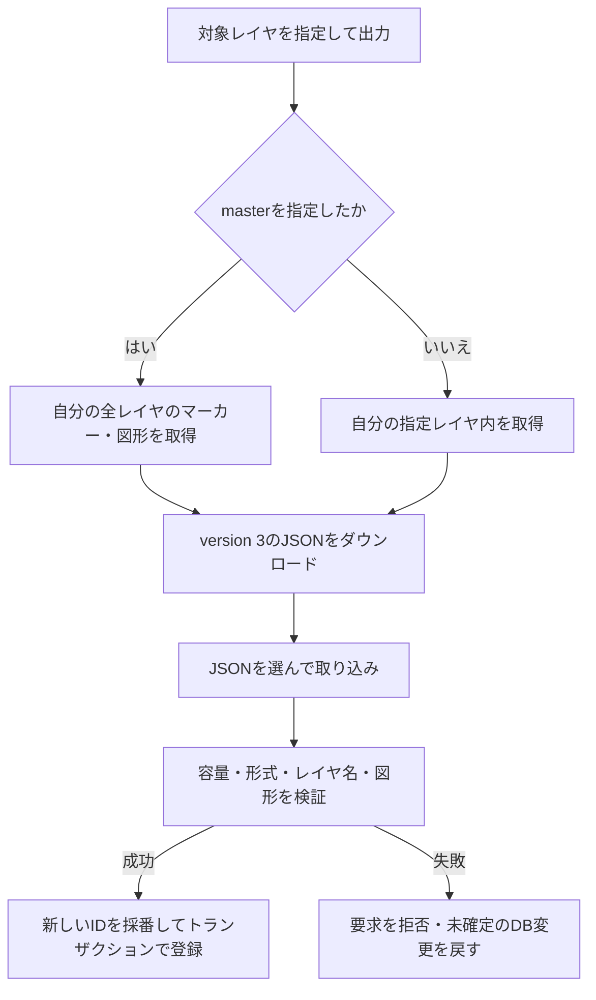

# JSONデータ入出力の利用・検証

自分のレイヤ・対象・フォーム・全回答履歴をJSONへ出力し、別の利用者へ渡して画像以外を再現する。取り込みは既存データの更新ではなく、新しいIDによる独立したコピーの作成となる。

## version 3

出力はversion 3のみとし、トップ画面のエクスポートボタンから確認モーダルを挟まず直接ダウンロードする。master選択中は全レイヤと未適用の共通フォーム、通常レイヤ選択中はそのレイヤと関連データを出力する。

| 配列 | 保存する内容 |
|---|---|
| `layers` | 空レイヤを含む名前、元のmaster区分、共通フォーム参照、日時 |
| `markers` | 座標・名前・本文・所属・日時 |
| `shapes` | 種別・名前・GeoJSON（メモ・スタイルを含む）・所属・日時 |
| `common_forms` | 現在の定義・版・削除状態、全版の項目定義、日時 |
| `form_configs` | 対象別の実際の定義、適用元と版、管理レイヤ、日時 |
| `submissions` | 全回答の構造化値・投稿時定義・適用元・Markdown・回答日時・優先順 |

最上位は`format: "geocode-web"`、`version: 3`、UTCの`exported_at`、`image_policy: "references_only"`と上記6配列。各要素の`key`はファイル内の識別子とし、DB内部ID・所有者IDを出力しない。対象参照は`{type: "marker" | "shape", key: "..."}`、共通フォーム参照は`{form_key: "...", version: N}`とする。

通常レイヤ出力にも参照先共通フォームの全版と、設定・回答から参照される削除済みフォームを含める。全件出力では未適用の未削除フォームも含める。版履歴には保存されている項目定義だけを含め、存在しない旧タイトル・説明は推測しない。

### 取り込み

- 同名レイヤも別々に作成する。元のmasterも新規通常レイヤとして作り、移行先masterを上書きしない。
- レイヤ・対象・共通フォーム・回答をすべて新規採番し、参照を同一トランザクションで復元する。参照先・版・管理状態・項目IDの整合性に不備があれば全体を拒否する。
- 手動コピー先の独自定義と適用元の旧版を維持する。管理中の対象は管理レイヤとの紐付けを復元する。
- 日時は両DBで表現できるUTC・マイクロ秒精度へ正規化する。元の日時・ID順から`source_order`を作り、新しい回答IDの大小関係にも元の優先順を反映する。秒未満の精度差で同日時になっても最新回答を維持する。最新選択後に検索条件を適用する既存の仕様を維持する。
- `submitted_values`を直接移し、本文・メモを再解析しない。未入力・項目なし・0・false、数値精度、スナップショットなしの旧回答を保持する。
- 履歴の登録時に本文・メモへ再追記しない。履歴の`rendered_markdown`も原文を保持する。
- 公開可否は無効、公開IDは新規、パスワードは未設定とする。公開URL・ハッシュ・トークン・投稿制限カウンターは出力しない。
- 既存データへの照合・統合・上書きは行わない。繰り返し取り込むと独立したコピーが増える。

### 画像と対象外データ

画像回答の`url`・`filename`・`content_type`と本文・メモ中の参照文字列だけを残す。画像実体・サムネイル・画像管理レコードはコピーせず、自動取得・到達確認・URL置換もしない。相対URLは移行先を基準に解釈されるため、移行後の画像表示を保証しない。カスタムアイコンは従来どおり対象外で、取り込み先は標準アイコンを使う。

アカウント、共有設定、タイル登録、位置履歴などは対象外。DB・ファイル保存領域の完全バックアップを代替する機能ではない。

### 容量と互換性

- version 3のファイルはUTF-8の実バイト数で20MiBまで。要求全体は21MiBまで。ちょうど上限のファイルも受け付ける。
- 旧配列・version 1/2・バージョンなし従来パッケージの読み込みは5MiBまで維持する。未知のバージョンは拒否する。
- 出力はversion 3のみ、20MiBまで。超過時はエラーを返し、レイヤ分割を案内する。回答の切り捨てや不完全なJSONの出力は行わない。
- 出力は同一の読み取りスナップショットから取得する。ブラウザではJSONを数値へ再変換せず、応答テキストをそのままファイル化する。エラー応答だけJSONとして扱い、既存の認証更新・再送信を維持する。
- 受け取り側も最新のGeoCode-Webを使用する。旧アプリによるversion 3読み込みはサポートせず、version 2への変換・出力は提供しない。最新アプリでは旧形式の読み込みを維持する。

APIは`GET /file/export/{layer_id}`と`POST /file/import`。出力はversion省略時・`?version=3`指定時ともversion 3で、`?version=2`などの他バージョン指定は400エラーを返す。入出力ハンドラーは両DBで同じファイル形式を使用し、DB差分はバックエンドで吸収する。

## 現在の処理フロー



## 利用手順

1. 出力するレイヤを選ぶ。全件出力ではmasterを選ぶ。
2. トップ画面のエクスポートボタンをクリックし、version 3のJSONを直接保存する。受け取り側も最新のGeoCode-Webを使用する。
3. PC版のJSON取り込みモーダルからファイルを選択し、取り込みを実行する。
4. 作成されたレイヤを選び、件数、位置、図形、メモを確認する。

モバイル版には専用の取り込みモーダルがない。繰り返し取り込むと新規データが増えるため、同じファイルを再送して既存データを更新する用途には使わない。

## 読み込み専用の従来version 2形式

従来のversion 2ファイルは`version`、`markers`、`shapes`を持つオブジェクト。最新アプリは読み込みに対応するが、この形式では出力しない。`version`は2。

```json
{
  "version": 2,
  "markers": [
    {
      "marker_name": "集合場所",
      "latitude": 35.681236,
      "longitude": 139.767125,
      "detail": "集合場所の説明",
      "layer": { "layer_name": "案内", "is_master": false }
    }
  ],
  "shapes": []
}
```

図形要素は`shape_type`、`name`、`geojson`、`layer`を持つ。GeoJSON内のメモとスタイルも含む。従来の出力ではDB内部の`id`、`user_id`、`layer_id`を含めなかった。レイヤ情報は各オブジェクトに内包するため、オブジェクトを持たない空レイヤは復元できない。

旧形式のマーカー配列、および内部IDを含む従来JSONも読み込める。内部IDを復元用のIDとして採用するわけではない。取り込み時はファイル内のレイヤ名をもとに新しい通常レイヤを作り、関連オブジェクトを割り当てる。

## 従来version 2の制限と保存対象

- JSONファイルは5MiB以下。UTF-8の`.json`ファイルを使用する。取り込みAPIの要求全体の上限はversion 3と共通の21MiB。
- 空のレイヤ名を拒否する。図形は`polygon`・`polyline`・`rectangle`・`circle`のみ許可し、GeoJSONも検証する。
- 線幅は1～10px。折れ線の矢印は`none`・`start`・`end`・`both`とし、他の種別の矢印設定を拒否する。
- 従来形式にはマーカーアイコン本体・アイコン参照を含めない。取り込んだ新規レイヤは標準マーカーを使用する。
- 画像・PDF・動画の実体、公開フォーム設定・投稿履歴、共有URL、アカウント、タイル登録、位置履歴はこのJSONの対象外。

本文やメモ中の画像URLは文字列として残る。取り込み先で参照先へアクセスできなければ表示されない。この機能はDBとファイル保存領域を含む完全なバックアップの代わりにはならない。

## API

| メソッド・パス | 認証と用途 |
|---|---|
| GET `/file/export/{layer_id}` | アカウント認証。所有する対象データをJSONで取得 |
| POST `/file/import` | アカウント認証。multipartのJSONから新規登録 |

出力は`application/json`と`attachment; filename="export.json"`を返す。取り込みはDBトランザクションで処理する。

## 検証手順

- `tests/form_transfer.rs`で別利用者への移行、空・同名レイヤ、管理と手動コピー、削除済み・未適用フォーム、旧回答、数値精度、同日時の最新選択、公開情報除外、失敗時の一括取り消しと容量境界を検証する。
- PostgreSQLの検証は`cargo run --offline --manifest-path scripts/postgres-transfer-tests/Cargo.toml -- --test form_transfer`で実行できる。設定から接続資格情報だけを読み、接続先DBを`postgres`へ変更して一時DBを作成する。アプリ用DBには接続せず、テストとコンパイル時のクエリ検証を一時DBで行って削除する。

- 通常レイヤとmasterから出力し、対象範囲と内部IDを含まないことを確認する。
- マーカーと4種の図形を取り込み、名前、所属、位置、メモ、線種・線幅・矢印を照合する。
- 旧配列形式を読み込み、繰り返し取り込みで新しいIDとレイヤが作成されることを確認する。
- 不正JSON、容量超過、空レイヤ名、不正な図形で途中のデータが残らないことを確認する。
- ファイル・アイコン・公開フォームが自動復元されないことを確認する。

## 関連する実装

[入出力ハンドラー](../src/handler/files.rs)、[データ型](../src/model/file.rs)、[図形検証](../src/shape_validation.rs)、[ファイル管理](FILE_MANAGEMENT.md)。
