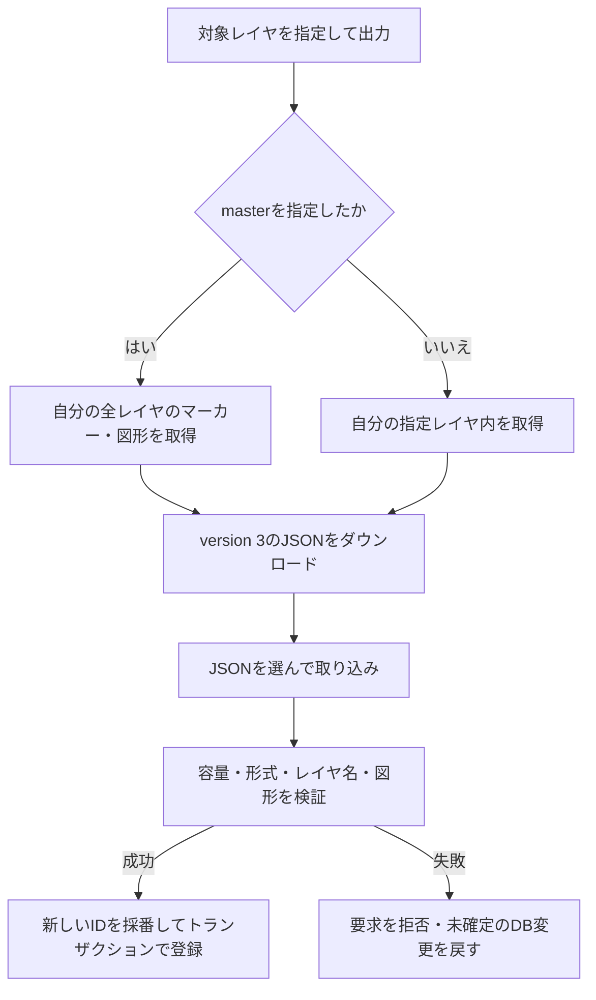

# JSONデータ入出力の利用・検証

自分のレイヤ・対象・フォーム・全回答履歴をJSONへ出力し、別の利用者へ渡して画像以外を再現する。取り込みは既存データの更新ではなく、新しいIDによる独立したコピーの作成となる。

フォームの適用方法は[共通フォーム](COMMON_FORMS.md)、回答追加・編集と検索は[フォーム回答](FORM_ANSWERS.md)を参照してください。

## version 3

出力はversion 3のみとし、トップ画面のエクスポートボタンから確認モーダルを挟まず直接ダウンロードする。master選択中は全レイヤと未適用の共通フォーム、通常レイヤ選択中はそのレイヤと関連データを出力する。

| 配列 | 保存する内容 |
|---|---|
| `layers` | 空レイヤを含む名前、元のmaster区分、自由記述制限、共通フォーム参照、日時 |
| `markers` | 座標・名前・本文・所属・日時 |
| `shapes` | 種別・名前・GeoJSON（メモ・スタイルを含む）・所属・日時 |
| `common_forms` | 現在の定義・版・削除状態、全版の項目定義、日時 |
| `form_configs` | 対象別の実際の定義、適用元と版、管理レイヤ、日時 |
| `submissions` | 全回答の構造化値・投稿時定義・適用元・Markdown・回答日時・優先順 |

最上位は`format: "geocode-web"`、`version: 3`、UTCの`exported_at`、`image_policy: "references_only"`と上記6配列。各要素の`key`はファイル内の識別子とし、DB内部ID・所有者IDを出力しない。対象参照は`{type: "marker" | "shape", key: "..."}`、共通フォーム参照は`{form_key: "...", version: N}`とする。

通常レイヤ出力にも参照先共通フォームの全版と、設定・回答から参照される削除済みフォームを含める。全件出力では未適用の未削除フォームも含める。版履歴には保存されている項目定義だけを含め、存在しない旧タイトル・説明は推測しない。

`layers[].restrict_free_text`にレイヤの自由記述制限を保存する。この項目のない旧version 3や旧形式では制限なしとして読み込む。JSONからの復元では、制限付きレイヤの既存本文・図形メモも保持する。

PostgreSQL版・SQLite版では、任意項目 `markers[].body_parts` / `shapes[].body_parts` に自由記述と回答部分の構成を保存する。テキスト部分は `{type:"text",text:"..."}`、回答部分は `{type:"answer",key:"a1"}` とし、ファイル内の回答キーで参照する。編集日時は `submissions[].edited_at` に保存する。取り込み時は新しい回答IDへ対応付け直し、本文・メモと全回答の一致を検証する。項目がない旧データも従来どおり読み込む。

両版とも本文構成・回答編集日時を含むJSONの出力・取り込みに対応する。画像は引き続き参照のみ、version 3は20MiB上限。

### 取り込み

- 同名レイヤも別々に作成する。元のmasterも新規通常レイヤとして作り、移行先masterを上書きしない。
- レイヤ・対象・共通フォーム・回答をすべて新規採番し、参照を同一トランザクションで復元する。参照先・版・管理状態・項目IDの整合性に不備があれば全体を拒否する。
- 手動コピー先の独自定義と適用元の旧版を維持する。管理中の対象は管理レイヤとの紐付けを復元する。
- 日時は両DBで表現できるUTC・マイクロ秒精度へ正規化する。元の日時・ID順から`source_order`を作り、新しい回答IDの大小関係にも元の優先順を反映する。秒未満の精度差で同日時になっても最新回答を維持する。最新選択後に検索条件を適用する既存の仕様を維持する。
- `submitted_values`を直接移し、本文・メモを再解析しない。未入力・項目なし・0・false、数値精度、スナップショットなしの旧回答を保持する。
- 履歴の登録時に本文・メモへ再追記しない。履歴の`rendered_markdown`も原文を保持する。
- 公開可否は無効、公開IDは新規、パスワードは未設定とする。公開URL・ハッシュ・トークン・投稿制限カウンターは出力しない。
- 既存データへの照合・統合・上書きは行わない。成功確認後に改めて取り込むと独立したコピーが増える。同じ取り込み要求の再試行は、次の仕組みで重複登録を防ぐ。

### 取り込み要求の再試行（PostgreSQL版・SQLite版共通）

`POST /file/import` は任意の `Idempotency-Key` ヘッダにUUIDを受け付ける。JSON本体・multipartのファイル項目・成功応答 `{"message":"Upload Ok."}` は変更しない。version 3、version 1/2、バージョンなし従来パッケージ、旧マーカー配列のいずれにも同じ仕組みを適用する。

PC画面は任意の `X-Import-Account` ヘッダに期待する利用者IDも指定する。認証中の利用者IDと一致しなければ登録前に409、不正なUUID・複数指定は400とする。別タブでログインアカウントを切り替えた直後も、古い画面の要求を別アカウントに取り込まない。両ヘッダを省略する既存クライアントの動作は変更しない。

| 要求 | 結果 |
|---|---|
| 同じ利用者・同じ要求ID・同じJSONバイト列 | 初回が確定済みなら200を返し、データを追加・更新しない |
| 同じ利用者・同じ要求ID・異なるJSONバイト列 | 409で拒否する |
| 異なる要求ID・同じJSON | 新しい独立コピーとして取り込む |
| 別利用者・同じ要求ID | 利用者ごとに独立して取り込む |
| ヘッダなし | 従来どおり取り込み、再送の重複防止は適用しない |
| 不正な要求ID | 400で拒否する |

内容の照合にはJSONファイルそのもののSHA-256を使用する。ファイル名・multipart境界は含めず、JSONの解析後の再シリアライズもしない。空白などを変えたファイルは別内容となる。

PostgreSQL版は利用者の行ロック取得後、SQLite版は既存の `BEGIN IMMEDIATE` による書き込みトランザクション内で完了記録を再確認し、新規データと完了記録を同一トランザクションで確定する。同じ要求の同時送信でも登録は一度だけ。確定前に失敗すればデータと完了記録の両方を取り消し、同じ要求IDで再試行できる。完了記録にはJSON本体を保存せず、自動期限削除はしない。アカウント削除時に削除する。取り込んだデータを後から編集・削除しても、確定済み要求の再送では取り込みを再実行しない。

完了記録の主キーは利用者IDと要求ID。PostgreSQL版はUUID・BYTEA・UTCのTIMESTAMP、SQLite版はUUIDのTEXT・32バイトのBLOB・UTCのTEXTで保存する。このDB表現の違いはバックエンドで吸収し、API・エラー・JSON形式・共通フロントエンドは同じにする。

コミット後の通信断では、応答を受け取れなくても全件登録済みの可能性がある。同じ要求IDと同じファイルで再試行して成功を確認する。PC画面は未解決の要求IDをアカウントとファイル内容ごとにsessionStorageへ保存し、モーダルの開閉・選択クリア・別ファイルの選択・同じタブの再読み込みでも再利用する。JSON本体はブラウザへ永続保存しない。成功応答を確認した時点で操作を完了し、その後に同じJSONを選び直した場合は新しい要求IDを使用する。別タブ・別端末などで新しい要求IDを作った操作は別の取り込みとなる。

### 成功後の画面更新

PC画面は取り込み成功後、現在の選択レイヤを維持してレイヤ一覧・マーカー・図形と地図iframeを更新し、検索条件を解除する。同じ地図URLでも明示的に再読み込みする。master表示では全レイヤ、通常レイヤ表示ではそのレイヤの範囲を維持するため、新しく取り込んだ別レイヤを表示するにはレイヤを切り替える。

取り込みの成功と画面更新の成功は分けて扱う。更新に失敗した場合は「取り込み済み・画面更新失敗」を案内し、再試行は一覧・地図の再取得だけを行う。画面更新の失敗を理由に取り込みPOSTを再送しない。API送信、データ再取得、地図iframe読込の進捗を区別する。

### 画像と対象外データ

画像回答の`url`・`filename`・`content_type`と本文・メモ中の参照文字列だけを残す。画像実体・サムネイル・画像管理レコードはコピーせず、自動取得・到達確認・URL置換もしない。相対URLは移行先を基準に解釈されるため、移行後の画像表示を保証しない。カスタムアイコンは従来どおり対象外で、取り込み先は標準アイコンを使う。

アカウント、共有設定、タイル登録、位置履歴などは対象外。DB・ファイル保存領域の完全バックアップを代替する機能ではない。

### 容量と互換性

- version 3のファイルはUTF-8の実バイト数で20MiBまで。要求全体は21MiBまで。ちょうど上限のファイルも受け付ける。
- 旧配列・version 1/2・バージョンなし従来パッケージの読み込みは5MiBまで維持する。未知のバージョンは拒否する。
- 出力はversion 3のみ、20MiBまで。超過時はエラーを返し、レイヤ分割を案内する。回答の切り捨てや不完全なJSONの出力は行わない。
- 出力は同一の読み取りスナップショットから取得する。ブラウザではJSONを数値へ再変換せず、応答テキストをそのままファイル化する。エラー応答だけJSONとして扱い、既存の認証更新・再送信を維持する。
- 受け取り側も最新のGeoCode-Webを使用する。旧アプリによるversion 3読み込みはサポートせず、version 2への変換・出力は提供しない。最新アプリでは旧形式の読み込みを維持する。

APIは`GET /file/export/{layer_id}`と`POST /file/import`。出力はversion省略時・`?version=3`指定時ともversion 3で、`?version=2`などの他バージョン指定は400エラーを返す。入出力ハンドラーは両DBで同じファイル形式を使用し、DB差分はバックエンドで吸収する。

## 現在の処理フロー



## 利用手順

1. 出力するレイヤを選ぶ。全件出力ではmasterを選ぶ。
2. トップ画面のエクスポートボタンをクリックし、version 3のJSONを直接保存する。受け取り側も最新のGeoCode-Webを使用する。
3. PC版のJSON取り込みモーダルからファイルを選択し、取り込みを実行する。
4. 作成されたレイヤを選び、件数、位置、図形、メモを確認する。

JSON入出力の操作はPC版を使用する。モバイル版にはJSONエクスポートの入口と専用の取り込みモーダルがない。成功確認後の再取り込みは新規コピーとなるため、同じファイルで既存データを更新する用途には使わない。

## 読み込み専用の従来version 2形式

従来のversion 2ファイルは`version`、`markers`、`shapes`を持つオブジェクト。最新アプリは読み込みに対応するが、この形式では出力しない。`version`は2。

```json
{
  "version": 2,
  "markers": [
    {
      "marker_name": "集合場所",
      "latitude": 35.681236,
      "longitude": 139.767125,
      "detail": "集合場所の説明",
      "layer": { "layer_name": "案内", "is_master": false }
    }
  ],
  "shapes": []
}
```

図形要素は`shape_type`、`name`、`geojson`、`layer`を持つ。GeoJSON内のメモとスタイルも含む。従来の出力ではDB内部の`id`、`user_id`、`layer_id`を含めなかった。レイヤ情報は各オブジェクトに内包するため、オブジェクトを持たない空レイヤは復元できない。

旧形式のマーカー配列、および内部IDを含む従来JSONも読み込める。内部IDを復元用のIDとして採用するわけではない。取り込み時はファイル内のレイヤ名をもとに新しい通常レイヤを作り、関連オブジェクトを割り当てる。

## 従来version 2の制限と保存対象

- JSONファイルは5MiB以下。UTF-8の`.json`ファイルを使用する。取り込みAPIの要求全体の上限はversion 3と共通の21MiB。
- 空のレイヤ名を拒否する。図形は`polygon`・`polyline`・`rectangle`・`circle`のみ許可し、GeoJSONも検証する。
- 線幅は1～10px。折れ線の矢印は`none`・`start`・`end`・`both`とし、他の種別の矢印設定を拒否する。
- 従来形式にはマーカーアイコン本体・アイコン参照を含めない。取り込んだ新規レイヤは標準マーカーを使用する。
- 画像・PDF・動画の実体、公開フォーム設定・投稿履歴、共有URL、アカウント、タイル登録、位置履歴はこのJSONの対象外。

本文やメモ中の画像URLは文字列として残る。取り込み先で参照先へアクセスできなければ表示されない。この機能はDBとファイル保存領域を含む完全なバックアップの代わりにはならない。

## API

| メソッド・パス | 認証と用途 |
|---|---|
| GET `/file/export/{layer_id}` | アカウント認証。所有する対象データをJSONで取得 |
| POST `/file/import` | アカウント認証。multipartのJSONから新規登録 |

出力は`application/json`と`attachment; filename="export.json"`を返す。取り込みはDBトランザクションで処理する。両DBの取り込みで上記の任意 `Idempotency-Key` と `X-Import-Account` を使用でき、CORSでも両ヘッダを許可する。

更新時は完了記録テーブルのマイグレーションを適用し、すべてのAPIプロセスを更新してから新しいフロントエンドを配信する。JSON形式の互換性と、古いAPIが要求IDによる重複防止に対応しているかは別であり、新UIは対応するAPIと組み合わせる。

移行ファイル名は両版とも `migrations/20261023120000_json_import_receipts.sql` とし、定義は各DB用にする。PostgreSQL版は通常の `sqlx migrate run` で適用し、SQLite版はSQLite用SQLファイルを `src/db/pool.rs` のランタイム移行21にも登録して起動時に適用する。SQLite版の既存データはそのまま保持し、新しい完了記録テーブルを追加する。
SQLite用SQLを先に適用済みの場合も、既存の完了記録を保持したまま起動時の移行21を記録できる。

## 検証手順

- `tests/form_transfer.rs`で別利用者への移行、空・同名レイヤ、管理と手動コピー、削除済み・未適用フォーム、旧回答、数値精度、同日時の最新選択、公開情報除外、失敗時の一括取り消しと容量境界を検証する。
- PostgreSQLの検証は `GEOCODE_TEST_PG_BIN` に `initdb`・`pg_ctl`・`psql` を含むディレクトリを指定し、`python scripts/postgres-transfer-tests/run.py -- --test import_idempotency --test form_transfer --test db_migrations` で実行する。専用の一時PostgreSQLクラスタを `target/` 配下で起動し、コンパイル時のSQLxクエリ検証とテストの接続先をそのクラスタへ明示する。アプリの `.env` や既存DBへの接続情報を使用しない。終了時にはこの実行が起動したクラスタだけを停止する。詳細は [テスト実行手順](../scripts/postgres-transfer-tests/README.md) を参照する。
- SQLite版は同版のルートで `SQLX_OFFLINE=true`、`DATABASE_URL=sqlite::memory:`、`CREATEDATABASE_PATH=:memory:` をプロセス環境へ明示し、`cargo test --locked --offline --jobs 1 --test import_idempotency --test form_transfer --test db_migrations` を実行する。`--jobs 1` はWindowsでのコンパイル時のメモリ使用量を抑える。SQLxのコンパイル時検証は既存の `.sqlx/` を使用し、テストはメモリDBまたは `target/` 内の一時SQLiteファイルを作る。利用中のDBや `.env`・設定JSONは変更しない。既存DBの移行も一時DBでランタイム移行21とCLI用SQLの整合性・再実行・既存データ保持を検証する。
- `tests/import_idempotency.rs` で同一要求の直列・並列再送、異なる内容の409、利用者分離、別要求IDでのコピー、途中失敗時の完了記録を含むロールバック、旧形式、アカウント不一致、CORSを検証する。
- PCの専用テストで要求IDの保持と成功後の更新を検証する。MapViewのテストではmaster・通常レイヤの範囲、図形とマーカー、同一URLのiframe再読み込み、画面更新だけの再試行を確認する。

- 通常レイヤとmasterから出力し、対象範囲と内部IDを含まないことを確認する。
- マーカーと4種の図形を取り込み、名前、所属、位置、メモ、線種・線幅・矢印を照合する。
- 旧配列形式を読み込み、繰り返し取り込みで新しいIDとレイヤが作成されることを確認する。
- 不正JSON、容量超過、空レイヤ名、不正な図形で途中のデータが残らないことを確認する。
- 画像ファイル・カスタムアイコンは復元せず、フォーム設定と回答履歴はversion 3で復元することを確認する。公開は無効・URLは新規・パスワードは未設定となることを確認する。

## 関連する実装

[入出力ハンドラー](../src/handler/files.rs)、[データ型](../src/model/file.rs)、[図形検証](../src/shape_validation.rs)、[ファイル管理](FILE_MANAGEMENT.md)。
