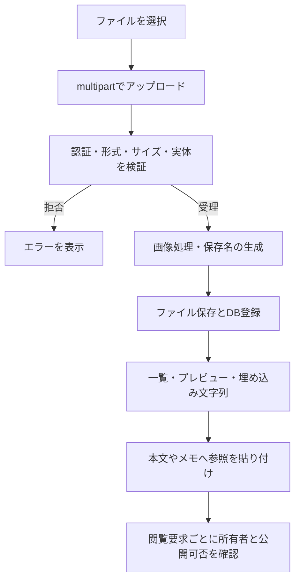

# 画像・PDF・動画の管理と検証

画像・PDF・MP4をアップロードし、一覧検索、プレビュー、Markdownへの埋め込み、削除を行う。ファイル情報はDB、実体はサーバの保存領域で管理する。公開ページからの閲覧も所有者のプライバシー設定に従う。

## 現在の処理フロー

## 必要な構成・保存先

`IMAGE_FILES_PATH`と`UPLOAD_FILE_PATH`を設定し、サーバプロセスが利用できる保存領域を用意する。ファイル情報は`image_model`で管理する。サーバの入れ替え時はDBだけでなくアップロード領域も引き継ぐ。

画像は再エンコードし、EXIF等の不要情報を除去して保存する。保存名は元のファイル名と分離し、UUIDに基づく名前を使用する。サムネイルはプレビュー用途で使用する。

| 制限 | 値 |
|---|---|
| 許可拡張子 | `png`・`jpg`・`jpeg`・`gif`・`webp`・`pdf`・`mp4` |
| 主ファイル | 100MiB以下 |
| 動画ポスター | 5MiB以下 |
| 画像寸法 | 最大12000px |
| アップロード要求全体 | 105MiB以下 |

前段のプロキシがこれより小さい要求上限を持つ場合は先に拒否される。ブラウザ側の加工、要求全体の制限、サーバが検証するファイル単位の制限を区別する。

## 利用手順

1. ファイル管理からアップロードする。
2. 一覧またはファイル名検索で目的のファイルを選ぶ。PCの一覧・検索は初期50件を取得する。
3. プレビューを確認し、生成されたMarkdown文字列をマーカー本文や図形メモへ貼り付ける。
4. 不要なファイルは削除する。本文中の参照を自動で別のファイルへ置き換える機能ではないため、共有中のページも確認する。

画像プレビュー、PDF表示、動画再生はファイル種別とブラウザの対応に従う。マーカーアイコンは別の管理領域を使用するため、[レイヤとマーカー](LAYERS_AND_MARKERS.md)を参照する。

## API

パス中の`eneble-images`は現行APIの綴り。

| メソッド・パス | 認証と用途 |
|---|---|
| POST `/images/upload` | アカウント認証。アップロード |
| GET `/images/eneble-images` | アカウント認証。所有ファイル一覧 |
| GET `/images/eneble-images/{limit}` | アカウント認証。件数指定 |
| GET `/images/eneble-images/search` | アカウント認証。ファイル名の部分一致検索 |
| DELETE `/images/delete/{image_id}` | アカウント認証。所有ファイル削除 |
| GET `/images/html/{image_name}` | プレビューHTML |
| GET `/static/images/{image_name}` | ファイル配信。`thumb=true`でサムネイル要求 |

配信ルートは匿名要求を受け付けるが、ファイル所有者と異なる閲覧者には所有者の`is_private`を確認する。非公開なら404を返す。プレビューHTMLへ到達できることだけでは、ファイル本体を取得できるとは限らない。

## 共有・バックアップの制約

一時共有、公開フォーム、ライブマップの本文に埋め込んだ画像も、既存のファイル配信制御を使用する。共有パスワードの認証が成功しても、非公開所有者のファイル閲覧権限は追加されない。

[JSON出力](DATA_IMPORT_EXPORT.md)は本文の参照文字列を保持するが、ファイル本体を梱包しない。完全な環境復元にはPostgreSQLとファイル保存領域のバックアップが必要となる。

## 検証手順

- 各許可形式をアップロードし、一覧・検索・プレビュー・Markdown埋め込みを確認する。
- 不正な実体、未許可形式、空ファイル、容量超過、画像寸法超過を確認する。
- 所有者、別アカウント、匿名の各状態で、プライバシーON/OFFによる配信可否を確認する。
- 削除後の本体・サムネイル・本文参照と、保存領域の書き込み失敗時の応答を確認する。
- DBとファイル領域を組にして検証環境へ復元し、参照が解決することを確認する。

## 関連する実装

[アップロード・一覧](../src/handler/images.rs)、[配信と閲覧制御](../src/handler/assets.rs)、[画像処理](../src/image/)、[公開フォームの画像](PUBLIC_FORMS.md)。
