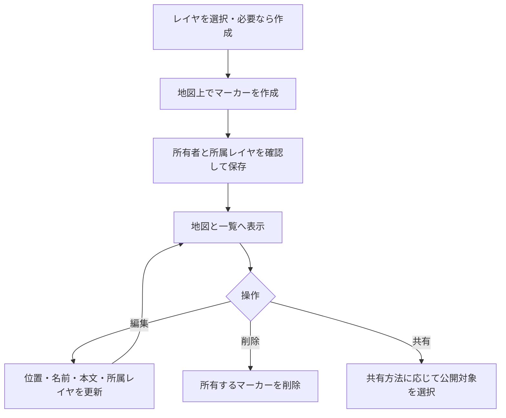

# レイヤとマーカーの利用・検証

レイヤでマーカーと図形をまとめ、マーカーに位置・名前・Markdown本文を保存する。データはユーザー単位で分離する。レイヤは地図画像を重ねる[重ね合わせタイル](TILE_OVERLAYS.md)とは別の機能。

## 現在の処理フロー

レイヤは`layer_model`、マーカーは`marker_info_model`に保存する。マーカーの`layer_id`で所属を管理し、更新時も所有者を確認する。

## 利用手順

1. 新規レイヤ作成で「レイヤ（グループ）」を選び、用途ごとのレイヤを作成する。
2. レイヤを選び、地図のマーカー作成操作から位置を登録する。
3. 一覧・詳細編集で名前と本文を入力し、必要に応じて位置と所属レイヤを変更する。
4. 本文にはMarkdownを使用する。画像・PDF・動画の参照文字列は[ファイル管理](FILE_MANAGEMENT.md)から取得する。
5. 不要なデータは削除する。レイヤ削除では所属するマーカーと図形もCASCADE削除となるため、対象を確認し、必要なデータは先に移動または[出力](DATA_IMPORT_EXPORT.md)する。

masterはアカウント作成時に生成される特別なレイヤで、削除できない。名前の更新も通常レイヤと異なり、masterの名前は維持する。PC・モバイルは同じAPIを使用し、編集結果を地図へ通知する。

## 共通フォームと本文の編集

レイヤ設定の「共通フォームを設定」から既存・新規対象へ適用できます。置換・解除・所属変更時の扱いは[共通フォーム](COMMON_FORMS.md)を参照してください。通常の本文欄では自由入力部分を編集し、フォーム由来の内容は[回答一覧から編集](FORM_ANSWERS.md)します。対象削除では編集済み・過去分を含む全回答も削除し、共通フォーム定義と画像ファイルは削除しません。

## 自由記述の制限

レイヤ設定の「内容やメモの自由記述を制限する」は初期状態でOFF。切り替えると、この項目だけを即時保存する。ON時は「マーカー内容・図形メモ作成の自由記述を制限しました。」、OFF時は「マーカー内容・図形メモの自由記述を許可しました。」と表示する。

- ONのレイヤでも、既存オブジェクトの名前・所属レイヤと、折れ線・ポリゴン・矩形の頂点追加・削除・移動を変更できる。本文・メモはコピー可能な読み取り専用とし、Markdown・ファイル挿入、マーカー位置・円の移動・スタイル変更を制限する。PostgreSQL版・SQLite版とも同じ制限と頂点編集の例外を適用する。
- 既存の本文や回答履歴を削除しない。内部・外部フォームの投稿は引き続き本文・メモへ追記できる。マーカー名だけの更新も可能で、本文の入力は必須ではない。
- 新規オブジェクトは本文・メモが空であれば作成できる。削除操作は従来どおり。masterの設定を他の所属レイヤへ一括適用しない。
- 所属変更時は変更前と変更先の両方を検査する。制限されたレイヤと同時に本文などを変更できない。移動だけを保存した後は、移動先の設定に従う。
- APIでも保存済みの値と比較して検証する。設定の切り替えとオブジェクト更新・フォーム投稿は同じ書き込み制御を使用する。

### 頂点だけの更新（PostgreSQL版・SQLite版）

所有者認証付き `PUT /shape/{shape_id}/geometry` に `base_shape_type`・`base_geometry`・`shape_type`・`coordinates` を送信する。形状の比較と更新を同一トランザクションで行い、他の形状変更があれば409で拒否する。フォーム投稿・回答編集・設定更新と同じ所有者ロックを用い、保存時点の最新GeoJSONの座標だけを差し替える。名前・所属レイヤ・本文・メモ・スタイル・回答との対応情報を保持し、更新後の図形を返す。フロント側も返却された最新のメモなどを反映する。

本文・スタイルなどを混ぜたリクエストは拒否する。図形種別の変更は矩形からポリゴンへの変換のみ許可し、最小頂点数・閉環・座標範囲を既存検証で確認する。円の移動にはこのAPIを使用しない。新しいマイグレーションやJSON移行形式の変更は不要。

## マーカーアイコン

レイヤ単位で所有アイコンを設定する。未設定時はLeaflet標準マーカーを表示する。

1. PNG・JPEG・GIF・WebPの画像をアップロードする。1ファイルは5MiB以下、ファイル名は1～100文字。
2. 所有アイコンの一覧・ファイル名検索から選び、レイヤに適用する。
3. 標準表示に戻す場合はアイコン設定を解除する。不要な所有アイコンは削除する。

サーバで実体を画像として読み込み、縦横比を保って縮小し、30×30pxの透明なキャンバス中央へ配置してPNGで保存する。保存先は`IMAGE_FILES_PATH`配下の`marker-icons`、情報は`marker_icon_model`。元のGIFアニメーションを保持する機能ではない。

レイヤ更新で`update_marker_icon=true`の場合にアイコン設定を変更し、`marker_icon_id=null`で解除する。他人のアイコンは設定できない。JSON出力にアイコン本体・参照は含まれない。

## API

所有データの操作はアカウント認証を必要とする。

| メソッド・パス | 用途 |
|---|---|
| GET `/layer/masterid` | masterのID |
| GET `/layer/read/all` | レイヤ一覧 |
| POST `/layer` | レイヤ作成 |
| PUT `/layer/update/{layer_id}` | レイヤ名・アイコン更新 |
| PUT `/layer/{layer_id}/input-policy` | 自由記述の制限を即時保存（`restrict_free_text: boolean`） |
| DELETE `/layer/delete/{layer_id}` | 通常レイヤ削除 |
| POST `/marker` | マーカー作成 |
| GET `/marker/read/all` | マーカー一覧 |
| PUT `/marker/update-marker-latlng` | 位置更新 |
| PUT `/marker/update/{marker_id}` | 名前・本文・所属更新 |
| DELETE `/marker/delete/{marker_id}` | マーカー削除 |
| GET `/marker-icons` | 所有アイコン一覧 |
| GET `/marker-icons/search` | アイコン検索 |
| POST `/marker-icons/upload` | アイコンアップロード |
| DELETE `/marker-icons/{icon_id}` | 所有アイコン削除 |
| GET `/static/marker-icons/{icon_name}` | 表示用アイコン配信 |

## 共有と削除の制約

通常の編集と、一時共有スナップショットの更新は別。元データを編集しても発行済みの一時共有へ自動反映しない。第三者から本文に追記してもらう場合は[公開入力フォーム](PUBLIC_FORMS.md)を使用する。

マーカー削除時は関連するフォーム設定・投稿履歴も削除対象となる。本文中のファイル参照と、アップロード済みファイル自体の管理は分かれている。削除後の参照先は共有画面を含めて確認する。

## 検証手順

- PC・モバイルで作成、位置移動、本文編集、所属変更を行い、再読み込み後も保存内容が一致することを確認する。
- masterの削除が拒否され、他ユーザーのレイヤ・マーカー・アイコンを変更できないことを確認する。
- 長い名前、Markdown、添付ファイルを地図ポップアップと一覧で確認する。
- 縦長・横長アイコンの表示、形式不正・容量超過、設定解除、使用中アイコンの削除後の表示を確認する。
- レイヤ削除の前後でマーカー・図形・公開フォームへの影響を確認する。

## 関連する実装

[レイヤ](../src/handler/layers.rs)、[マーカー](../src/handler/markers.rs)、[アイコンAPI](../src/handler/marker_icons.rs)、[アイコン画像処理](../src/image/marker_icon.rs)、[地図表示](MAP_VIEWING.md)。
