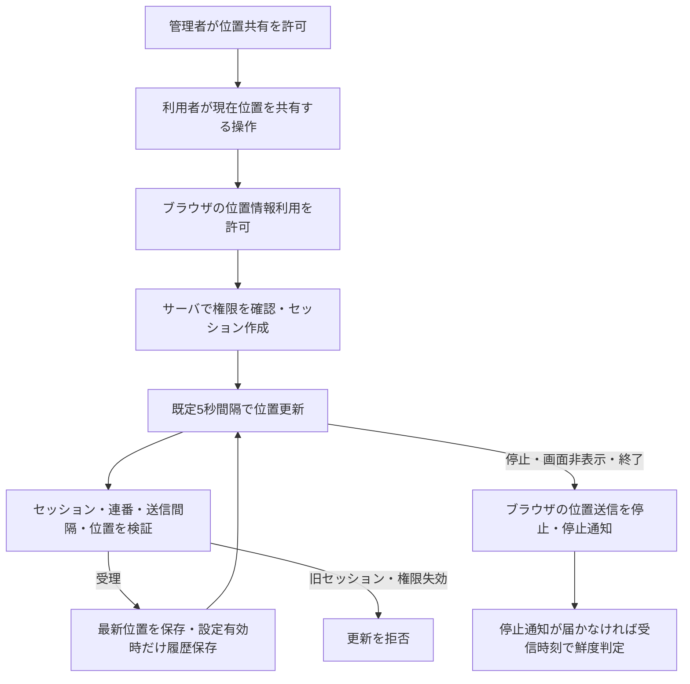
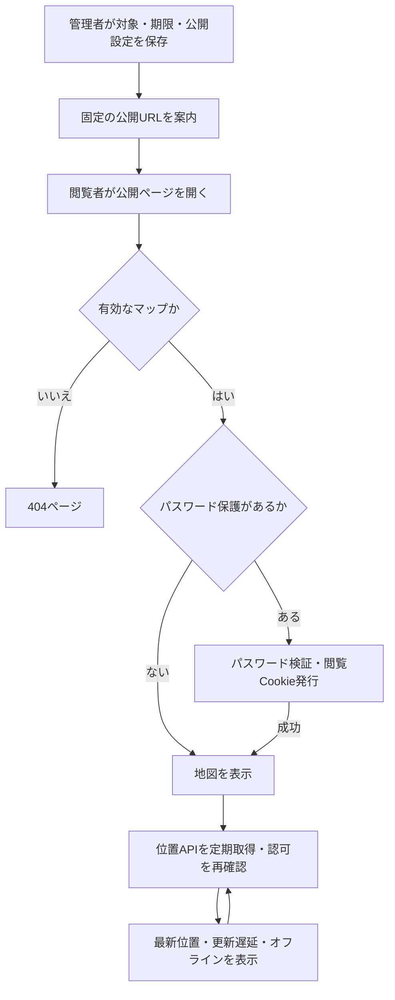

# 現在位置共有の導入・検証

許可されたアカウントが現在位置を送り、管理者が作成した公開マップで最新位置を表示する。公開マップはアプリケーション全体で未失効1件、登録対象は1～20アカウント。位置送信は利用者の明示操作で開始する。

## 現在の処理フロー

### 1. 位置共有の開始・更新・停止

1アカウントに最新位置を1件保持する。同じアカウントで別の共有を開始するとセッションIDを更新し、古いセッションからの更新を拒否する。更新は増加する連番と1秒以上の間隔を要求し、座標・精度・方位・速度・観測時刻を検証する。

ブラウザ版はページの非表示・終了で送信を停止する。Androidクライアントのサービスによる継続とは区別する。カメラ配信の開始条件・バックグラウンド継続・停止条件は[カメラ共有](CAMERA_SHARING.md)を参照する。

### 2. 公開マップの閲覧

## 必要な構成・サーバ設定

PostgreSQLの位置共有・公開マップ・履歴・公開レイヤ用の[マイグレーション](../migrations/)を適用する。ブラウザの位置取得にはHTTPSまたはlocalhostと位置情報権限が必要。Redisは公開位置の短時間キャッシュ用で任意。

| 設定 | 既定値・用途 |
|---|---|
| `LIVE_LOCATION_HISTORY_ENABLED` | `false`。受理した位置の履歴保存 |
| `LIVE_LOCATION_UPLOAD_INTERVAL_SECONDS` | `5`。位置送信の既定間隔 |
| `LIVE_LOCATION_STALE_SECONDS` | `20`。更新遅延の閾値 |
| `LIVE_LOCATION_OFFLINE_SECONDS` | `120`。オフラインの閾値 |
| `LIVE_MAP_SNAPSHOT_CACHE_SECONDS` | `2`。Redisの位置スナップショット保持秒数 |
| `LIVE_MAP_VIEWER_SESSION_MINUTES` | `720`。閲覧認証の上限時間・分 |
| `LIVE_MAP_PASSWORD_ATTEMPT_LIMIT` | `5`。パスワード試行上限 |
| `LIVE_MAP_PASSWORD_WINDOW_MINUTES` | `10`。試行制限の時間枠・分 |

変更後はサーバの全プロセスを再起動する。`LIVE_LOCATION_HISTORY_ENABLED`は`true`・`false`のみを受け付け、不正値では起動に失敗する。Redisは共通の`REDIS_URL`設定を使用し、`TILE_CACHE_TTL_SECONDS=0`の場合は位置スナップショットもキャッシュしない。

## 保存内容と履歴

最新位置は`live_location_session`へ保存する。履歴保存が有効な場合だけ、共有開始時と受理した更新を`live_location_history`へ同じDBトランザクションで追加する。履歴にはアカウント、セッション、連番、座標、精度・方位・速度、観測・受信時刻を保持する。

共有停止で最新セッションを削除しても、保存済み履歴は削除しない。履歴設定を`false`へ戻しても過去の行は残る。現行ルートに履歴専用の閲覧・出力APIはなく、自動の保存期限も設けていない。履歴を有効にする場合は保存容量と保管期間を運用で決める。ユーザー削除時は履歴もCASCADE削除となる。

## 管理者の利用手順

1. ユーザー管理で`can_share_live_location`を有効にする。
2. 位置共有マップで1～20アカウントを選び、マップ名、対象表示名、色、有効期限を入力する。
3. 必要なら共有パスワード、重ね合わせタイルの使用可否、公開するレイヤを設定する。
4. 作成・更新を保存し、管理画面に表示される固定URLをコピーする。
5. 公開を終える場合は失効する。URLを変更する場合は再発行する。

マップ名と対象表示名は1～100文字、色は`#RRGGBB`、有効期限は保存時点から30日以内。パスワードは前後の空白を除き、4文字以上かつ64バイト以内とする。bcryptハッシュだけを保存する。

### 公開レイヤとタイル

公開レイヤは「レイヤ（マーカー・図形）を追加」で操作中の管理者が所有する通常レイヤを選ぶ。masterは選択できない。モーダルの「選択を適用」は編集中の値へ反映するだけで、マップの作成・更新時にDBへ保存する。

`live_map_layer`に選択を保存し、`layers_configured_by`に設定者を記録する。別の管理者は自身のレイヤで上書きできるが、レイヤ設定に触れない更新では既存の選択を維持する。APIの`layer_ids`未指定・nullは維持、空配列は全解除。

公開レイヤのマーカー・図形はページ再読み込みで最新内容を取得する。位置の定期更新とは独立する。添付ファイルは既存の閲覧制御に従う。

タイルはマップ作成者`created_by`の最新の有効な登録を参照する。公開レイヤの設定者とは異なり、他の管理者が編集しても作成者は変わらない。`use_tile_overlays`の既定値はtrue。falseの場合はタイル情報もコントロールも渡さない。

使用が有効な場合、`is_check_overlay=true`でタイルを初期表示する。未指定・false・その他は初期非表示。URL設定はDB・ローカルストレージへ保存せず、共有アカウントのチェックには影響しない。

## 公開画面と停止・認可

背景地図、共有対象ごとの表示、対象名の一括表示、閲覧端末の現在位置への移動を使用できる。閲覧端末の位置はサーバへ送信しない。対象一覧の選択で最新位置へ移動し、非表示の対象も再表示してポップアップを開く。位置がない対象は選択できない。

既定では最終受信から20秒超で更新遅延、120秒超でオフラインとし、オフラインの座標は公開しない。公開位置APIは`Cache-Control: no-store`。短時間の内部キャッシュや通信周期があるため、停止や更新は瞬時の表示変更を保証しない。

モバイルは全画面地図と下部の横スワイプ式カードを表示する。幅700px以下の「地図だけを表示」はコントロールだけを隠し、位置更新、レイヤのチェック状態、カード操作を維持する。表示切替自体は永続保存しない。

パスワード認証後は署名済みHttpOnly Cookieを発行し、公開ページと位置APIの両方で検証する。有効期間は既定12時間とし、マップの期限を超えない。パスワード変更・解除、URL再発行、失効で認証世代を更新し、既存Cookieを無効にする。

パスワード試行制限は転送ヘッダー由来の接続元識別値とUser-Agentを使用する。前段プロキシで信頼できる転送ヘッダーを設定する。詳細なヘッダー処理と欠落時の扱いは[全体仕様](../SPECIFICATION.md)の現在位置共有APIに記載する。

## API

| メソッド・パス | 認証と用途 |
|---|---|
| POST `/live-location/session` | 許可された所有者。開始 |
| PUT / DELETE `/live-location/session/{session_id}` | 所有者。更新・停止 |
| POST `/live-location/session/{session_id}/stop` | 所有者。終了時の停止通知 |
| GET `/admin/live-locations` | 管理者。共有対象情報 |
| PUT `/admin/users/{user_id}/live-location-permission` | 管理者。共有許可変更 |
| GET / POST `/admin/live-maps` | 管理者。一覧・作成 |
| PUT / DELETE `/admin/live-maps/{map_id}` | 管理者。更新・失効 |
| POST `/admin/live-maps/{map_id}/rotate-url` | 管理者。URL再発行 |
| GET `/admin/live-map-layers` | 管理者。自身の公開候補レイヤ |
| GET `/live/{public_id}` | 公開ページ。必要なら閲覧認証 |
| POST `/live/{public_id}/authenticate` | 公開マップのパスワード認証 |
| GET `/live-api/maps/{public_id}/positions` | マップ閲覧認可。最新位置 |

## 導入・無効化と検証手順

1. 検証環境でDBマイグレーションを適用し、サーバとWebアセットを更新する。
2. 限定したアカウントへ共有を許可し、同意操作、位置情報権限、送信・停止を確認する。
3. 公開マップを作成し、PC・モバイルとログアウトしたブラウザで確認する。
4. 履歴が必要な場合だけ設定を有効にし、開始・受理更新の保存、拒否更新が保存されないことを確認する。

共有許可の取消しは送信セッションを削除する。マップ失効は公開を終了する操作で、各アカウントの位置送信の停止とは区別する。停止と履歴削除も別に扱う。

- 同一アカウントの別端末開始、古い連番、過密更新、不正座標、時刻ずれを確認する。
- 画面非表示、通信断、停止通知失敗、遅延・オフライン移行を確認する。
- パスワード試行制限、Cookie失効、期限切れ、URL再発行、メンバー削除を確認する。
- 公開レイヤの所有者切替、master拒否、全解除、タイル使用可否とURL初期設定を確認する。
- Redisあり・なしで公開位置が取得でき、公開マップから位置履歴を取得しないことを確認する。

## 関連する実装

[位置共有](../src/handler/live_location.rs)、[公開マップ](../src/handler/live_map.rs)、[公開レイヤ](../src/handler/live_map_layers.rs)、[履歴テーブル](../migrations/20260908120000_create_live_location_history.sql)、[既存結合テスト](../tests/live_location.rs)、[カメラ共有](CAMERA_SHARING.md)。
