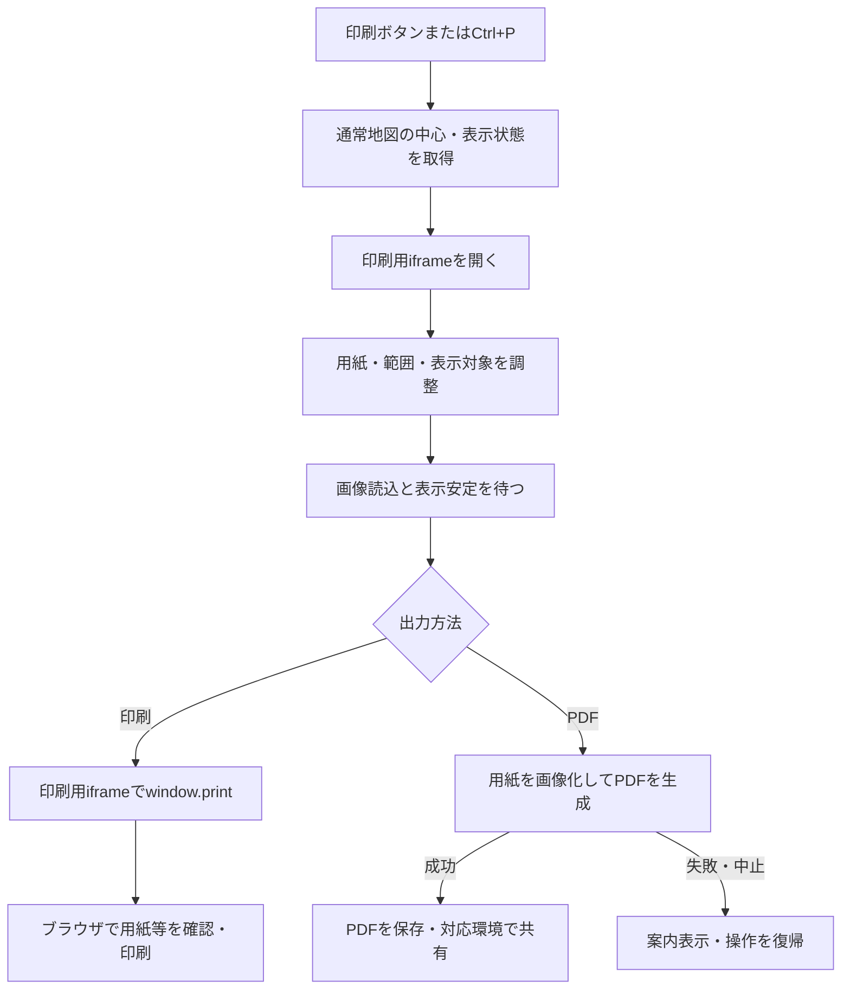

# 地図印刷・PDF出力の利用と検証

PC版のログイン後の地図から印刷プレビューを開き、用紙に合わせて範囲と表示内容を調整する。ブラウザ印刷と、ブラウザ内で生成する1ページPDFに対応する。モバイル版には専用の印刷UIを設けていない。

## 現在の処理フロー

印刷用地図は通常地図と別に生成する。プレビューの操作で通常地図の保存済み中心・表示設定を変更しない。

## 必要な構成

PCフロントエンドとtemplate-scriptsを通常のビルド工程で配布する。PDF用ライブラリは必要時に読み込み、関連アセットと`template-third-party-licenses.txt`を配布成果物へ含める。[フロントエンド全体構成](../src_frontend/SPECIFICATION.md)に従って統合する。

印刷専用のDB、サーバ設定、新しいAPIは使用しない。`GET /map-another?print=1`を既存のアカウント認証で取得し、ブラウザ側が`print=1`を判定して印刷用に初期化する。

## 利用手順

1. ツールバーの印刷ボタン、または`Ctrl+P`（Macは`Command+P`）でプレビューを開く。
2. 左側で用紙、任意のタイトル、背景地図、対象レイヤ、表示項目、重ね合わせタイルを指定する。
3. 右側の地図をドラッグ・拡大縮小し、出力範囲を調整する。必要なポップアップを開く。
4. 読み込み完了後、「印刷」または「PDF出力」を選ぶ。
5. 右上の「閉じる」または`Esc`で終了する。終了後は開く前のフォーカスへ戻る。

モーダル内の`Ctrl+P`は印刷を実行する。IME変換中、Shift・Alt併用、キー長押しの繰り返しは対象外。ブラウザのメニューによる印刷はアプリ内ショートカットと別の操作となる。

## 初期値と表示対象

| 項目 | 動作 |
|---|---|
| 用紙 | A4・A3・JIS B5の縦横。初期値A4横 |
| 寸法 | A4は210×297mm、A3は297×420mm、JIS B5は182×257mm。横向きは縦横を交換 |
| 余白 | 四辺10mm、1ページ |
| タイトル | 初期値空、最大40文字。前後空白を除きテキストとして表示 |
| 地図状態 | 通常地図の中心、ズーム、背景、タイル、マーカー・図形・図形名表示を引き継ぐ |
| レイヤ | 現在の選択。master表示時は全レイヤ |
| ポップアップ | 通常地図の開閉状態は引き継がず、プレビュー内で開く |

用紙・タイトルは永続保存しない。開き直すと初期値へ戻る。プレビュー内で開いたポップアップは見えている範囲を出力し、長文の全文を別ページへ分割しない。設定UI・ズームボタン・ポップアップの閉じるボタンは出力から除外する。

## 読み込み待ちとブラウザ印刷

地図移動中・画像読み込み中・表示変更直後は印刷できない。通常は最後の変更から700ms以上の安定を待つ。ポップアップ内の画像も対象とするが、閉じたdetails内の画像は対象外。

本文の段階表示がある場合、印刷・PDF出力は追加済みの内容を対象とする。「さらに読み込む」「続きを全て読み込む」の両ボタンは出力しない。未表示の文章・画像や閉じたdetails本文の自動読み込みは行わない。本文の残りも印刷する場合は、事前に対象本文の「続きを全て読み込む」で読み込みを完了させる。

画像取得失敗時は「再読み込み」と案内を表示する。読み込みが落ち着けば「現在の表示で印刷」を使用でき、待機が30秒を超えた場合も同様。ただし地図移動中は実行しない。この操作は未取得画像を補完しない。

初期化が15秒以内に終わらない場合は「再試行」でiframeと状態取得をやり直す。画像の「再読み込み」とは別の処理。

ブラウザの印刷画面で用紙・向きを合わせ、倍率100%、ヘッダー・フッターOFFを確認する。印刷中は操作を止め、完了・キャンセル後にプレビュー操作を再開する。

## PDF出力と制約

html2canvasで用紙領域を画像化し、jsPDFで1ページのPDFをブラウザ内に生成する。サーバでのPDF生成・外部画像中継は行わない。地図・日本語タイトル・ラベル・出典・表示中ポップアップを含める。

- 地図と文字は画像となり、PDF内の文字検索・選択には対応しない。出典のHTTP(S)リンクはPDFのリンクとして付ける。
- 解像度は150dpi相当を上限とし、さらに400万画素以内に制限する。
- 画像読み込み完了、失敗なし、表示安定を必要とする。外部画像は匿名CORSで再取得し、失敗すれば生成を中断する。通常表示やブラウザ印刷ができてもPDF化できない場合がある。
- 生成中は地図・設定の操作を止め、「生成を中止」を使用できる。中止は処理の区切りで反映する。
- 完成後に「PDFを保存」を押してダウンロードする。対応環境ではWeb Share APIの「共有」も使用できる。保存要求の実行は端末への保存完了を保証しない。
- プレビュー設定、ポップアップの開閉・切替、内部スクロール・詳細表示・画像状態の変化で生成済みPDFを無効化する。
- 終了時は生成を中止し、画像バッファとBlob URLを解放する。生成PDFをサーバへ保存しない。

## 画面間連携

親画面は通常地図から状態を取得し、印刷iframeの準備後に初期値を渡す。メッセージの送信元ウィンドウ・オリジン・要求IDを確認する。終了時はキー入力・通信のリスナーとタイマーを解除する。詳細は[地図スクリプト仕様](../src_frontend/template-scripts/SPECIFICATION.md)を参照する。

## 検証手順

- A4・A3・JIS B5の縦横で1ページ、10mm余白、タイトルと出典を確認する。
- master・通常レイヤ、マーカー・図形・タイルの切替と、プレビュー操作が通常地図へ保存されないことを確認する。
- ショートカット、閉じる、Esc、フォーカス復帰、初期化失敗と再試行を確認する。
- 画像遅延・失敗、30秒待機、「現在の表示で印刷」、再読み込み、印刷キャンセルを確認する。
- PDFの日本語、図形ラベル、ポップアップ、出典リンク、CORS失敗、中止、設定変更後の再生成を確認する。
- 実際に保存したPDFと利用するブラウザ・プリンターの印刷結果を確認する。画面上のプレビューだけを合格条件にしない。

## 関連する実装

[印刷プレビュー](../src_frontend/template-scripts/src/map/print/print-preview.ts)、[PDF生成](../src_frontend/template-scripts/src/map/print/pdf-export.ts)、[PDF操作](../src_frontend/template-scripts/src/map/print/pdf-controls.ts)、[PC UI仕様](../src_frontend/frontend/SPECIFICATION.md)、[地図表示](MAP_VIEWING.md)。

## 回答検索結果の地図を印刷する（PC版）

[回答一覧](FORM_ANSWERS.md)の条件を反映し、「地図で確認」を開きます。回答条件・対象名・レイヤで追加の絞り込みを反映し、「地図を印刷」を押してプレビューを確認してください。プレビューの印刷・PDF出力を利用できます。閉じると元の回答地図へ戻ります。

対象はその地図で絞り込んだ範囲です。位置・形状は現在の情報で、回答当時の地図ではありません。表示内容の切り替えは[地図表示](MAP_VIEWING.md#popup-content)を参照してください。「フォームからの回答」は一致回答だけでなく、その対象の全回答の修正後の内容を表示します。紙・PDFには選択した表示種別が記載されます。

モバイル版には回答地図の印刷・PDF出力と地図からのCSV出力はありません。一覧からのCSV出力は利用できます。

### 色分けした回答地図の凡例

回答地図で「地図で色分け」を実行してから印刷を開くと、反映済みの色分けを引き継ぎます。未反映の条件編集は使用しません。色分けを使用していない場合は、従来の印刷画面になります。

凡例には分類ごとの色・分類名を表示します。見出しの「凡例」をドラッグして配置を調整し、右下のハンドルをドラッグして枠の幅・高さを変更できます。左側の設定には次の項目が表示されます。

| 設定 | 動作 |
|---|---|
| 凡例を表示 | 凡例全体を表示・非表示。地図の表示は変更しません |
| 各分類のチェック | 対応する分類を凡例で表示・非表示 |
| 地図と連動 | 分類のチェック状態を、その分類に一致する地図オブジェクトすべてに適用 |
| 凡例の文字サイズ | 見出し・分類ラベルの両方を8〜32pxで変更。色見本も追従。初期値は12px |

初期値は凡例表示ON、各分類ON、地図連動OFFです。たとえば「耐用年数50年以上」のチェックを外すと、その分類を凡例から隠します。「地図と連動」がONなら、一致する地図オブジェクトもまとめて非表示にします。地図連動を解除すると、凡例の分類による地図の非表示を解除します。レイヤや名前検索などで除外された対象を復活させる操作ではありません。操作しても地図を再読み込みせず、元の回答地図へ影響しません。

凡例の表示・文字サイズ・枠サイズ・配置を変更すると、生成済みPDFは無効になるため作り直してください。凡例が枠に収まらない場合は案内を確認し、枠を広げるか、文字を小さくするか、不要な分類を非表示にしてください。凡例を用紙外へはみ出させることはできません。
