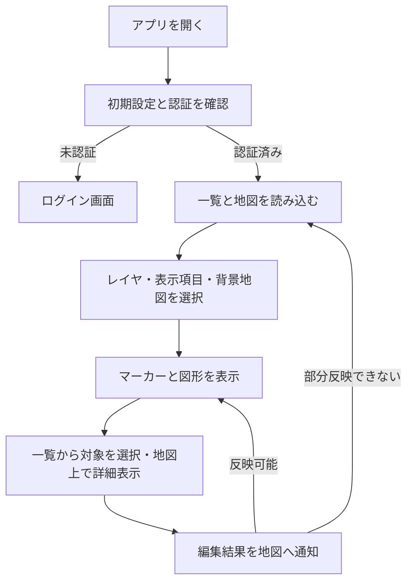

# 地図表示の利用・検証

ログインしたユーザーのマーカー・図形を地図上に表示する。通常地図は編集に使用し、別画面地図はレイヤを切り替えて閲覧する。PC・モバイルで同じ保存データを使用し、画面構成と操作方法を切り替える。

## 現在の処理フロー

PC・モバイルのVue画面は一覧と設定を担当し、地図本体は`/map`のiframeを使用する。別画面は`/map-another`。URLの綴りと内部テンプレート`map-anather.html`の綴りは異なる。

## 利用手順と表示

1. レイヤを選び、地図と一覧に表示する対象を決める。masterは全体を扱う特別なレイヤとして使用する。
2. 地図の背景を切り替える。マーカー、図形、図形名、現在位置、登録済み重ね合わせタイルの表示を必要に応じて切り替える。
3. 一覧または地図上から対象を選択し、名前・本文・メモを確認する。編集は[レイヤとマーカー](LAYERS_AND_MARKERS.md)、[図形と測定](SHAPES_AND_MEASUREMENT.md)を参照する。
4. 地図の現在位置コントロールを利用する場合はブラウザの位置情報利用を許可する。

閲覧端末の現在位置への移動と、サーバへ位置を送る[現在位置共有](LIVE_LOCATION_SHARING.md)は別の操作。位置への移動だけで共有セッションは開始しない。

マーカーは表示対象をクラスタに集約する。図形の名前と測定ラベルにはズームや件数に応じた表示制御があり、チェックが有効でも常に全ラベルが出るわけではない。

通常地図（PC・モバイル）、別画面地図、回答地図では、表示対象・重ね合わせタイルのコントロール内に「クラスタ」がある。初期状態はONで、ズーム15以上ではチェックを外して個々のマーカーを表示できる。15未満に縮小すると自動でONへ戻り、再度拡大してもONを維持する。チェック操作はマーカーの表示・非表示や検索条件を変更しない。

`is_cluster=false` が指定されている場合は、この指定を優先し、全ズームでクラスタを無効にする。この場合の「クラスタ」はOFF・操作不可。印刷プレビューには現在のクラスタ状態とこの固定設定を引き継ぐ。手動の切替状態は保存せず、通常の再読み込み時は初期状態に戻る。一時共有地図と現在位置共有地図には、この切替項目を追加しない。

## 保存される表示状態

地図の中心・ズーム、表示設定は地図スクリプトの保存処理で復元する。最後に選択したレイヤは`geocode-web:last-active-layer-id`に保存し、利用できなくなったレイヤはmasterへ戻す。PCの一覧開閉は`geocode-web:map-object-table-open`を使用する。

選択レイヤと一覧開閉のキーにアカウントIDは含まれない。重ね合わせタイルの表示状態はアカウント別に保存する。共有ページの初期表示は各共有機能のURL設定に従う。詳しい保存キーと画面間連携は[地図スクリプト仕様](../src_frontend/template-scripts/SPECIFICATION.md)を参照する。

## PC・モバイルの違い

| 機能 | PC | モバイル |
|---|---|---|
| 地図編集 | マウス向け操作 | タップ向け操作 |
| 地図の高さ | 画面設定に応じた高さ | 100vh |
| 印刷プレビュー | 対応 | 専用UIなし |
| JSON取り込み | 専用モーダルあり | 専用モーダルなし |
| 外部サイトURL設定 | 専用UIあり | 専用UIなし |

Service Workerの登録はあるが、オフライン地図の提供を意味しない。データ取得と背景地図の読み込みには通信が必要となる。

## API・外部サイト設定

| メソッド・パス | 認証と用途 |
|---|---|
| GET `/app-init` | 認証不要。アプリ名・UIの利用可否等 |
| GET `/map` | アカウント認証。編集地図 |
| GET `/map-another` | アカウント認証。別画面地図・印刷用地図 |
| GET `/external-site-url` | 自分の外部サイトURL。未設定時は既定URL |
| PUT `/external-site-url` | 自分の外部サイトURLを保存 |

外部サイトURLはHTTPまたはHTTPSで、最大2048文字。`external_site_urls`へユーザー単位で保存する。設定できることと、相手サイトが埋め込み表示を許可することは別であり、相手の表示制限によって読み込めない場合がある。

## 検証手順

- PC・モバイルで同じレイヤと保存データを表示し、編集後の一覧・地図の同期を確認する。
- 中心・ズーム・表示項目を変更して再読み込みし、復元と削除済みレイヤからの復帰を確認する。
- 位置情報の許可・拒否、背景地図の通信失敗時の表示を確認する。
- 別画面と共有画面で編集操作の有無とレイヤ表示を確認する。
- 外部サイトURLの保存、未設定、形式不正、相手サイトの埋め込み拒否を確認する。

## 関連する実装

[地図ハンドラー](../src/handler/map.rs)、[外部サイト](../src/handler/external_site.rs)、[地図共通処理](../src_frontend/template-scripts/src/map/common/)、[PC UI](../src_frontend/frontend/SPECIFICATION.md)、[モバイルUI](../src_frontend/frontend-mobile/SPECIFICATION.md)。

## 本文・メモの表示切り替え

所有者の通常地図・モバイル地図・別画面地図・回答確認用地図・回答地図の印刷プレビューでは、マーカーと図形の「表示内容」から「通常表示」「自由入力の内容」「フォームからの回答」を選べます。初期状態と開き直したときは、自由入力とフォーム回答を結合した「通常表示」です。

「フォームからの回答」は、その対象の全回答の修正後の内容を表示します。回答地図の検索に一致した回答だけには限定しません。安全に分離できない旧データや取得に失敗した場合などは、通常表示のみとなり、理由を案内します。表示切り替えは保存データ・分析条件を変更しません。共有・ライブ・一時共有マップは対象外です。

対象画面は `map.html`、`map-mobile.html`、`map-anather.html`、`form-answer-map.html`、`form-answer-map-print.html`。回答検索と地図への移動は[フォーム回答](FORM_ANSWERS.md)を参照してください。

ポップアップのタイトルと操作UIは常時表示し、本文はDOM量と文字量の上限に応じて先頭から段階表示します。画像・日付・見出し・文章・表・リストなどをまとめて対象とし、本文末尾の「さらに読み込む」を押すたびに続きを追加します。右隣の「続きを全て読み込む」は、同じ本文の残りを小分けに自動追加し、最後まで表示します。両ボタンは間隔を空けて配置し、狭い画面では折り返します。自動追加中は両ボタンを無効にし、読み込み中の状態を表示します。表示済みの内容は残し、残りがなくなると両ボタンを非表示にします。保存済みのMarkdownを修正する必要はありません。

未表示部分のHTMLやDOMは先に生成せず、必要な部分だけ安全化して追加します。画像も未表示のものは取得しません。参照形式のリンク・画像、装飾、表やリストの構造と順序を保ち、長い単一段落・表・リスト・コードも段階表示の対象とします。

`:::details 見出し` ～ `:::` とHTMLの `

見出し
…
` の折りたたみ本文は、初めて展開したときに段階表示を開始します。入れ子の節も、それぞれ展開するまで本文を生成しません。「続きを全て読み込む」の対象は押したボタンが属する本文で、detailsの開閉状態を維持し、入れ子の本文は独立して扱います。全件読み込み中にdetailsを閉じると一時停止し、再展開すると再開します。同じ節を閉じて再展開すると追加済みの内容を保ち、ポップアップを閉じるか表示内容を切り替えると自動追加を中止します。ポップアップを開き直すと先頭の表示量に戻ります。追加直後や画像読み込み完了後もスクロール位置を保ち、ボタンを押した位置から読み進められます。

未表示部分の日付や文章も、いずれかの読み込みボタンで追加するまでは表示されません。ブラウザのページ内検索は表示済み部分が対象です。地図のマーカー・図形検索は保存済みの本文を使うため、未表示部分も検索できます。表示内容の情報取得後に同じ本文を再描画しない動作も維持します。

大量本文の確認では、画像なしの長文、日付と画像の混在、巨大な段落・表・リスト、複数・入れ子の `:::details` を使用します。初期表示だけでなく、繰り返し読み込んだ後の追加操作・開閉・表示内容切り替え・画像プレビュー・印刷とスクロール保持も確認します。

本文量の予算と変更前後の計測結果は[ポップアップ本文の負荷計測](performance/POPUP_CONTENT.md)を参照してください。
