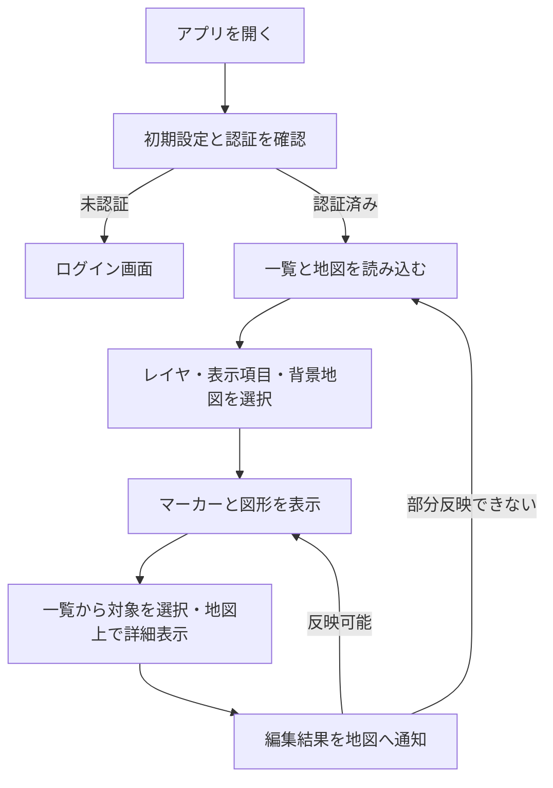
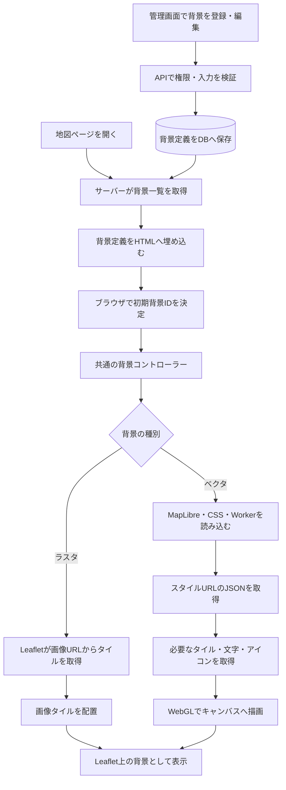
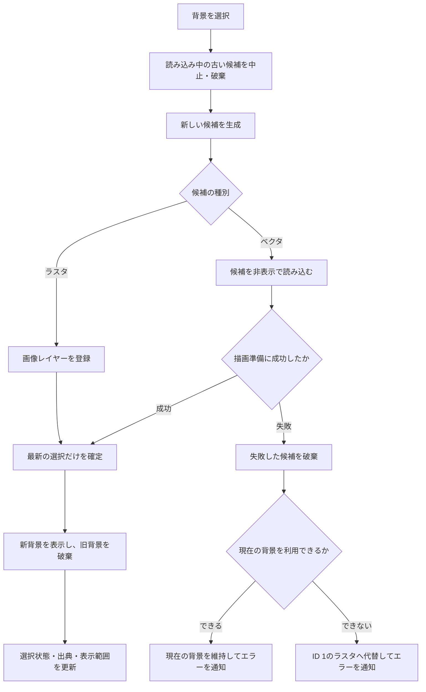

# 地図表示の利用・検証

ログインしたユーザーのマーカー・図形を地図上に表示する。通常地図は編集に使用し、別画面地図はレイヤを切り替えて閲覧する。PC・モバイルで同じ保存データを使用し、画面構成と操作方法を切り替える。

## 現在の処理フロー

PC・モバイルのVue画面は一覧と設定を担当し、地図本体は`/map`のiframeを使用する。別画面は`/map-another`。URLの綴りと内部テンプレート`map-anather.html`の綴りは異なる。

## 背景地図の取得・描画

通常・モバイル・別画面・共有・回答・ライブ地図は、共通の背景生成・切替処理を使用する。背景定義の `kind` が `raster` なら画像タイル、`vector` なら `style_url` のスタイルに従って描画する。種別を持たない旧定義はラスタとして読む。

管理画面では、次の設定を保存する。

| 設定画面 | 保存先 | 内容 |
|---|---|---|
| 背景地図設定 | `tileserver_model` | 背景ごとの表示名・識別名・種別・画像URL・スタイルURL・出典・ズーム範囲・海外表示 |
| タイルサーバ設定 | `tile_server_settings` | ラスタの中継先・暗号化したAPIキー・ベクタ配信元の接続許可 |

現在のDBから背景一覧を取得するページは、次の順に初期表示する。背景定義は地図HTML内のbootstrapデータの `tileServers` へ埋め込む。

初期背景IDは、画面に応じてローカルストレージの選択、共有・印刷から引き継いだ表示状態、既定のID `1` から決まる。初期選択がベクタの場合はID `1` のラスタを暫定表示し、ベクタの描画準備が整ってから置き換える。表示中のマーカー・図形もLeaflet上で扱う。

描画時の取得経路は、登録されたURLによって変わる。

| 対象 | 取得経路 |
|---|---|
| ラスタの `/tile/{z}/{x}/{y}.png` | ブラウザ → GeoCode-Webの中継API → Redisキャッシュ確認 → キャッシュがなければ上流から取得 → PNGを返却 |
| 外部URLのラスタ | ブラウザ → 指定された画像配信元 |
| ベクタ | ブラウザのMapLibre → スタイルJSON → その定義が参照するTileJSON・タイル・glyph（文字）・sprite（アイコン）等の配信元 |

ラスタ中継の上流は管理画面の適用済み設定を使用し、管理設定を適用していない場合は実行時設定JSONから読み込んだ値を使用する。中継設定の変更時には描画用URLへ設定の版を付け、キャッシュを切り替える。処理図と設定方法は[タイル配信プロキシ](TILE_PROXY.md)を参照する。

ベクタの配信元許可は、地図ページのCSP応答ヘッダーへ反映する。ブラウザが外部資材を取得する際はCSPと配信元側のCORSに従う。スタイルJSON内にラスタソースが含まれる場合は、その画像もMapLibreが取得する。設定変更後に地図を開き直すと、新しい背景定義と接続許可を使用する。[管理画面からの設定](TILE_PROXY.md#管理画面からの設定)

ベクタ行にも、DB・API・共有データの共通項目として画像URL `url` を保持する。ベクタの描画には `style_url` を使用し、障害時の代替表示にはID `1` のラスタ背景定義を使用する。管理画面・API・DBの制約でID `1` をラスタとして確保する。[管理画面での登録](ADMINISTRATION.md#背景地図とタイルサーバの設定)

### 背景切替と失敗時の処理

利用者が背景を選ぶと、現在の背景を表示したまま次の候補を生成する。ラスタはレイヤー登録時、ベクタは描画準備の完了時に切替を確定する。

連続切替では古い候補の読み込みを中止し、世代番号を確認して最後の選択だけを反映する。利用者による選択が確定したときだけ、保存を有効にしている画面の選択IDを更新する。一時的な障害による代替表示では保存済みの選択を上書きしない。

ベクタ候補の初回取得・描画待ちは30秒で打ち切る。初期ベクタの失敗時は暫定表示していたID `1` のラスタを通常のズーム・表示範囲の設定へ戻す。表示中のベクタに読み込みエラーやWebGLコンテキスト喪失が起きた場合、または表示ズーム範囲から外れた場合も、切替中の候補の状態を考慮してID `1` へ代替する。ラスタは画像を順次取得し、一部タイルの欠損を従来の部分表示として扱う。

### 共有・印刷への引き継ぎ

表示状態を保存した共有URLは、共有データ内の背景定義と選択IDを復元する。表示状態を保存していない従来の共有URLは、現在のDBから背景一覧を取得する。共有形式は保存対象の背景一覧全体で判定し、すべてラスタならv1、ベクタを1件でも含む場合はv2となる。URLなどの背景定義を保存し、スタイルJSON・タイル・文字・アイコンの実体は閲覧時に取得する。[共有形式と復元](TEMPORARY_SHARING.md#背景定義と共有形式の互換性)

共有・印刷の開始時に背景切替中であれば確定を待ち、確定済みの背景IDを使用する。印刷用地図へ表示状態を引き継ぎ、共有・読取専用地図では、その地図が保持している背景定義も渡す。ベクタのキャンバスは、ブラウザ印刷時に一時的な画像へ置換して終了後に復元し、PDF出力では用紙全体の画像化へ組み込む。読み込み待ち・失敗時の出力条件は[地図印刷・PDF出力](MAP_PRINTING.md#読み込み待ちとブラウザ印刷)を参照する。

実装は[背景定義の取得](../src/db/tiles.rs)、[定義の正規化](../src_frontend/template-scripts/src/map/common/basemap-definition.ts)、[背景コントローラー](../src_frontend/template-scripts/src/map/common/basemap-controller.ts)、[レイヤー生成](../src_frontend/template-scripts/src/map/common/basemap-layer.ts)、[MapLibre描画](../src_frontend/template-scripts/src/map/common/maplibre-basemap.ts)を参照する。

## 利用手順と表示

1. レイヤを選び、地図と一覧に表示する対象を決める。masterは全体を扱う特別なレイヤとして使用する。
2. 地図の背景を切り替える。マーカー、図形、図形名、現在位置、登録済み重ね合わせタイルの表示を必要に応じて切り替える。
3. 一覧または地図上から対象を選択し、名前・本文・メモを確認する。編集は[レイヤとマーカー](LAYERS_AND_MARKERS.md)、[図形と測定](SHAPES_AND_MEASUREMENT.md)を参照する。
4. 地図の現在位置コントロールを利用する場合はブラウザの位置情報利用を許可する。

PCアプリ内の全画面地図には「現在の地図を共有する」がある。絞り込み・名前／本文検索・グループ選択・マーカー／図形表示を満たす保持済みデータと、色分け・中心・ズーム・背景・タイル等の状態を押下時に固定する。画面外も含め、除外対象は共有データに含めない。通常共有と同じ1URL枠を使用する。操作・SQLiteの移行・制約は[一時共有URL](TEMPORARY_SHARING.md)を参照する。

PCの全画面地図と一時共有地図では、「地図を印刷」からプレビューを開き、印刷・PDF出力できる。開く時点の表示条件に合う地物と、中心・ズーム・背景・タイル・色分けを引き継ぐ。共有地図で出力できる地物は、共有時に保存した範囲に限る。[地図印刷・PDF出力](MAP_PRINTING.md#pc全画面地図一時共有地図を印刷する)

閲覧端末の現在位置への移動と、サーバへ位置を送る[現在位置共有](LIVE_LOCATION_SHARING.md)は別の操作。位置への移動だけで共有セッションは開始しない。

マーカーは表示対象をクラスタに集約する。図形の名前と測定ラベルにはズームや件数に応じた表示制御があり、チェックが有効でも常に全ラベルが出るわけではない。

通常地図（PC・モバイル）、別画面地図、回答地図では、表示対象・重ね合わせタイルのコントロール内に「クラスタ」がある。初期状態はONで、管理画面の「地図表示設定」で指定した最小ズーム以上ではチェックを外して個々のマーカーを表示できる。未設定時の下限は15。管理者が保存した値は地図の再読み込み時に反映する。下限未満に縮小すると自動でONへ戻り、再度拡大してもONを維持する。チェック操作はマーカーの表示・非表示や検索条件を変更しない。

`is_cluster=false` が指定されている場合は、この指定を優先し、全ズームでクラスタを無効にする。この場合の「クラスタ」はOFF・操作不可。印刷プレビューと全画面地図からのスナップショット共有には現在のクラスタ状態とこの固定設定を引き継ぐ。印刷プレビューでは表示元の下限を使い、共有先では閲覧時の管理設定を使う。手動の切替状態は通常の再読み込み時は初期状態に戻る。通常方式の一時共有地図と現在位置共有地図には、この切替項目を追加しない。

## 色分けの凡例

PCの全画面地図とPC・モバイルの共有地図では、現在の表示対象に使われている分類の色と名前を「凡例」に表示する。凡例は絞り込み、文字列検索、レイヤグループ、マーカー・図形の表示切替に追従する。画面外や未描画でも、表示条件を満たす対象は判定に含める。色分けを解除した場合や該当分類が0件の場合は、凡例を隠す。モバイルの共有地図では、操作UIが隠れていても凡例の表示条件を満たせば表示する。

見出しをドラッグすると移動し、右下のハンドルをドラッグすると幅と高さを調整できる。マウス・タッチで操作できる。位置とサイズの調整は開いている地図内で有効で、共有地図を開くと標準の位置とサイズから調整できる。共有対象の詳細は[一時共有URL](TEMPORARY_SHARING.md)を参照する。

## 保存される表示状態

地図の中心・ズーム、表示設定は地図スクリプトの保存処理で復元する。最後に選択したレイヤは`geocode-web:last-active-layer-id`に保存し、利用できなくなったレイヤはmasterへ戻す。PCの一覧開閉は`geocode-web:map-object-table-open`を使用する。

選択レイヤと一覧開閉のキーにアカウントIDは含まれない。重ね合わせタイルの表示状態はアカウント別に保存する。通常の一時共有はURLの初期表示指定、全画面地図の共有は保存済み状態を使用し、後者は閲覧端末の保存設定で置き換えない。詳しい保存キーと画面間連携は[地図スクリプト仕様](../src_frontend/template-scripts/SPECIFICATION.md)を参照する。

## PC・モバイルの違い

| 機能 | PC | モバイル |
|---|---|---|
| 地図編集 | マウス向け操作 | タップ向け操作 |
| 地図の高さ | 画面設定に応じた高さ | 100vh |
| 印刷・PDF出力 | 通常・全画面・回答・一時共有地図で対応 | 専用UIなし |
| 全画面地図のスナップショット共有 | 作成・閲覧 | 閲覧のみ（通常共有の作成は従来どおり） |
| JSON取り込み | 専用モーダルあり | 専用モーダルなし |
| 外部サイトURL設定 | 専用UIあり | 専用UIなし |

Service Workerの登録はあるが、オフライン地図の提供を意味しない。データ取得と背景地図の読み込みには通信が必要となる。

## API・外部サイト設定

| メソッド・パス | 認証と用途 |
|---|---|
| GET `/app-init` | 認証不要。アプリ名・UIの利用可否等 |
| GET `/map` | アカウント認証。編集地図 |
| GET `/map-another` | アカウント認証。別画面地図・印刷用地図 |
| GET `/external-site-url` | 自分の外部サイトURL。未設定時は既定URL |
| PUT `/external-site-url` | 自分の外部サイトURLを保存 |

外部サイトURLはHTTPまたはHTTPSで、最大2048文字。`external_site_urls`へユーザー単位で保存する。設定できることと、相手サイトが埋め込み表示を許可することは別であり、相手の表示制限によって読み込めない場合がある。

## 検証手順

- PC・モバイルで同じレイヤと保存データを表示し、編集後の一覧・地図の同期を確認する。
- 中心・ズーム・表示項目を変更して再読み込みし、復元と削除済みレイヤからの復帰を確認する。
- 位置情報の許可・拒否、背景地図の通信失敗時の表示を確認する。
- 別画面と共有画面で編集操作の有無とレイヤ表示を確認する。
- PCの全画面地図と共有地図で印刷プレビューを開き、表示条件と色分けが引き継がれることを確認する。
- 色分けの適用・解除、検索や表示切替で凡例に出る分類を確認する。マウス・タッチでの移動とサイズ調整、画面縮小時に枠が地図内に収まることも確認する。
- 外部サイトURLの保存、未設定、形式不正、相手サイトの埋め込み拒否を確認する。

## 関連する実装

[地図ハンドラー](../src/handler/map.rs)、[外部サイト](../src/handler/external_site.rs)、[地図共通処理](../src_frontend/template-scripts/src/map/common/)、[PC UI](../src_frontend/frontend/SPECIFICATION.md)、[モバイルUI](../src_frontend/frontend-mobile/SPECIFICATION.md)。

## 本文・メモの表示切り替え

所有者の通常地図・モバイル地図・別画面地図・回答確認用地図・回答地図の印刷プレビューでは、マーカーと図形の「表示内容」から「通常表示」「自由入力の内容」「フォームからの回答」を選べます。初期状態と開き直したときは、自由入力とフォーム回答を結合した「通常表示」です。

「フォームからの回答」は、その対象の全回答の修正後の内容を表示します。回答地図の検索に一致した回答だけには限定しません。安全に分離できない旧データや取得に失敗した場合などは、通常表示のみとなり、理由を案内します。表示切り替えは保存データ・分析条件を変更しません。共有・ライブ・一時共有マップは対象外です。

対象画面は `map.html`、`map-mobile.html`、`map-anather.html`、`form-answer-map.html`、`form-answer-map-print.html`。回答検索と地図への移動は[フォーム回答](FORM_ANSWERS.md)を参照してください。

ポップアップのタイトルと操作UIは常時表示し、本文はDOM量と文字量の上限に応じて先頭から段階表示します。画像・日付・見出し・文章・表・リストなどをまとめて対象とし、本文末尾の「さらに読み込む」を押すたびに続きを追加します。右隣の「続きを全て読み込む」は、同じ本文の残りを小分けに自動追加し、最後まで表示します。両ボタンは間隔を空けて配置し、狭い画面では折り返します。自動追加中は両ボタンを無効にし、読み込み中の状態を表示します。表示済みの内容は残し、残りがなくなると両ボタンを非表示にします。保存済みのMarkdownを修正する必要はありません。

未表示部分のHTMLやDOMは先に生成せず、必要な部分だけ安全化して追加します。画像も未表示のものは取得しません。参照形式のリンク・画像、装飾、表やリストの構造と順序を保ち、長い単一段落・表・リスト・コードも段階表示の対象とします。

`:::details 見出し` ～ `:::` とHTMLの `

見出し
…
` の折りたたみ本文は、初めて展開したときに段階表示を開始します。入れ子の節も、それぞれ展開するまで本文を生成しません。「続きを全て読み込む」の対象は押したボタンが属する本文で、detailsの開閉状態を維持し、入れ子の本文は独立して扱います。全件読み込み中にdetailsを閉じると一時停止し、再展開すると再開します。同じ節を閉じて再展開すると追加済みの内容を保ち、ポップアップを閉じるか表示内容を切り替えると自動追加を中止します。ポップアップを開き直すと先頭の表示量に戻ります。追加直後や画像読み込み完了後もスクロール位置を保ち、ボタンを押した位置から読み進められます。

未表示部分の日付や文章も、いずれかの読み込みボタンで追加するまでは表示されません。ブラウザのページ内検索は表示済み部分が対象です。地図のマーカー・図形検索は保存済みの本文を使うため、未表示部分も検索できます。表示内容の情報取得後に同じ本文を再描画しない動作も維持します。

大量本文の確認では、画像なしの長文、日付と画像の混在、巨大な段落・表・リスト、複数・入れ子の `:::details` を使用します。初期表示だけでなく、繰り返し読み込んだ後の追加操作・開閉・表示内容切り替え・画像プレビュー・印刷とスクロール保持も確認します。

本文量の予算と変更前後の計測結果は[ポップアップ本文の負荷計測](performance/POPUP_CONTENT.md)を参照してください。
