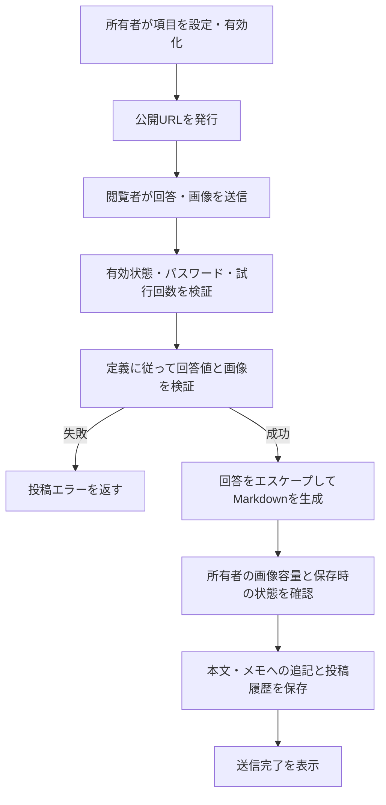

# 公開入力フォームの利用・検証

マーカーと図形に第三者向けの入力フォームを設け、回答を本文またはメモの末尾へ追記する。初期状態は無効。所有者が有効化し、ランダムIDの公開URLを発行する。任意のパスワードで投稿を保護できる。

## 現在の処理フロー



投稿APIは既存本文・名前・位置の更新を受け付けず、検証した回答からサーバが生成したMarkdownだけを追記する。画像処理・回答検証はマーカーと図形で共通。

## 必要な構成・設定

公開フォーム用の[マイグレーション](../migrations/)を適用し、画像の保存領域を準備する。マーカー用設定・履歴は`marker_form_config_model`・`marker_form_submission_model`、図形用は`shape_form_config_model`・`shape_form_submission_model`を使用する。画像の容量管理には`marker_form_image_model`を使用する。

```dotenv
MARKER_FORM_STORAGE_QUOTA_BYTES=1073741824
```

既定の画像容量は所有者あたり1GiB。マーカー・図形のフォームで共通管理する。設定変更はサーバを再起動して反映する。実体の保存先は[ファイル管理](FILE_MANAGEMENT.md)と共通。

## 利用手順

1. マーカーまたは図形の編集画面から「入力フォーム」を開く。
2. フォーム名、説明、項目名、型、必須指定、文字数、選択肢を設定する。
3. 必要に応じてパスワードを設定し、フォームを有効にする。
4. 公開URLを開き、回答と任意の画像を送信する。
5. 所有者の画面を更新し、マーカー本文または図形メモへの追記を確認する。

対応型は1行テキスト、複数行テキスト、数値、日付、セレクト、ラジオ、チェックボックス、画像。任意HTMLを入力型として使用しない。設定の`password_mode`は`keep`（空も同じ）で維持、`set`で設定、`clear`で解除する。パスワードは前後空白を除いて4～64文字を検証し、bcryptハッシュで保存する。

URL再発行は旧URLを無効化する。利用終了時はフォームを無効にする。対象マーカー・図形を削除すると関連設定・投稿履歴も削除する。図形の「元に戻す」で元のフォーム履歴は復元されない。

## 画像と投稿の制限

| 項目 | 制限 |
|---|---|
| 項目数 | 最大20 |
| 画像項目 | 最大3 |
| 投稿要求全体 | 6MiB以下 |
| 回答JSON部分 | 64KiB以下 |
| 画像1件 | 1500000バイト以下 |
| サーバが受け付ける画像寸法 | 最大4096px |
| 保存画像の長辺 | 最大1600px |
| 保存サムネイル | 300000バイト以下 |
| フォーム単位の試行回数 | 毎分30件 |
| 図形メモ | 追記後も10000文字以内 |

ブラウザで最大1600pxのJPEG Blobへ縮小し、回答JSONと画像をmultipartで送る。サーバでも実体を検証してJPEGへ再エンコードする。本文には画像バイナリを保存せずURLを記載する。

パスワード誤り、必須不足、選択肢不一致、上限超過、容量不足は投稿失敗となる。投稿保存時も有効状態を確認する。DB処理失敗時には準備した画像の清掃を試みる。

## 所有者による既存回答の編集（PostgreSQL版）

回答一覧の「編集」と回答詳細の「回答を編集」から、投稿時の定義で修正する。回答ID・投稿日時・適用元・投稿時の定義は維持し、分析用の回答値と本文・図形メモを同じトランザクションで更新する。編集日時と版番号を記録する。回答件数は増えず、過去回答の編集で最新回答の順序も変わらない。回答履歴には修正後の値を表示する。

本文・図形メモは自由記述と回答由来の部分を分け、回答由来部分は回答IDで管理する。通常の編集欄では自由記述のみを編集する。自由記述を変更しない保存では、既存の文章配置を維持する。自由記述を変更する場合は最初の自由記述位置にまとめ、各回答の文章を保持する。自由記述制限ONでも回答編集は許可する。

旧データは保存済みMarkdownの出現箇所が一意なら自動で対応付ける。重複・直接編集などで曖昧な場合は、編集フォームに元の本文と回答部分を表示し、所有者が残す自由記述を確認してから投稿順で再構成する。投稿時の定義がない回答は閲覧のみ。

編集の競合時は409を返し、画面の入力を保持して再読み込みを案内する。画像は保持・差し替え・回答からの削除を指定でき、ファイル本体を自動削除しない。画像準備・DB更新に失敗した場合は、新しい画像を清掃し、回答と本文の更新を取り消す。図形メモは編集後も10000文字以内とする。

SQLite版の編集API・DB項目は次段階。共通UIソースだけを同期し、APIが回答編集に対応したと通知するまで編集操作を表示しない。

### 所有者地図のポップアップ表示切り替え（PostgreSQL版）

`map.html`・`map-mobile.html`・`map-anather.html`・`form-answer-map.html`・`form-answer-map-print.html` のマーカー／図形に「表示内容」を設ける。「通常表示」を初期選択とし、自由入力の内容、フォームからの回答へ切り替えられる。開き直すと通常表示に戻る。保存内容や分析条件は変更しない。共有・ライブ・一時共有マップには適用しない。

フォームからの回答は、その対象に保存されている全回答の修正後の文章を投稿順に表示する。回答地図の絞り込みや分析に採用された1件だけには限定せず、分析値・使用した回答の情報は本文と別枠で維持する。本文が空の場合は内容がない旨を表示する。

旧データは安全に対応付けできる場合だけ分離する。対応が曖昧な場合、取得失敗、地図の本文と取得時の本文が異なる場合は通常表示を維持し、理由を表示する。表示用の読み取りでDBの本文や対応情報は更新しない。回答地図は同じ読み取りトランザクション内で分離情報を確定し、印刷には対象を限定したスナップショットを渡す。印刷側で本文を追加取得しない。既存の32MiB上限を維持し、紙・PDFでは選択欄を隠して表示種別を文字で示す。新しいマイグレーションは不要。SQLite版への機能反映は別段階とする。

## API

| メソッド・パス | 認証と用途 |
|---|---|
| GET / PUT `/form-answers/{kind}/{answer_id}` | 所有者認証。既存回答の取得・更新（`kind`: marker / shape） |
| GET `/marker/{marker_id}/form/body` / `/shape/{shape_id}/form/body` | 所有者認証。自由記述と回答由来部分の取得 |
| GET / PUT `/marker/{marker_id}/form` | 所有者認証。マーカーフォーム設定 |
| POST `/marker/{marker_id}/form/rotate-url` | 所有者認証。URL再発行 |
| GET / PUT `/shape/{shape_id}/form` | 所有者認証。図形フォーム設定 |
| POST `/shape/{shape_id}/form/rotate-url` | 所有者認証。URL再発行 |
| GET / POST `/forms/{public_id}` | 公開マーカーフォームの表示・投稿 |
| GET / POST `/shape-forms/{public_id}` | 公開図形フォームの表示・投稿 |

マーカーは`detail`、図形は`geojson.properties.memo`へ追記し、投稿値と生成Markdownを履歴に保存する。履歴をDBへ保存することと、履歴専用の閲覧・出力UIがあることは区別する。回答文字列はMarkdown記号をエスケープする。

## 検証手順

- マーカー・図形の両方で各入力型、必須、文字数、選択肢を確認する。
- Markdown記号やHTMLを含む回答が意図しない本文構造にならないことを確認する。
- 画像縮小、実体不正、容量・寸法超過、所有者容量超過、連続投稿制限を確認する。
- 無効化、URL再発行、パスワード変更、対象削除後の投稿拒否を確認する。
- 既存本文と同時投稿が失われないこと、図形メモ10000文字超過時に追記されないことを確認する。
- 匿名閲覧時の投稿画像には所有者のプライバシー設定が適用されることを確認する。

## 関連する実装

[フォームハンドラー](../src/handler/marker_forms.rs)、[データ型](../src/model/marker_form.rs)、[公開フォーム画面](../src/templates/marker-form.html)、[ブラウザ処理](../src_frontend/template-scripts/src/marker-form/)、[既存結合テスト](../tests/marker_forms.rs)。
