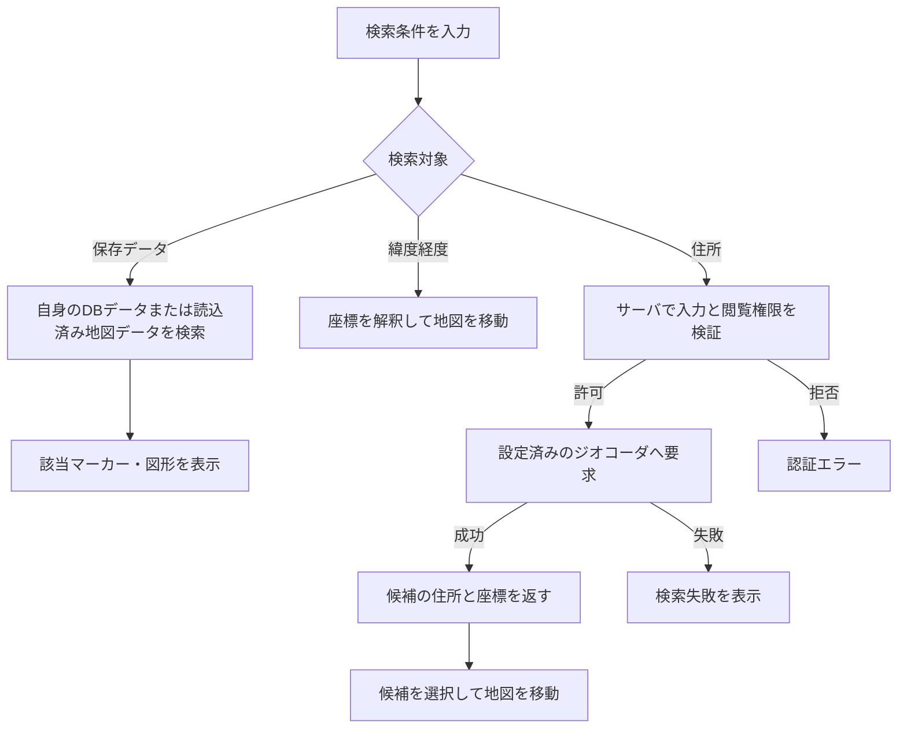

# 検索とジオコーディングの利用・検証

保存済みのマーカー・図形を検索し、住所または緯度経度から地図を移動する。保存データの検索と、外部サービスを使用する住所検索は別の処理となる。

## 現在の処理フロー



検索結果への移動はデータの新規登録ではない。位置を保存する場合は別途マーカーを作成する。

## 利用手順と対象

一覧の統合検索では、マーカー名・本文と図形名・メモを対象とする。サーバはマーカーと図形IDを返し、画面が一覧・地図の表示へ反映する。地図側の読込済みマーカー検索では座標も検索文字列に含める。検索解除後はレイヤと表示設定に従った表示へ戻す。

住所・緯度経度検索は地図の検索コントロールから行う。座標は`35.681236,139.767125`のように緯度・経度の順でカンマ区切りにする。住所に候補が複数ある場合は目的の候補を選ぶ。共有ページのオブジェクト検索は、そのページへ渡された公開データを対象とし、所有者の全データを検索するものではない。

## サーバ設定

```dotenv
GEOCODER_PROVIDER=csis
```

| 設定 | 動作 |
|---|---|
| `GEOCODER_PROVIDER` | `csis`・`gsi`・`abr`。未設定・空は`csis` |
| `GEOCODER_URL` | 接続先。`csis`・`gsi`は未設定時に実装内の既定URL、`abr`は必須 |
| `GEOCODER_API_KEY` | 任意。サーバから上流へ`X-API-Key`として送る |

URLは資格情報とフラグメントを含まない絶対HTTP(S) URLとする。不正な設定では起動時にエラーとなる。設定変更後はサーバの全プロセスを再起動する。キーはサーバだけに保持し、WebアセットやGitへ含めない。

上流通信は10秒で打ち切り、リダイレクトを追跡しない。応答本文の上限は1MiB。設定した1つのサービスを使用し、失敗時に別サービスへ自動切り替えしない。

## APIと認可

| メソッド・パス | 認証と用途 |
|---|---|
| GET `/map-objects/read/query` | アカウント認証。統合検索、`markers`と`shape_ids`を返す |
| GET `/marker/read/query` | アカウント認証。マーカー検索 |
| POST `/geocode` | アカウント認証または一時共有ページの検索トークン。住所検索 |

`/geocode`の本文は`address`と任意の`share_token`。住所は前後の空白を除いて1～100文字。応答は`results`内に`address`、`latitude`、`longitude`を返し、`Cache-Control: no-store`とする。

一時共有用トークンは既存の共有閲覧認可後に発行する。共有ID・期限・パスワードハッシュ由来の版を検証し、停止・期限切れ・パスワード変更後は使用できない。認証不要ルートに配置されているが、無制限の匿名住所検索APIではない。ライブマップ用の閲覧CookieだけでこのAPIを使用できるとは扱わない。

## 検証手順

- 名前・本文・メモ、該当なし、空検索、検索解除、レイヤ切替との組み合わせを確認する。
- 住所候補の選択と緯度経度での移動が保存データを増やさないことを確認する。
- 各providerの正常応答、上流エラー、タイムアウト、不正応答を確認する。
- 未認証、正常な一時共有トークン、失効済みトークンで認可を確認する。
- ブラウザの要求や配布アセットに上流APIキーが含まれないことを確認する。

## 関連する実装

[統合検索](../src/handler/map.rs)、[住所検索API](../src/handler/geocoding.rs)、[provider設定と応答処理](../src/geocoding/)、[地図検索](../src_frontend/template-scripts/src/map/common/search.ts)、[一時共有](TEMPORARY_SHARING.md)。
