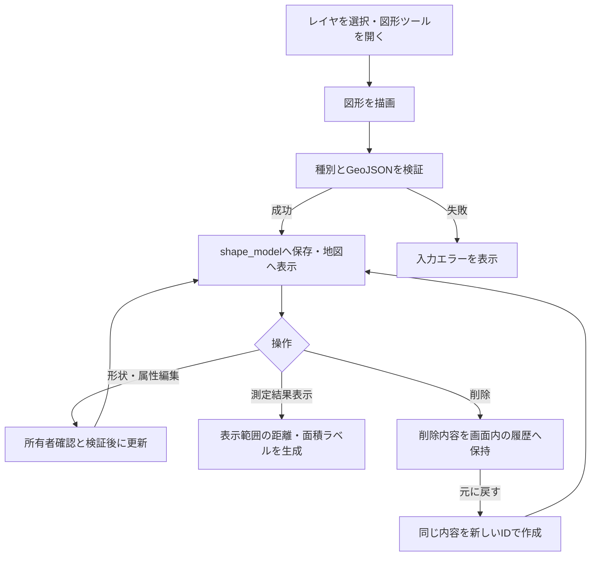

# 図形描画と測定の利用・検証

通常地図で多角形・折れ線・矩形・円を描画し、レイヤ単位で保存する。形状、名前、メモ、色や線種を編集でき、距離と面積を表示できる。測定結果は地図上の概算として扱う。

## 現在の処理フロー



## 利用手順

1. `/map`の「図形」ボタンで、初期状態では折りたたまれている操作パネルを開く。
2. 図形種別を選び、地図上で描画を完了する。
3. 形状編集で頂点を追加・移動・削除する。円は位置を移動できる。
4. 名前ラベルや編集操作から名前、所属レイヤ、色、線種、線の太さ、メモを設定する。所属変更後は親画面の表示レイヤも変更先へ同期する。
5. 必要に応じて「測定結果表示」を有効にする。初期状態は非表示。

PCとモバイルの編集地図で描画・編集する。別画面と共有ページは保存済み図形を閲覧し、表示・測定ラベルを切り替える。

レイヤの[自由記述制限](LAYERS_AND_MARKERS.md#自由記述の制限)がONの場合、既存図形の名前・所属レイヤに加え、折れ線・ポリゴン・矩形の頂点追加・削除・移動を変更できる。座標だけを更新し、本文・メモ・フォーム回答を保持する。地図上のメモ・スタイル編集と円の移動は制限する。フォーム回答の登録・編集は引き続き利用できる。

図形編集のメモ欄は自由入力部分を編集します。フォーム由来の内容を修正する場合は[回答一覧](FORM_ANSWERS.md)を使用してください。「フォームで回答を登録」は新規回答の追加です。図形削除では編集済み・過去分を含む全回答も削除します。共通フォーム定義と画像ファイルはこの連動削除の対象外です。

## 保存形式とスタイル

`shape_model`に`shape_type`、`name`、`geojson`、所有者、所属レイヤを保存する。対応する`shape_type`は`polygon`、`polyline`、`rectangle`、`circle`。

| 項目 | 保存・制約 |
|---|---|
| メモ | `geojson.properties.memo`。最大10000文字 |
| 線の太さ | `geojson.properties.style.weight`。1～10px、既定5px |
| 線種 | 実線、破線、点線、一点鎖線 |
| 折れ線の矢印 | `geojson.properties.style.arrowType`。`none`・`start`・`end`・`both` |

矢印の始点・終点はGeoJSON座標配列の順で判定し、線色・太さに追従する。未指定時は`none`。折れ線以外に矢印設定を付けることは許可しない。

## 測定・表示制御

| 図形 | 測定結果 |
|---|---|
| 多角形・矩形 | 各辺の距離、面積 |
| 折れ線 | 区間距離、総延長 |
| 円 | 半径、面積 |

面積は`EPSG:3857`上の平面近似で計算する。1000000m²以上はkm²、それ未満はm²で表示する。投影による歪みがあるため、精密な測量値として扱わない。

測定ラベルは初回復元時にまとめて生成せず、表示を有効にした間だけ、表示中で画面範囲と交差する図形と画面内のラベルを生成する。図形名はズーム8未満、または表示候補50件以上で抑制する。保存済み表示設定も適用する。

図形本体も、表示範囲と周囲20%に入る図形だけを必要時に生成する。画面上の大きさが長辺4 CSS px未満の場合は省略し、移動・拡大後に表示する。小さな管路を低ズームでまとめて生成する処理を避けるための制御で、保存された形状や頂点は変更しない。

通常のPC・モバイル地図と別画面地図は、図形の総件数に関係なく、保存済みの図形・図形名表示設定に従う。未保存ならONとし、初期化で保存設定を書き換えない。初期表示にも同じ遅延描画を適用する。回答地図・共有地図・印刷の表示状態の引き継ぎルールは維持する。画面外の図形も検索・CSV・印刷・全対象への移動から除外せず、印刷では用紙の範囲で描画し、4pxによる省略を行わない。

生成済み図形は再利用するが、非表示かつ非選択のキャッシュは256件・50000頂点までとし、古いものから解放する。編集中・フォーカス中・計測選択中の図形は保持する。パンで画面外へ移動しただけでは計測の選択や合計を解除しない。

別画面・共有ページはレイヤのチェックと図形表示の両方に従う。図形名のチェックも独立して持ち、レイヤを隠すと対応する測定ラベルも隠れる。

## API・削除と復元

いずれもアカウント認証と所有者確認を行う。

| メソッド・パス | 用途 |
|---|---|
| GET `/shapes` | 図形一覧 |
| POST `/shape` | 新規作成・削除後の復元 |
| PUT `/shape/{shape_id}` | 形状・名前・所属・スタイル・メモの更新 |
| DELETE `/shape/{shape_id}` | 削除 |

「元に戻す」はフロントエンドの一時メモリを使用する。再読み込みで削除履歴は消える。復元は新規作成となり、名前やスタイルを引き継ぐがIDは変わる。削除で失われた公開フォームや投稿履歴を復元する操作ではない。

[一時共有](TEMPORARY_SHARING.md)では`include_shapes`を有効にして選択レイヤの図形をスナップショットへ含める。[JSON入出力](DATA_IMPORT_EXPORT.md)ではスタイルとメモを含むGeoJSONを引き継ぐ。

## 検証手順

- 4種の描画と再読み込み、頂点編集、円の移動、所属変更をPC・モバイルで確認する。
- 線幅の上下限、不正値、各線種と矢印の組み合わせ、座標順による始点・終点を確認する。
- 図形名の表示、ズーム・候補件数による抑制、測定ON/OFFと画面移動を確認する。
- 削除・復元で内容が戻りIDが変わること、再読み込み後に復元できないことを確認する。
- 一時共有とJSON出力後の再取り込みで形状・スタイル・メモを確認する。

## 図形描画の性能検証

2026-10-26に、実際のLeaflet・SVGと閲覧地図runtimeを使い、同一の合成管路データをChromeで各3回計測した中央値。ブラウザーへ読み込んだデータから、地図初期化と最初の生成バッチが同期的に終了するまでの時間（ms）を比較する。モジュール読み込み、通信、JSON転送・解析は含めない。

PC幅は1024×768、モバイル幅は390×844・CPU4倍制限のエミュレーションであり、実モバイル端末の計測ではない。

| 条件 | 初期Leaflet生成数（前→後） | PC同期処理ms（前→後） | モバイル幅同期処理ms（前→後） |
|---|---:|---:|---:|
| 400件・範囲内80件 | 400 → 80 | 45.9 → 36.3 | 296.8 → 153.4 |
| 2000件・範囲内80件 | 2000 → 80 | 69.1 → 42.5 | 298.7 → 163.7 |
| 10000件・範囲内80件 | 10000 → 80 | 162.9 → 42.3 | 777.3 → 207.8 |
| 密集2000件・ズーム5 | 2000 → 0 | 69.4 → 33.3 | 314.8 → 143.1 |
| 2000件・各100頂点・範囲内80件 | 2000 → 80 | 110 → 48.4 | 505.5 → 182.5 |

初期範囲を同じにしたケースでは総件数を増やしても80件だけを生成する。移動・縮小後の非表示キャッシュは256件・50000頂点以内であることも検証する。表示中・編集中・選択中の図形はこの非表示キャッシュ上限の対象外。データ原本は全件保持するため、総メモリ使用量が常に一定になるという意味ではない。

分割処理があるため、同期処理時間と全図形の生成完了時間は異なる。各試行の `readyMs`、移動後の更新時間、生成数、キャッシュ数、長いタスクはJSONへ保存している。フレーム待ち時間はGPUの描画完了時刻を保証せず、ヒープ値は参考値として扱う。単一の巨大図形の生成、初回の範囲計算、全件取得・JSON解析の負荷は残る。

- [PC変更前](performance/shape-rendering-baseline.json) / [PC変更後](performance/shape-rendering-after.json)
- [モバイル幅変更前](performance/shape-rendering-mobile-baseline.json) / [モバイル幅変更後](performance/shape-rendering-mobile-after.json)

再現スクリプトは [measure-shape-rendering.mjs](../src_frontend/frontend/scripts/measure-shape-rendering.mjs)。`--output` はリポジトリルート基準。変更前のコミットを指定し、PC・モバイル幅を直列比較できる。`--playwright-path` は環境のPlaywrightモジュールへ置き換える。

```powershell
# src_frontend/frontend で実行
node scripts/measure-shape-rendering.mjs --compare --with-mobile --samples=3 --baseline-revision=3ab4c5a3f6ac2a651eeba44f2a66c62761e8eba3 --playwright-path=C:/path/to/playwright/index.mjs
```

### 初期表示の件数制限撤廃の検証

追加計測には [measure-initial-shape-visibility.mjs](../src_frontend/frontend/scripts/measure-initial-shape-visibility.mjs) と専用HTMLを使用する。通常編集地図のPC・モバイルと、別画面地図のPC・モバイル幅について、実際のVite prelude・ソース一覧から組み立てた編集runtime、および閲覧runtimeをLeaflet・Chrome上で実行する。

同じ現行runtimeで「保存設定なしの自動初期ON」と「保存設定OFFで初期化後、表示コントロールから手動ON」を各3回比較する。これは表示を開始するタイミングの比較であり、旧コミットからの高速化率としては扱わない。別画面地図の所属レイヤが初期OFFになる既存仕様を維持し、両条件とも初期化後に同じ所属レイヤを選択する。別画面の完了時間にはその選択後の描画も含める。

総数1万件・範囲内80件、密集1万件・ズーム5、密集2500件・ズーム14、各100頂点の2500件・範囲内80件を対象に、生成数・初期同期時間・描画生成完了時間・長いタスク・移動後のキャッシュ上限を確認する。モバイル幅は390×844・CPU4倍制限のエミュレーションとし、通信・JSON転送解析・モジュール読み込みは計測から除外する。表示中の図形数と単一図形の生成負荷は別途残り、生成完了時間はGPUの描画完了時刻を保証しない。

```powershell
# src_frontend/frontend で実行
node scripts/measure-initial-shape-visibility.mjs --samples=3 --playwright-path=C:/path/to/playwright/index.mjs
```

2026-10-26の全96試行で、期待する生成数、移動後の表示更新、非表示キャッシュの上限を確認した。密集1万件でもズーム5では生成数は0件となった。以下は初期化開始から生成完了までの中央値（ms、自動初期ON／手動ON）。

| 対象 | 1万件・範囲内80件 | 密集2500件・ズーム14 |
|---|---:|---:|
| 編集地図PC | 43.7 ／ 47.8 | 1786 ／ 1816.7 |
| 編集地図モバイル幅・CPU4倍制限 | 284.5 ／ 292 | 6287.2 ／ 6474 |
| 別画面地図PC | 61.8 ／ 62.2 | 187.2 ／ 187.1 |
| 別画面地図モバイル幅・CPU4倍制限 | 282.1 ／ 311.7 | 1062.5 ／ 1032.8 |

同じ表示条件では自動初期ONと手動ONの生成数は一致し、生成完了時間も同程度だった。高密度の編集地図では完了まで数秒かかる条件が残るため、総件数制限の撤廃だけで、表示中の図形数や頂点数に起因する負荷まで解消するものではない。詳細な初期同期時間・長いタスク・多頂点条件・移動後の結果は [計測JSON](performance/shape-initial-visibility.json) に保存する。

## 関連する実装

[図形API](../src/handler/shapes.rs)、[GeoJSON検証](../src/shape_validation.rs)、[編集処理](../src_frontend/template-scripts/src/map/editor/)、[測定処理](../src_frontend/template-scripts/src/map/common/shape-measurement.ts)、[表示制御](../src_frontend/template-scripts/src/map/common/shape-viewport.ts)。
