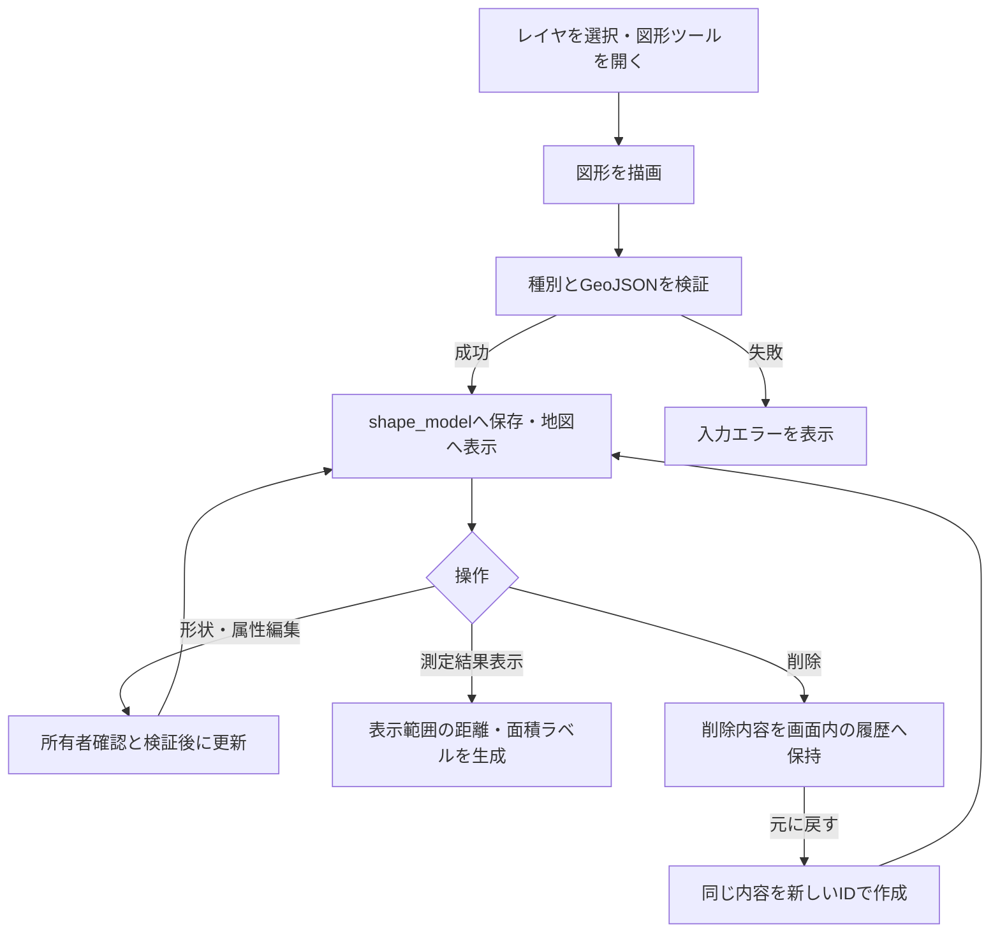

# 図形描画と測定の利用・検証

通常地図で多角形・折れ線・矩形・円を描画し、レイヤ単位で保存する。形状、名前、メモ、色や線種を編集でき、距離と面積を表示できる。測定結果は地図上の概算として扱う。

## 現在の処理フロー



## 利用手順

1. `/map`の「図形」ボタンで、初期状態では折りたたまれている操作パネルを開く。
2. 図形種別を選び、地図上で描画を完了する。
3. 形状編集で頂点を追加・移動・削除する。円は位置を移動できる。
4. 名前ラベルや編集操作から名前、所属レイヤ、色、線種、線の太さ、メモを設定する。所属変更後は親画面の表示レイヤも変更先へ同期する。
5. 必要に応じて「測定結果表示」を有効にする。初期状態は非表示。

PCとモバイルの編集地図で描画・編集する。別画面と共有ページは保存済み図形を閲覧し、表示・測定ラベルを切り替える。

レイヤの[自由記述制限](LAYERS_AND_MARKERS.md#自由記述の制限)がONの場合、既存図形の名前・所属レイヤに加え、折れ線・ポリゴン・矩形の頂点追加・削除・移動を変更できる。座標だけを更新し、本文・メモ・フォーム回答を保持する。地図上のメモ・スタイル編集と円の移動は制限する。フォーム回答の登録・編集は引き続き利用できる。

図形編集のメモ欄は自由入力部分を編集します。フォーム由来の内容を修正する場合は[回答一覧](FORM_ANSWERS.md)を使用してください。「フォームで回答を登録」は新規回答の追加です。図形削除では編集済み・過去分を含む全回答も削除します。共通フォーム定義と画像ファイルはこの連動削除の対象外です。

## 保存形式とスタイル

`shape_model`に`shape_type`、`name`、`geojson`、所有者、所属レイヤを保存する。対応する`shape_type`は`polygon`、`polyline`、`rectangle`、`circle`。

| 項目 | 保存・制約 |
|---|---|
| メモ | `geojson.properties.memo`。最大10000文字 |
| 線の太さ | `geojson.properties.style.weight`。1～10px、既定5px |
| 線種 | 実線、破線、点線、一点鎖線 |
| 折れ線の矢印 | `geojson.properties.style.arrowType`。`none`・`start`・`end`・`both` |

矢印の始点・終点はGeoJSON座標配列の順で判定し、線色・太さに追従する。未指定時は`none`。折れ線以外に矢印設定を付けることは許可しない。

## 測定・表示制御

| 図形 | 測定結果 |
|---|---|
| 多角形・矩形 | 各辺の距離、面積 |
| 折れ線 | 区間距離、総延長 |
| 円 | 半径、面積 |

面積は`EPSG:3857`上の平面近似で計算する。1000000m²以上はkm²、それ未満はm²で表示する。投影による歪みがあるため、精密な測量値として扱わない。

測定ラベルは初回復元時にまとめて生成せず、表示を有効にした間だけ、表示中で画面範囲と交差する図形と画面内のラベルを生成する。図形名はズーム8未満、または表示候補50件以上で抑制する。保存済み表示設定も適用する。

図形本体も、表示範囲と周囲20%に入る図形だけを必要時に生成する。長辺の表示開始条件は、ズーム11未満で8 CSS px、11以上14未満で6 CSS px、14以上で4 CSS pxとする。閾値以上の図形を表示し、拡大すると省略していた小図形も順に表示する。長辺は図形全体の外接矩形をEPSG:3857へ投影した大きさであり、線幅や画面内に見えている部分だけの長さではない。保存された形状や頂点は変更しない。追加は固定対象・画面内・周囲の余白の順で行い、画面内が揃っても余白分を継続する。印刷などの完了待機は全処理の終了まで維持する。

通常のPC・モバイル地図と別画面地図は、図形の総件数に関係なく、保存済みの図形・図形名表示設定に従う。未保存ならONとし、初期化で保存設定を書き換えない。初期表示にも同じ遅延描画を適用する。回答地図・共有地図・印刷の表示状態の引き継ぎルールは維持する。画面外の図形も検索・CSV・印刷・全対象への移動から除外せず、印刷では用紙の範囲で描画し、画面表示向けのサイズ省略を行わない。

生成済み図形は再利用するが、非表示かつ非選択のキャッシュは256件・50000頂点までとし、古いものから解放する。編集中・フォーカス中・計測選択中の図形は保持する。パンで画面外へ移動しただけでは計測の選択や合計を解除しない。

別画面・共有ページはレイヤのチェックと図形表示の両方に従う。図形名のチェックも独立して持ち、レイヤを隠すと対応する測定ラベルも隠れる。

## 編集地図の原本・取得と差分同期

通常のPC・モバイル編集地図では、親画面のPiniaストアが一覧と地図の共通原本を保持する。ログイン中のメモリキャッシュであり、アカウントごとに分離し、ログアウトで破棄する。全レイヤ／個別レイヤの取得済み状態を区別し、空の成功結果も再利用する。原本はIDで一元保持し、検索結果は別のID集合として扱う。同時取得は共有し、取得途中に成功した追加・更新・削除は、古い取得応答へ重ねて適用する。

取得済み範囲への切替とiframeの再生成では原本を再利用し、通常の作成・更新・削除・復元後に一覧全件のGETを行わない。検索中の変更は変更対象だけを同じ条件で再判定する。ユーザーの検索操作による検索APIは維持する。非選択範囲はLRUで解放し、通常は最大8範囲を保持する。表示中・取得中・切替完了待ちの範囲を件数上限だけで破棄しない。

埋め込み地図は `/map?data_source=parent` で開き、サーバーの図形・マーカーSELECTとHTMLへの原本埋め込みを省略する。親が既存 `/marker/read/all` と `/shapes` を初回に各1回取得し、runtime準備完了→原本適用→適用確認の順で地図を利用可能にする。初期データ適用の確認と、全図形の遅延生成完了は分離し、印刷では引き続き生成完了を待つ。通常の直接 `/map` アクセスはサーバー埋め込みで自己完結する。

埋め込み地図の保存通信は親画面が管理し、保存中にiframeが消えても保存済みレコードを原本へ反映する。POSTと通常PUTはサーバーの保存結果を使用し、削除は成功したIDを除去する。差分通知と応答は送信元window・origin・runtime世代・要求IDを確認し、再通知で保存APIを二重実行しない。古い更新応答や削除済みIDの遅延通知による復活も防ぐ。

手動再読み込み、JSON取り込み、レイヤ一括削除では対象を無効化して再取得する。他端末の更新は手動再読み込みで反映する。取得・適用に失敗した場合は取得済み原本を保持し、再保存せず表示を再同期する。別画面・共有・回答・印刷地図は既存の取得範囲とスナップショットの仕組みを維持する。

## API・削除と復元

いずれもアカウント認証と所有者確認を行う。

| メソッド・パス | 用途 |
|---|---|
| GET `/shapes` | 図形一覧 |
| POST `/shape` | 新規作成・削除後の復元 |
| PUT `/shape/{shape_id}` | 形状・名前・所属・スタイル・メモの更新 |
| DELETE `/shape/{shape_id}` | 削除 |

作成応答は既存の `id`・`message`に保存済みの `object`を追加する。通常の図形・マーカー情報更新とマーカー位置更新も `object`を返し、サーバーが確定した本文・所属・更新日時を差分反映に使用する。図形座標更新の完全レコード応答は維持する。取得APIと保存形式を変えず、DBマイグレーションは追加しない。

「元に戻す」はフロントエンドの一時メモリを使用する。再読み込みで削除履歴は消える。復元は新規作成となり、名前やスタイルを引き継ぐがIDは変わる。削除で失われた公開フォームや投稿履歴を復元する操作ではない。

[一時共有](TEMPORARY_SHARING.md)では`include_shapes`を有効にして選択レイヤの図形をスナップショットへ含める。[JSON入出力](DATA_IMPORT_EXPORT.md)ではスタイルとメモを含むGeoJSONを引き継ぐ。

## 検証手順

- 4種の描画と再読み込み、頂点編集、円の移動、所属変更をPC・モバイルで確認する。
- 線幅の上下限、不正値、各線種と矢印の組み合わせ、座標順による始点・終点を確認する。
- 図形名の表示、ズーム・候補件数による抑制、測定ON/OFFと画面移動を確認する。
- 削除・復元で内容が戻りIDが変わること、再読み込み後に復元できないことを確認する。
- 一時共有とJSON出力後の再取り込みで形状・スタイル・メモを確認する。

## 図形描画の性能検証

2026-10-26に、実際のLeaflet・SVGと閲覧地図runtimeを使い、同一の合成管路データをChromeで各3回計測した中央値。ブラウザーへ読み込んだデータから、地図初期化と最初の生成バッチが同期的に終了するまでの時間（ms）を比較する。モジュール読み込み、通信、JSON転送・解析は含めない。

PC幅は1024×768、モバイル幅は390×844・CPU4倍制限のエミュレーションであり、実モバイル端末の計測ではない。

| 条件 | 初期Leaflet生成数（前→後） | PC同期処理ms（前→後） | モバイル幅同期処理ms（前→後） |
|---|---:|---:|---:|
| 400件・範囲内80件 | 400 → 80 | 45.9 → 36.3 | 296.8 → 153.4 |
| 2000件・範囲内80件 | 2000 → 80 | 69.1 → 42.5 | 298.7 → 163.7 |
| 10000件・範囲内80件 | 10000 → 80 | 162.9 → 42.3 | 777.3 → 207.8 |
| 密集2000件・ズーム5 | 2000 → 0 | 69.4 → 33.3 | 314.8 → 143.1 |
| 2000件・各100頂点・範囲内80件 | 2000 → 80 | 110 → 48.4 | 505.5 → 182.5 |

初期範囲を同じにしたケースでは総件数を増やしても80件だけを生成する。移動・縮小後の非表示キャッシュは256件・50000頂点以内であることも検証する。表示中・編集中・選択中の図形はこの非表示キャッシュ上限の対象外。データ原本は全件保持するため、総メモリ使用量が常に一定になるという意味ではない。

分割処理があるため、同期処理時間と全図形の生成完了時間は異なる。各試行の `readyMs`、移動後の更新時間、生成数、キャッシュ数、長いタスクはJSONへ保存している。フレーム待ち時間はGPUの描画完了時刻を保証せず、ヒープ値は参考値として扱う。単一の巨大図形の生成、初回の範囲計算、全件取得・JSON解析の負荷は残る。

- [PC変更前](performance/shape-rendering-baseline.json) / [PC変更後](performance/shape-rendering-after.json)
- [モバイル幅変更前](performance/shape-rendering-mobile-baseline.json) / [モバイル幅変更後](performance/shape-rendering-mobile-after.json)

再現スクリプトは [measure-shape-rendering.mjs](../src_frontend/frontend/scripts/measure-shape-rendering.mjs)。`--output` はリポジトリルート基準。変更前のコミットを指定し、PC・モバイル幅を直列比較できる。`--playwright-path` は環境のPlaywrightモジュールへ置き換える。

```powershell
# src_frontend/frontend で実行
node scripts/measure-shape-rendering.mjs --compare --with-mobile --samples=3 --baseline-revision=3ab4c5a3f6ac2a651eeba44f2a66c62761e8eba3 --playwright-path=C:/path/to/playwright/index.mjs
```

### 初期表示の件数制限撤廃の検証

追加計測には [measure-initial-shape-visibility.mjs](../src_frontend/frontend/scripts/measure-initial-shape-visibility.mjs) と専用HTMLを使用する。通常編集地図のPC・モバイルと、別画面地図のPC・モバイル幅について、実際のVite prelude・ソース一覧から組み立てた編集runtime、および閲覧runtimeをLeaflet・Chrome上で実行する。

同じ現行runtimeで「保存設定なしの自動初期ON」と「保存設定OFFで初期化後、表示コントロールから手動ON」を各3回比較する。これは表示を開始するタイミングの比較であり、旧コミットからの高速化率としては扱わない。別画面地図の所属レイヤが初期OFFになる既存仕様を維持し、両条件とも初期化後に同じ所属レイヤを選択する。別画面の完了時間にはその選択後の描画も含める。

総数1万件・範囲内80件、密集1万件・ズーム5、密集2500件・ズーム14、各100頂点の2500件・範囲内80件を対象に、生成数・初期同期時間・描画生成完了時間・長いタスク・移動後のキャッシュ上限を確認する。モバイル幅は390×844・CPU4倍制限のエミュレーションとし、通信・JSON転送解析・モジュール読み込みは計測から除外する。表示中の図形数と単一図形の生成負荷は別途残り、生成完了時間はGPUの描画完了時刻を保証しない。

```powershell
# src_frontend/frontend で実行
node scripts/measure-initial-shape-visibility.mjs --samples=3 --playwright-path=C:/path/to/playwright/index.mjs
```

2026-10-26の全96試行で、期待する生成数、移動後の表示更新、非表示キャッシュの上限を確認した。密集1万件でもズーム5では生成数は0件となった。以下は初期化開始から生成完了までの中央値（ms、自動初期ON／手動ON）。

| 対象 | 1万件・範囲内80件 | 密集2500件・ズーム14 |
|---|---:|---:|
| 編集地図PC | 43.7 ／ 47.8 | 1786 ／ 1816.7 |
| 編集地図モバイル幅・CPU4倍制限 | 284.5 ／ 292 | 6287.2 ／ 6474 |
| 別画面地図PC | 61.8 ／ 62.2 | 187.2 ／ 187.1 |
| 別画面地図モバイル幅・CPU4倍制限 | 282.1 ／ 311.7 | 1062.5 ／ 1032.8 |

同じ表示条件では自動初期ONと手動ONの生成数は一致し、生成完了時間も同程度だった。高密度の編集地図では完了まで数秒かかる条件が残るため、総件数制限の撤廃だけで、表示中の図形数や頂点数に起因する負荷まで解消するものではない。詳細な初期同期時間・長いタスク・多頂点条件・移動後の結果は [計測JSON](performance/shape-initial-visibility.json) に保存する。

### 原本供給方式の検証

2026-10-27に、共通フロントエンドのPostgreSQL作業ツリーから実際の編集runtimeを組み立て、Chromeの同一origin iframeとnative postMessageで4万件の合成管路を検証した。DB・通信・API応答解析・巨大なHTML内JSON解析は計測外である。両方式とも同じiframe・同じ画面寸法とズーム14を使い、親側と地図側に2つの原本を保持する条件を揃えた。`server`は準備済みbootstrap、`parent`は空のbootstrapへ親から初期データを適用する方式である。実データやアプリ全体の起動時間の比較ではない。

各3回、計24試行が60秒枠内で完了した。以下は初期化開始からLeaflet生成完了までの中央値（ms）。GPUの描画完了時刻ではない。PCは1024×768、モバイル幅は390×844・CPU4倍制限のエミュレーションであり、実端末の計測ではない。

| 条件 | server供給ms | parent供給ms | 両方式の生成数 |
|---|---:|---:|---:|
| PC・4万件中80件表示 | 53.2 | 150.1 | 80 |
| モバイル幅・同条件 | 331.4 | 712.6 | 80 |
| PC・4万件表示 | 2,598.5 | 2,657.9 | 40,000 |
| モバイル幅・4万件表示 | 17,180.2 | 19,184.9 | 40,000 |

親供給には初回の転送コストが残る。4万件中80件表示の転送時間はPC87.7ms・モバイル幅386.3ms、受信後の登録は28.3ms・112.9msだった。転送時間に含まれるnative clone送信の同期部分は34.7ms・159.1ms。通常原本ではDTO変換は0msで、Vue proxyが混ざる場合だけ同期DataCloneErrorから変換して再送する。このfallbackは別の単体テストで確認する。

範囲内80件の初期ヒープ参考値はserver／parentでPC73.1／71.9MB、モバイル幅72.7／73.2MB。ヒープはブラウザープロセスの参考値で、フレーム単体の使用量や一定の上限を保証しない。密集条件でも生成は各4万回で、生成の重複はなかった。refresh回数と5000件単位の進捗はJSONへ記録する。表示中の件数が多い場合のSVG生成時間は引き続き残る。

この比較は重複するDB照会・HTTP転送・JSON解析を含まないため、取得一本化によるアプリ全体の高速化率として扱わない。通常操作後・キャッシュ再利用時の全件GET抑制、4万件保持中の単一変更で原本の全件走査を行わないことは、別途ストア・画面・ハンドラーのテストで検証する。

- [server供給・範囲内80件](performance/shape-data-initial-server-spread.json) / [parent供給・範囲内80件](performance/shape-data-initial-parent-spread.json)
- [server供給・密集](performance/shape-data-initial-server-dense.json) / [parent供給・密集](performance/shape-data-initial-parent-dense.json)
- [保持条件調整前の30秒診断](performance/shape-data-initial-parent-dense-30s-diagnostic.json)はモバイル幅の1試行が未完了。最終24試行や3回成功の中央値には含めない。

再現には既存の [measure-shape-render-tuning.mjs](../src_frontend/frontend/scripts/measure-shape-render-tuning.mjs) を使用する。下記は同じiframe・2原本の比較。`--entry=editor-mobile`、`--case=dense`へ置き換えて同じ条件を実行できる。計測中は別のビルド・テストを止め、`--playwright-path`を環境に合わせる。

```powershell
# src_frontend/frontend で実行
node scripts/measure-shape-render-tuning.mjs --stage=after --entry=editor-pc --case=spread --frame=true --initial-only=true --samples=3 --timeout-ms=60000 --playwright-path=C:/path/to/playwright/index.mjs --output=target/shape-data-server.json
node scripts/measure-shape-render-tuning.mjs --stage=after --entry=editor-pc --case=spread --parent-data=true --frame=true --initial-only=true --samples=3 --timeout-ms=60000 --playwright-path=C:/path/to/playwright/index.mjs --output=target/shape-data-parent.json
```

### 縮尺に応じた小図形の省略

2026-10-27に、全縮尺共通4pxから、広域8px・中間6px・詳細4pxへ既定値を変更した。ズーム11未満／11以上14未満／14以上の区分は小数のズーム値にも適用する。明示的な `minPixelSize` の指定を優先し、印刷の0px指定と、比較計測の固定4・6・8・12px指定を維持する。

通常の編集PC・モバイル、別画面、回答、一時共有PC・モバイルが共通処理を使う。公開live-mapの公開レイヤは別実装であり、この変更の対象には含めない。図形表示・所属レイヤ・検索・回答対象のフィルターを優先し、その範囲内で編集中・保存中・新規作成直後・フォーカス・ポップアップ・計測選択中の図形を保持する。回答件数、凡例、全対象への移動、CSV、計測値は原本から計算し、描画省略で対象データを削除しない。API・DB・原本キャッシュは変更しない。

余白20%、画面内優先、分割生成の8ms予算、非表示キャッシュ上限は維持する。長い管路は外接矩形も大きいため残りやすい。今回のサイズ条件を超える長距離管路が多数残る場合は、表示用形状や管路専用の開始縮尺を別途検討する。

計測時だけ `collectDiagnostics: true` を指定すると、`getDiagnostics()` で最新の範囲判定時点の表示予定件数・頂点数、サイズ省略件数、画面内／余白のサイズ分布（4px未満、4〜6、6〜8、8〜12、12px以上）を取得できる。画面内と余白は重複せず、余白外の保護対象は別カウントとなる。集計は既存の対象判定ループで行い、通常利用では無効。返り値はコピーであり、範囲・原本変更後は次の判定までnullとなる。これは生成前の予定値なので、描画完了件数は `getStats()` と `whenIdle()` で確認する。

比較には `measure-shape-render-tuning.mjs` の `zoom-policy-z10`／`zoom-policy-z12`／`zoom-policy-z14` ケースを使う。省略条件以外を同じにした現行runtime同士で、`--min-pixel=4` と既定の縮尺連動を比較する。 各ケースは初期ズームで同じ画面上の長さになるよう地理座標を作るため、z10・z12・z14のケース間は別の地理データである。同じケース内の固定値対縮尺連動、および同じ原本によるズーム往復として比較する。`--initial-only=true` では初期生成だけ、指定を外すとパン・ズーム往復後の表示・再生成・キャッシュも確認する。

```powershell
# src_frontend/frontend で実行。PCからeditor-mobile、another-pcにも置き換えられる。
node scripts/measure-shape-render-tuning.mjs --stage=after --entry=editor-pc --case=zoom-policy --min-pixel=4 --initial-only=true --samples=3 --timeout-ms=60000 --playwright-path=C:/path/to/playwright/index.mjs --output=target/shape-zoom-fixed4.json
node scripts/measure-shape-render-tuning.mjs --stage=after --entry=editor-pc --case=zoom-policy --initial-only=true --samples=3 --timeout-ms=60000 --playwright-path=C:/path/to/playwright/index.mjs --output=target/shape-zoom-adaptive.json
```

今回の比較はChrome 155.0.8059.85・Leaflet SVGで実行した。PCは1024×768、モバイル幅は390×844・CPU4倍制限のエミュレーションであり、実端末・ユーザーの実データではない。各ケースは4万件、画面内3.2万件・余白8千件、初期長辺3.25／5.25／7.25／10.25／16.25 CSS pxを各8千件とした。初期比較は各3回の中央値（ms）。生成数は余白も含み、画面内生成完了と余白込み完了を区別する。通信・JSON転送解析・fixture準備・モジュール読み込みを含まず、GPU描画完了時刻ではない。診断・生成観測の負荷は両比較条件に入っている。

| 対象 | ズーム | 生成数（固定4px → 縮尺連動） | 画面内生成完了ms | 余白込み生成完了ms |
|---|---:|---:|---:|---:|
| 編集PC | 10 | 32,000 → 16,000 | 1,721.2 → 944.5 | 2,130.6 → 1,158.8 |
| 編集PC | 12 | 32,000 → 24,000 | 1,752.5 → 1,345.1 | 2,158.5 → 1,629.2 |
| 編集PC | 14 | 32,000 → 32,000 | 1,785.5 → 1,750.5 | 2,191 → 2,129.7 |
| 編集モバイル幅・CPU4倍制限 | 10 | 32,000 → 16,000 | 7,461.7 → 3,809.9 | 9,652 → 4,622.9 |
| 編集モバイル幅・CPU4倍制限 | 12 | 32,000 → 24,000 | 7,762.6 → 5,597.1 | 10,102.2 → 7,073.9 |
| 編集モバイル幅・CPU4倍制限 | 14 | 32,000 → 32,000 | 7,539 → 7,480.2 | 9,905.1 → 9,953.1 |
| 別画面PC | 10 | 32,000 → 16,000 | 1,706.3 → 854.7 | 2,128.8 → 1,082.8 |

広域では生成数が50%、中間では25%減少し、詳細では同じ件数を維持した。固定12pxもズーム10で各3回比較し、生成数8千件、余白込み完了はPC568.5ms／モバイル幅2695.7msだった。ただし8pxでは表示される10.25pxの管路も省略するため、既定値には採用せず比較用に留めた。

初期比較48試行と、編集PC・モバイル幅／別画面PC・モバイル幅のズーム往復・パン検証各1回、計52試行が完了した。往復では同じ4万件の原本で、ズーム10の1.6万件→ズーム11の3.2万件→ズーム10の1.6万件を確認した。戻りでは非表示キャッシュ上限により再生成も発生する。遠方移動後は表示0・保留0、非表示キャッシュは256件・50000頂点以内だった。

[計測JSON（全52試行、分布・頂点数・各段階の生データ）](performance/shape-zoom-policy.json)。この比較はPostgreSQL作業ツリーの共通フロントエンドで実施し、同一の変更と結果をSQLite版にも反映した。実データに長い管路が多い場合は同じ削減率になるとは限らず、サイズ分布と実機での視認性を併せて判断する。

## 関連する実装

[原本キャッシュ](../src_frontend/frontend/src/stores/map-record-cache.ts)、[保存通信の仲介](../src_frontend/frontend/src/composables/useMapObjectWriter.ts)、[編集地図の同期境界](../src_frontend/template-scripts/src/map/editor/map-editor-final.ts)。

[図形API](../src/handler/shapes.rs)、[GeoJSON検証](../src/shape_validation.rs)、[編集処理](../src_frontend/template-scripts/src/map/editor/)、[測定処理](../src_frontend/template-scripts/src/map/common/shape-measurement.ts)、[表示制御](../src_frontend/template-scripts/src/map/common/shape-viewport.ts)。
