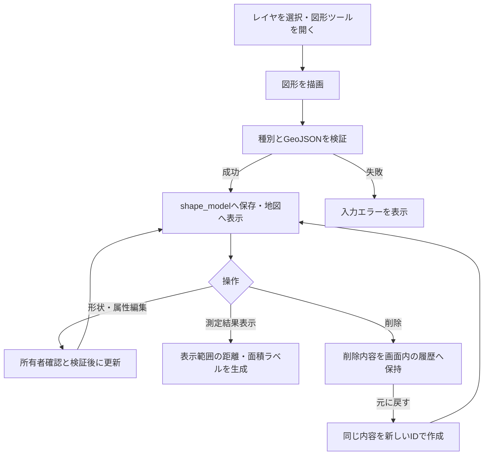

# 図形描画と測定の利用・検証

通常地図で多角形・折れ線・矩形・円を描画し、レイヤ単位で保存する。形状、名前、メモ、色や線種を編集でき、距離と面積を表示できる。測定結果は地図上の概算として扱う。

## 現在の処理フロー

## 利用手順

1. `/map`の「図形」ボタンで、初期状態では折りたたまれている操作パネルを開く。
2. 図形種別を選び、地図上で描画を完了する。
3. 形状編集で頂点を追加・移動・削除する。円は位置を移動できる。
4. 名前ラベルや編集操作から名前、所属レイヤ、色、線種、線の太さ、メモを設定する。所属変更後は親画面の表示レイヤも変更先へ同期する。
5. 必要に応じて「測定結果表示」を有効にする。初期状態は非表示。

PCとモバイルの編集地図で描画・編集する。別画面と共有ページは保存済み図形を閲覧し、表示・測定ラベルを切り替える。

レイヤの[自由記述制限](LAYERS_AND_MARKERS.md#自由記述の制限)がONの場合、既存図形の名前・所属レイヤに加え、折れ線・ポリゴン・矩形の頂点追加・削除・移動を変更できる。座標だけを更新し、本文・メモ・フォーム回答を保持する。地図上のメモ・スタイル編集と円の移動は制限する。フォーム回答の登録・編集は引き続き利用できる。

図形編集のメモ欄は自由入力部分を編集します。フォーム由来の内容を修正する場合は[回答一覧](FORM_ANSWERS.md)を使用してください。「フォームで回答を登録」は新規回答の追加です。図形削除では編集済み・過去分を含む全回答も削除します。共通フォーム定義と画像ファイルはこの連動削除の対象外です。

## 保存形式とスタイル

`shape_model`に`shape_type`、`name`、`geojson`、所有者、所属レイヤを保存する。対応する`shape_type`は`polygon`、`polyline`、`rectangle`、`circle`。

| 項目 | 保存・制約 |
|---|---|
| メモ | `geojson.properties.memo`。最大10000文字 |
| 線の太さ | `geojson.properties.style.weight`。1～10px、既定5px |
| 線種 | 実線、破線、点線、一点鎖線 |
| 折れ線の矢印 | `geojson.properties.style.arrowType`。`none`・`start`・`end`・`both` |

矢印の始点・終点はGeoJSON座標配列の順で判定し、線色・太さに追従する。未指定時は`none`。折れ線以外に矢印設定を付けることは許可しない。

## 測定・表示制御

| 図形 | 測定結果 |
|---|---|
| 多角形・矩形 | 各辺の距離、面積 |
| 折れ線 | 区間距離、総延長 |
| 円 | 半径、面積 |

面積は`EPSG:3857`上の平面近似で計算する。1000000m²以上はkm²、それ未満はm²で表示する。投影による歪みがあるため、精密な測量値として扱わない。

測定ラベルは初回復元時にまとめて生成せず、表示を有効にした間だけ、表示中で画面範囲と交差する図形と画面内のラベルを生成する。図形名はズーム8未満、または表示候補50件以上で抑制する。大量図形の初期表示抑止や保存済み表示設定も適用する。

別画面・共有ページはレイヤのチェックと図形表示の両方に従う。図形名のチェックも独立して持ち、レイヤを隠すと対応する測定ラベルも隠れる。

## API・削除と復元

いずれもアカウント認証と所有者確認を行う。

| メソッド・パス | 用途 |
|---|---|
| GET `/shapes` | 図形一覧 |
| POST `/shape` | 新規作成・削除後の復元 |
| PUT `/shape/{shape_id}` | 形状・名前・所属・スタイル・メモの更新 |
| DELETE `/shape/{shape_id}` | 削除 |

「元に戻す」はフロントエンドの一時メモリを使用する。再読み込みで削除履歴は消える。復元は新規作成となり、名前やスタイルを引き継ぐがIDは変わる。削除で失われた公開フォームや投稿履歴を復元する操作ではない。

[一時共有](TEMPORARY_SHARING.md)では`include_shapes`を有効にして選択レイヤの図形をスナップショットへ含める。[JSON入出力](DATA_IMPORT_EXPORT.md)ではスタイルとメモを含むGeoJSONを引き継ぐ。

## 検証手順

- 4種の描画と再読み込み、頂点編集、円の移動、所属変更をPC・モバイルで確認する。
- 線幅の上下限、不正値、各線種と矢印の組み合わせ、座標順による始点・終点を確認する。
- 図形名の表示、ズーム・候補件数による抑制、測定ON/OFFと画面移動を確認する。
- 削除・復元で内容が戻りIDが変わること、再読み込み後に復元できないことを確認する。
- 一時共有とJSON出力後の再取り込みで形状・スタイル・メモを確認する。

## 関連する実装

[図形API](../src/handler/shapes.rs)、[GeoJSON検証](../src/shape_validation.rs)、[編集処理](../src_frontend/template-scripts/src/map/editor/)、[測定処理](../src_frontend/template-scripts/src/map/common/shape-measurement.ts)、[表示制御](../src_frontend/template-scripts/src/map/common/shape-viewport.ts)。
