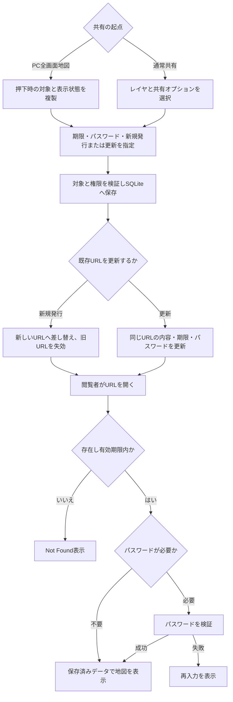

# 一時共有URLの利用・検証

マーカー・図形を、ログイン不要のURLで公開する。レイヤ単位の通常共有と、PCの全画面地図で操作した状態を固定する共有がある。両方式でユーザーごとに共通の1枠を使い、有効期限と任意のパスワードを設定できる。共有先はPC・モバイルの両方に対応する。

## 2つの共有方式

| 項目 | 通常共有 | 全画面地図のスナップショット共有 |
|---|---|---|
| 作成画面 | 既存の共有設定モーダル | PCアプリ内の全画面地図にある「現在の地図を共有する」 |
| 対象 | 選択レイヤ内の全マーカーと、共有を許可した図形 | 適用済みの絞り込み・文字列検索・グループ選択・マーカー／図形表示の共通部分 |
| データの固定時点 | 発行・更新処理でDBから取得した時点 | 共有ボタンを押した時点の保持済みデータ |
| 色分け・中心・ズーム・背景地図 | 操作中の状態は引き継がない | 選択状態と分類結果を保存して復元 |
| 重ね合わせタイル | 共有を許可した場合、閲覧時の作成者の最新登録を使用 | 利用する定義と個別のON／OFFを保存 |
| 対象0件・グループ未選択 | 共有するレイヤの指定が必要 | 0件・グループ未選択も保存可能 |

スナップショット共有の作成UIはPCのみ。モバイルの通常共有は従来どおり利用できる。別画面地図を単独URLで開ける場合も、共有設定モーダルの起動にはPCアプリ内の全画面地図を使用する。

## 現在の処理フロー



## 利用手順

### 通常共有

1. 共有リンクの作成画面で共有するレイヤを選択する。空の選択では発行できない。
2. 有効期間を分単位で指定し、必要ならパスワードを設定する。
3. 図形を公開する場合は図形共有、重ね合わせタイルを公開する場合はタイル共有を有効にする。
4. 新規発行または既存リンクの更新を実行し、表示されたURLを使用する。
5. 終了時は共有を停止する。期限切れの場合も以後のアクセスでは無効となる。

### 現在の全画面地図を共有

1. PCアプリで全画面地図を開き、レイヤグループ、絞り込み、文字列検索、色分け、表示項目、背景地図、タイル、中心・ズームを調整する。
2. 地図上の「現在の地図を共有する」を押す。選択グループの取得中・取得失敗中、絞り込みや色分けの反映中は共有を開始しない。完了を待つか、失敗したグループを再チェックする。
3. モーダルで固定された対象件数・グループ・色分け・背景地図・タイル・中心・ズームを確認し、期限とパスワードを指定する。このモードでは共有対象を選び直さない。
4. 新規発行またはURL更新を実行する。取り直す場合は設定モーダルを閉じ、地図内の共有ボタンを押し直す。
5. 結果のモーダルからURLを取得する。従来の共有設定モーダルからも現在のURL・期限・パスワード保護の有無を確認し、共有を停止できる。

### URL・期限・パスワードの共通仕様

新規発行は通常共有・スナップショット共有のどちらで作成した旧URLも失効させる。URL更新は同じURLの内容・期限・パスワードを差し替える。既存URLがない場合の更新は新規作成となる。作成・更新・停止は`BEGIN IMMEDIATE`の書き込みトランザクションで処理し、並行操作でも共通の1枠を維持する。検証や書き込みに失敗した場合は以前の共有を残す。

UIでは有効期間を10分以上の整数で指定する。共有停止・期限切れ後は新たな閲覧を受け付けない。

パスワードは前後の空白を除いて処理し、空なら保護なし。現行実装はUTF-8のバイト数で4～64バイトを検証し、bcryptハッシュだけを保存する。

## 保存内容と更新タイミング

`temporary_urls`に共有ID、所有者、URL、期限、パスワードハッシュ、レイヤ・マーカー・図形のJSON、タイル共有可否、任意の`map_snapshot`を保存する。SQLiteのJSON保存欄はTEXTとし、バックエンドでJSONとの相互変換を行う。

| 対象 | 反映時点 |
|---|---|
| レイヤ名・マーカー・図形 | 通常共有ではDBから取得。全画面地図では共有ボタン押下時の保持済みデータから対象だけを保存 |
| 背景地図・重ね合わせタイル | 通常共有では閲覧時に取得。全画面地図の共有では保存した定義と表示状態を使用 |
| 添付ファイル | 本文中の参照先から取得。既存のファイル閲覧制御に従う |

レコード本体は既存の`layers`・`markers`・`shapes`へ保存する。転送時の図形配列は、保存・共有HTMLではIDをキーとするオブジェクトになる。`map_snapshot`は`{version,state,tileServers,tileOverlays}`をJSON文字列として保存し、`version`は`1`または`2`とする。通常共有では`NULL`とする。

スナップショットの対象は選択グループ・適用済み属性条件・名前／本文検索・マーカー／図形表示の共通部分。画面範囲による切り取りは行わず、画面外や縮尺のために未描画の有効な図形も含める。選択した空グループや0件の結果も、その状態のまま保存する。

除外したレコード・本文・図形・対象ID・色の割当・非選択グループを共有に含めない。色分けは分類名・色・対象ごとの結果を固定し、属性絞り込みや色分けの条件式・フォーム定義を共有先で再評価しない。名前／本文検索文字列は表示状態として保存する。

中心・ズーム・背景地図、タイルごとのON／OFF、グループ選択、マーカー／図形／図形名の表示、クラスタ状態を保存値から復元する。閲覧端末の通常地図設定で初期状態を置き換えず、検索解除や表示切替でも保存対象の外へ範囲を広げない。タイル画像や雨雲の対象時刻は固定せず、閲覧時に配信元から取得する。測定ラベルの表示・選択状態は保存項目に含めない。

PC・モバイルの共有先では、保存済みの色分け結果から、閲覧中の表示対象に使われている分類だけを凡例に表示する。該当分類が0件なら凡例を隠す。共有先を開くと標準の位置とサイズで表示し、閲覧者がその画面内で調整できる。モバイルでは操作UIが初期状態で非表示でも、条件を満たす凡例を地図の説明として表示する。操作方法は[色分けの凡例](MAP_VIEWING.md#色分けの凡例)を参照する。

上限はマーカーと図形の合計10,000件、`snapshot`のUTF-8 JSONで32MiB。作成要求のHTTP本文全体は33MiBまでとし、超過時は一部を切り捨てずエラーにする。通常共有へ更新する場合は`map_snapshot`を`NULL`に戻し、古い色分けや表示状態を残さない。

元データの編集や削除は保存済みスナップショットへ自動反映しない。既にブラウザへ渡した内容を停止操作だけで回収する機能ではない。最新位置を定期表示する用途は[現在位置共有](LIVE_LOCATION_SHARING.md)を使用する。

## PCで共有地図を印刷・PDF出力する

通常共有・スナップショット共有とも、PCで地図上の「地図を印刷」を押すか、`Ctrl+P`（Macは`Command+P`）を押すとプレビューが開く。中心・ズーム・背景・タイル・表示項目・色分けを引き継ぎ、用紙と出力範囲を調整して「印刷」または「PDF出力」を選べる。

出力候補は共有時に保存したマーカー・図形だけで、そのうちプレビューを開く時点の表示条件を満たす地物を引き継ぐ。スナップショット作成時の絞り込みで除外した地物や、共有対象外の地物は含まれない。地図を移動・拡大縮小すると、候補のうち元の画面外にあった地物も用紙に収められる。

閲覧時に配信されたデータを使うため、共有URLへの再アクセスやパスワードの再入力は不要。モバイル版の共有地図には専用の印刷・PDF出力操作を設けていない。対象件数・容量の上限や操作は[地図印刷・PDF出力](MAP_PRINTING.md#pc全画面地図一時共有地図を印刷する)を参照する。

## URLの初期表示設定

```text
/onetime/{共有ID}?is_checked=false&lat=35.681236&lng=139.767125&zoom=14&isMapUiHidden=false&is_overlay_tile=false
```

| パラメータ | 動作 |
|---|---|
| `is_checked` | `false`で共有レイヤを初期非表示。未指定時は表示 |
| `lat`・`lng` | 初期中心。未指定・不正時は既定の緯度39.2、経度138.5を使用 |
| `zoom` | 0～22。未指定・不正時は6 |
| `isMapUiHidden` | モバイルの操作UI。`false`で初期表示、未指定時は隠す |
| `is_overlay_tile` | タイル共有が有効な場合、`false`で初期非表示。未指定時は表示 |

この表は通常共有の初期表示指定。非表示のレイヤは閲覧者がチェックして表示でき、パスワード入力後も指定を引き継ぐ。`include_tile_overlays=false`の通常共有をクエリパラメータで有効化することはできない。

スナップショット共有は中心・ズーム・グループ・タイル表示の保存値を優先し、URLクエリで対象を増やさない。モバイルの操作UI表示指定は別に扱い、保存対象を変更しない。

### 背景定義と共有形式の互換性

種別のない旧背景定義はラスタとして読む。保存対象の背景一覧がすべてラスタなら共有v1、ベクタを1件でも含む場合は共有v2を生成する。v1は従来の項目だけを保存し、v2は各背景の`kind`・`style_url`も保存する。種別省略と`kind=raster`・`style_url=null`は同じラスタとして扱う。

共有の作成・更新時は、背景IDと管理済みDB定義の一致を検証する。未知の種別・形式・不正なスタイルURL・v1へのベクタ混入は保存せず、更新失敗時も既存共有のURLと内容を保持する。閲覧時は保存時の背景定義を復元するため、後から管理設定を編集・種別変更しても既存共有の定義は保持される。

共有データが固定するのはURLなどの背景定義で、スタイルJSON・タイル・文字・アイコンの実体は閲覧時に取得する。同じURLの配信内容が更新された場合は見た目が変わり得る。表示状態を保存しない従来共有は、現在の背景一覧を読む。[背景描画の流れ](MAP_VIEWING.md#basemap-flow)

## API

| メソッド・パス | 認証と用途 |
|---|---|
| POST `/onetimeurl/generate` | 所有者認証。新規発行・既存更新 |
| GET `/onetimeurl/current` | 所有者認証。現在のURLと期限等 |
| DELETE `/onetimeurl/delete/{id_url}` | 所有者認証。停止 |
| GET `/onetime/{url_id}` | 公開。地図またはパスワード画面 |
| POST `/onetime/{url_id}` | 公開。パスワード検証後に地図を返す |

作成本文は`layers`、`minutes`、`update_url`、任意の`share_password`、`include_shapes`、`include_tile_overlays`、任意の`snapshot`を使用する。`snapshot`を省略または`null`にすると通常共有となり、空の`layers`は拒否する。

全画面地図の共有では、押下時に取得した次の形式を`snapshot`へ指定し、外側の`layers`も同じグループID集合にする。

```javascript
const payload = {
  minutes: 60,
  layers: Object.keys(snapshot.layers),
  update_url: false,
  share_password: "",
  include_shapes: snapshot.shapes.length > 0,
  include_tile_overlays: snapshot.tileOverlays.length > 0,
  snapshot,
};
```

| `snapshot`の項目 | 形式 |
|---|---|
| `version` | `1`または`2`。保存する背景一覧がすべてラスタなら`1`、ベクタを含む場合は`2` |
| `layers`・`markers` | UUIDをキーとするレコードのオブジェクト |
| `shapes` | 図形レコードの配列 |
| `tileServers` | 文字列IDをキーとする背景地図定義。既定の`"1"`と選択中の背景を含む。v2では`kind`・`style_url`も保持し、`"1"`はラスタに限定する |
| `tileOverlays` | 表示中・非表示の重ね合わせタイル定義の配列 |
| `state` | 次の表示状態 |

| `state`の項目 | 内容 |
|---|---|
| `view`・`tileServerId` | `{latitude,longitude,zoom}`と選択中の背景地図ID文字列 |
| `overlays` | タイルUUIDをキーとする表示の真偽値 |
| `layerIds`・`markerIds`・`shapeIds` | 保存対象のID集合。配列指定時は各保存集合と一致させ、省略・`null`時も保存対象IDへ正規化 |
| `objectQuery` | 適用済みの名前／本文検索文字列 |
| `markersVisible`・`shapesVisible`・`shapeNamesVisible` | 表示の真偽値 |
| `clusteringEnabled`・`clusteringAllowed` | クラスタ状態と利用可否 |
| `coloring` | 任意。`{version:1,rules:[{id,label,color}],targets:{"marker:UUID":"分類ID","shape:UUID":"分類ID"}}`。色は`#RRGGBB`、割当先は保存対象のみ |

スナップショットでは通常共有用の図形・タイル共有可否で対象を追加しない。成功応答は`{id,url,expiration}`、現在URLの応答はこれらに`is_password_protected`を含む。現在URL取得APIはスナップショットの本文や全設定を返さない。ライブマップの閲覧Cookieとは異なり、パスワードPOSTは検証後に地図HTMLを返す。

## 認可・導入

サーバーでも形式、座標・GeoJSON、文字列長、対象ID集合、色分け、件数・容量を検証する。所有者・存在・所属はDBで再確認し、検証できない対象があれば全体を拒否する。本文・座標・形状をDB最新版へ置き換えない。

アイコンは現在の管理済み関連、背景地図は管理定義、重ね合わせタイルは作成者の登録済み・有効な定義と照合する。未知のIDや任意URLを混ぜず、地図を開いた後に設定が変更された場合は開き直して共有する。保存後は固定済み定義を使用する。

iframeの送信先は同一originを基本とし、Rust開発ビルド（`debug_assertions`）はサーバーが明示した`http://localhost:5173`も許可する。リリース版では追加しない。親は表示中のiframeのwindow・origin・メッセージ種別・形式を確認し、任意のURLパラメータを許可送信先として扱わない。

パスワード保護時は認証前に対象データを返さない。共有地図・パスワード画面・期限切れ／Not FoundのHTMLへ`Cache-Control: no-store`を付け、JSON埋め込みには`json_encode_for_html`を使用する。

SQLite版はアプリ／サーバーの起動時マイグレーション23でnullableな`map_snapshot TEXT`を自動追加する。既存共有は`NULL`のまま通常共有として利用できる。SQLx用の[migrations/20261105120000_add_map_snapshot_to_temporary_urls.sql](../migrations/20261105120000_add_map_snapshot_to_temporary_urls.sql)も整合させる。RustサーバーとPC UI・template-scripts・共有HTMLを揃えて更新する。PostgreSQL用の手動DB移行手順は使用せず、実利用DBをテスト準備先にしない。

Tauriの通常起動は同じPCでの利用を想定する。別端末へURLを共有する場合は、到達可能なサーバー単体モードとHTTPS対応リバースプロキシを使用する。設定・配布方法は[ルートREADME](../README.md)を参照する。

## 検証手順

- レイヤと図形共有の選択に従うこと、他のレイヤが含まれないことを確認する。
- 元データ編集だけでは共有内容が変わらず、共有更新後に再読み込みすると反映することを確認する。
- 同じURLの更新、新規発行時の旧URL失効、停止、期限切れ、不正URLを確認する。
- パスワードの設定・変更・解除・誤入力と、認証前後のURLパラメータ維持を確認する。
- タイル共有の有無と初期チェック、匿名閲覧時の添付ファイル表示を確認する。
- 全画面地図の属性条件・検索・選択グループ・表示設定の共通部分だけを保存し、除外対象を本文・ID・色割当まで含めないことを確認する。画面外・未描画の図形も含める。
- 0件・空グループ、取得中／失敗中・反映中、10,000件／32MiB超過、不正形式・他ユーザーの対象・任意タイルURLを確認する。
- 共有ボタン押下後の元データ変更を混ぜず、共有先の検索解除でも除外対象を増やさないこと、PC・モバイルで保存した中心・背景・タイル・グループ・色分けを復元することを確認する。
- PCの共有地図で、印刷・PDF出力に保存済みの地物だけが含まれることを確認する。出力範囲や表示項目を変更しても、共有時に除外した地物が含まれないことを確認する。
- 共有元で凡例を移動・サイズ調整してから共有し、共有先では標準の枠で始まることを確認する。検索や表示切替で該当分類が0件になったときの非表示と、対象を戻したときの再表示も確認する。モバイルの操作UIが初期状態で非表示の場合も、該当分類の凡例を確認する。
- 通常共有との往復更新、並行発行・停止時の1枠維持、新規発行失敗時の旧URL保持、起動時移行と再実行時の既存値保持を確認する。

SQLite版ルートで行う自動検証例。テストは一時DBを使用し、通常利用DBや`.env`を書き換えない。以下は検証手順であり、実アプリ起動・実機確認の実施結果ではない。

```powershell
cargo fmt --check
cargo check --locked --all-targets
cargo test --locked --test onetime_snapshot --test onetime_security --test tile_overlays --test handler_sqlite --test db_migrations -- --test-threads=1
cargo test --locked --no-fail-fast -- --test-threads=1
npm --prefix src_frontend/template-scripts run test -- tests/share-snapshot.spec.ts tests/read-only-lazy-objects.spec.ts
npm --prefix src_frontend/frontend run test:run -- src/components/share/__tests__ src/components/map/__tests__/FullScreenMapModal.spec.ts src/views/__tests__/MapView.loading.spec.ts
```

## 関連する実装

[共有ハンドラー](../src/handler/onetime_url.rs)、[スナップショット検証](../src/handler/onetime_url/snapshot.rs)、[共有データ型](../src/model/onetime_url.rs)、[取得と転送](../src_frontend/template-scripts/src/map/common/share-snapshot.ts)、[共有結合テスト](../tests/onetime_snapshot.rs)、[重ね合わせタイル](TILE_OVERLAYS.md)、[ファイル管理](FILE_MANAGEMENT.md)、[検索](SEARCH_AND_GEOCODING.md)。
