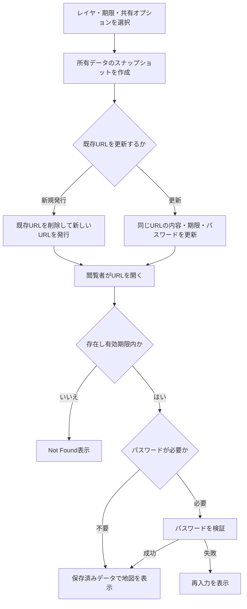

# 一時共有URLの利用・検証

選択したレイヤのマーカー・図形を、ログイン不要のURLで公開する。ユーザーごとに1件の共有URLを保持し、有効期限と任意のパスワードを設定できる。マーカー・図形・レイヤ名は発行・更新時点のスナップショットとなる。

## 現在の処理フロー



## 利用手順

1. 共有リンクの作成画面で共有するレイヤを選択する。空の選択では発行できない。
2. 有効期間を分単位で指定し、必要ならパスワードを設定する。
3. 図形を公開する場合は図形共有、重ね合わせタイルを公開する場合はタイル共有を有効にする。
4. 新規発行または既存リンクの更新を実行し、表示されたURLを使用する。
5. 終了時は共有を停止する。期限切れの場合も以後のアクセスでは無効となる。

パスワードは前後の空白を除いて処理し、空なら保護なし。現行実装はUTF-8のバイト数で4～64バイトを検証し、bcryptハッシュだけを保存する。

## 保存内容と更新タイミング

`temporary_urls`に共有ID、所有者、URL、期限、パスワードハッシュ、レイヤ・マーカー・図形のJSON、タイル共有可否を保存する。

| 対象 | 反映時点 |
|---|---|
| レイヤ名・マーカー・図形 | 発行または共有内容の更新時 |
| 重ね合わせタイル | 共有を許可した場合のみ、作成者の最新の有効な登録内容をページ読込時に取得 |
| 添付ファイル | 本文中の参照先から取得。既存のファイル閲覧制御に従う |

元データの編集や削除は保存済みスナップショットへ自動反映しない。既にブラウザへ渡した内容を停止操作だけで回収する機能ではない。最新位置を定期表示する用途は[現在位置共有](LIVE_LOCATION_SHARING.md)を使用する。

## URLの初期表示設定

```text
/onetime/{共有ID}?is_checked=false&lat=35.681236&lng=139.767125&zoom=14&isMapUiHidden=false&is_overlay_tile=false
```

| パラメータ | 動作 |
|---|---|
| `is_checked` | `false`で共有レイヤを初期非表示。未指定時は表示 |
| `lat`・`lng` | 初期中心。未指定・不正時は既定の緯度39.2、経度138.5を使用 |
| `zoom` | 0～22。未指定・不正時は6 |
| `isMapUiHidden` | モバイルの操作UI。`false`で初期表示、未指定時は隠す |
| `is_overlay_tile` | タイル共有が有効な場合、`false`で初期非表示。未指定時は表示 |

非表示のレイヤは閲覧者がチェックして表示できる。パスワード入力後も初期表示指定を引き継ぐ。`include_tile_overlays=false`の共有をクエリパラメータで有効化することはできない。

## API

| メソッド・パス | 認証と用途 |
|---|---|
| POST `/onetimeurl/generate` | 所有者認証。新規発行・既存更新 |
| GET `/onetimeurl/current` | 所有者認証。現在のURLと期限等 |
| DELETE `/onetimeurl/delete/{id_url}` | 所有者認証。停止 |
| GET `/onetime/{url_id}` | 公開。地図またはパスワード画面 |
| POST `/onetime/{url_id}` | 公開。パスワード検証後に地図を返す |

作成本文は`layers`、`minutes`、`update_url`、`share_password`、`include_shapes`、`include_tile_overlays`等を使用する。ライブマップの閲覧Cookieとは異なり、このパスワードPOSTは検証後に地図HTMLを返す。

## 検証手順

- レイヤと図形共有の選択に従うこと、他のレイヤが含まれないことを確認する。
- 元データ編集だけでは共有内容が変わらず、共有更新後に再読み込みすると反映することを確認する。
- 同じURLの更新、新規発行時の旧URL失効、停止、期限切れ、不正URLを確認する。
- パスワードの設定・変更・解除・誤入力と、認証前後のURLパラメータ維持を確認する。
- タイル共有の有無と初期チェック、匿名閲覧時の添付ファイル表示を確認する。

## 関連する実装

[共有ハンドラー](../src/handler/onetime_url.rs)、[共有データ型](../src/model/onetime_url.rs)、[重ね合わせタイル](TILE_OVERLAYS.md)、[ファイル管理](FILE_MANAGEMENT.md)、[検索](SEARCH_AND_GEOCODING.md)。
