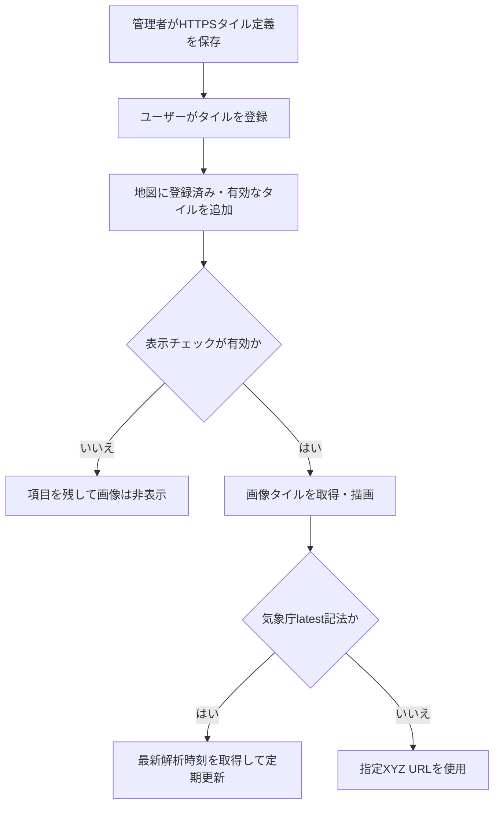

# 重ね合わせタイルの利用・検証

背景地図の上に、ハザードマップや雨雲などの画像タイルを重ねる。管理者が定義を用意し、各ユーザーが利用するタイルを登録する。登録状態と地図上の表示チェックは別に管理する。

## 現在の処理フロー



タイルは背景地図より上、マーカー・図形より下へ描画し、表示順・名前・IDの順で並べる。

## 必要な構成・登録手順

タイル定義を`tile_overlay_model`、ユーザーの登録を`user_tile_overlay_model`に保存する。[マイグレーション](../migrations/)のタイル定義、共有URLのタイル共有可否、ライブマップのタイル使用可否を適用する。

1. 管理画面の「タイル追加設定」で名前、URL、出典、ズーム、不透明度、表示順、有効状態を保存する。
2. PC・モバイルの新規レイヤ作成モーダルで「重ね合わせタイル」を選ぶ。
3. 「追加」をチェックして自分のアカウントへ登録する。変更は自動保存する。
4. 地図のコントロールで登録済みタイルの表示・非表示を切り替える。

保存中は連続操作やモーダル終了を制限する。保存失敗時はチェック状態を変更せずエラーを表示する。管理者による無効化では登録を残し、再度有効にすると利用できる。定義削除では関連するユーザー登録も削除する。

## 定義の制約

| 項目 | 条件 |
|---|---|
| 名前 | 空白だけは不可、最大100文字 |
| URL | HTTPS、最大4096バイト、`{z}`・`{x}`・`{y}`をすべて含む |
| URLの資格情報・フラグメント | 不可。未知の波括弧プレースホルダーも不可 |
| 出典 | 最大1000文字 |
| 最小・最大ズーム | 0～22、最大は最小以上 |
| 不透明度 | 0～1 |

出典は通常のテキストとHTTP(S)の絶対URLリンクを表示できる。入力HTMLをそのまま実行せず、許可したリンクとテキストへ再構成し、リンクに`noopener noreferrer`を設定する。

## 画面ごとの保存・共有

| 画面 | 参照元・初期表示 |
|---|---|
| 通常・モバイル・別画面 | 自分の登録。チェック状態をアカウント別ローカルストレージへ保存 |
| 一時共有 | 作成者の最新登録。`include_tile_overlays=true`のときだけ利用可 |
| ライブマップ | マップ作成者の最新登録。`use_tile_overlays=true`のときだけ利用可 |

通常画面のキーは`geocode-web:tile-overlay-visibility:{accountId}`。未保存のタイルは表示し、削除・無効化・登録解除で利用できなくなった保存値を除去する。保存データの破損やストレージ利用不可で地図操作を止めない。

一時共有は`is_overlay_tile=false`で初期非表示、未指定時は表示。新規のタイル共有可否は既定false。既存リンクの移行では互換性のためtrueとしている。

ライブマップは`is_check_overlay=true`のときだけ初期表示。使用可否の既定値はtrue。共有ページのチェック状態はローカルストレージへ保存しない。どちらもURLパラメータで共有・使用の禁止を解除することはできない。

## 気象庁ナウキャスト

次のURLを登録すると、本アプリの最新雨雲表示として扱う。

```text
https://www.jma.go.jp/bosai/jmatile/data/nowc/latest/none/latest/surf/hrpns/{z}/{x}/{y}.png
```

設定例は最小ズーム4、最大18、不透明度0.7、出典「気象庁」。`latest`はGeoCode-Web内の識別記法で、そのまま画像配信元へ送信しない。前後空白を除く完全一致で判定し、クエリ付き・別ホスト・日時固定は通常のXYZタイルとする。

現在の実装は`targetTimes_N1.json`から`hrpns`を含む最新解析を選び、地図に日本時間で対象時刻を表示する。表示中は通常300秒間隔で再確認し、時刻が変わったときだけ画像を更新する。通信は15秒で打ち切り、失敗時は2分、4分、最大5分間隔で再試行する。

非表示・タブ背景化・地図破棄で定期取得を止め、再表示時に確認する。対象時刻から15分以上経過した画像は隠す。これは本アプリの鮮度基準。チェックは維持し、取得が回復すれば表示を再開する。

対応は降水強度の最新解析PNGのみ。予報選択、過去再生、雷・竜巻、欠測域GeoJSONの重ね合わせは対象外。透明部分は無降水だけを意味せず、欠測や対象外を含む。現行の配信ズーム4・6・8・10に合わせ、奇数ズームと10より上は拡大表示する。

時刻・取得状態の表示位置は画面ごとに変わる。モバイルのUI切替に連動する画面があり、ライブマップは幅700px以下でステータスを隠す。ステータスの非表示だけでは雨雲タイルの更新を止めない。

ブラウザから気象庁のJSON・画像へ接続する。前段プロキシでCSPを追加する場合も`https://www.jma.go.jp`への接続を許可する。外部の公開ファイル形式・CORS等が変更された場合は再検証する。

## API・読込失敗

| メソッド・パス | 認証と用途 |
|---|---|
| GET `/tile-overlays` | アカウント認証。選択可能なタイルと登録状態 |
| PUT `/tile-overlays/{id}` | アカウント認証。自分の登録・解除 |
| GET / POST `/admin/tile-overlays` | 管理者。定義一覧・作成 |
| PUT / DELETE `/admin/tile-overlays/{id}` | 管理者。定義更新・削除 |

画像読み込み失敗はデータ未提供地域でも起きるため、URL誤りとは断定しない。画像エラーイベントだけではHTTPステータスを判定できない。ブラウザの通信表示で確認する。ログはタイルID・名前・座標を使用し、URLを含めない。

## 検証手順

- 管理者の作成・編集・無効化・削除と、一般ユーザーの登録・解除・表示切替を確認する。
- 不正URL、ズーム範囲、不透明度、出典HTMLの除去と許可リンクを確認する。
- 再読み込み、アカウント切替、ストレージ破損、タイル無効化後の復元を確認する。
- 一時共有・ライブマップの使用可否、参照元、初期表示パラメータの違いを確認する。
- 雨雲の時刻更新、タブ背景化、通信失敗、15分経過、復旧、ズーム変更を確認する。

## 関連する実装

[タイルAPI](../src/handler/tile_overlays.rs)、[表示処理](../src_frontend/template-scripts/src/map/common/tile-overlays.ts)、[ナウキャスト時刻](../src_frontend/template-scripts/src/map/common/nowcast-time.ts)、[ナウキャスト描画](../src_frontend/template-scripts/src/map/common/nowcast-layer.ts)、[既存結合テスト](../tests/tile_overlays.rs)、[一時共有](TEMPORARY_SHARING.md)、[現在位置共有](LIVE_LOCATION_SHARING.md)。
