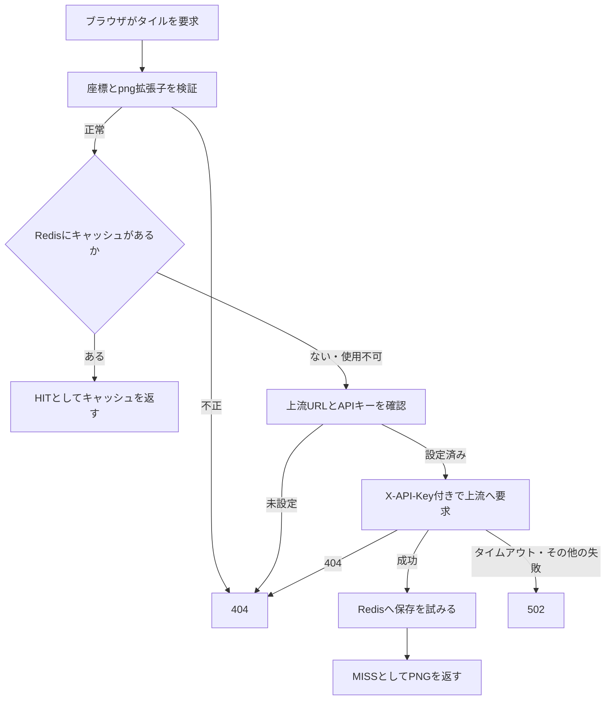

# タイル配信プロキシの導入・検証

`/tile/{z}/{x}/{y}.png`で上流タイルサーバのPNGを中継する。上流の`X-API-Key`はRustサーバから付与し、ブラウザへ渡さない。Redisを設定するとタイルを一定期間キャッシュする。

本体に組み込まれた[ローカル地図](LOCAL_TILES.md)は、完成DBから生成し、`/local-tiles/<dataset_id>/<render_id>/{z}/{x}/{y}.png`で配信する別経路である。ローカル側はRedisや上流接続を必要とせず、外部プロキシの設定・revision・上限ズーム19は維持する。ローカル背景を選んでも、ここで説明する外部プロキシ設定は自動変更しない。

## 現在の処理フロー



キャッシュを先に参照するため、有効期間内に保存済みのタイルは、上流キーが無効な間も取得できる。ブラウザのキャッシュとRedisのキャッシュは別に働く。

## サーバ設定

通常のTauri起動・サーバー単体モードでは、実行時設定JSONの`tile_server_base_url`・`tile_server_api_key`・`redis_url`等を読み込む。以下は開発・検証時に内部サーバーへ渡す環境変数の例である。通常利用の設定ファイルと管理画面からの設定は、後述の[管理画面からの設定](#管理画面からの設定)を参照する。

```dotenv
TILE_SERVER_BASE_URL=https://tiles.example.com
TILE_SERVER_API_KEY=<上流用APIキー>
REDIS_URL=redis://redis:6379
REDIS_CONNECT_TIMEOUT_SECONDS=3
TILE_CACHE_TTL_SECONDS=604800
TILE_CACHE_NAMESPACE=default
```

例のURL・キーは実環境に置き換える。Redisを使わない場合は`REDIS_URL`を未設定とする。秘密はGitやWebアセットへ含めない。

| 設定 | 動作 |
|---|---|
| `TILE_SERVER_BASE_URL` | 上流のベースURL。末尾に`/{z}/{x}/{y}.png`を付ける |
| `TILE_SERVER_API_KEY` | 上流へ送るキー。キャッシュMISS時に必要 |
| `REDIS_URL` | 任意のRedis接続先 |
| `REDIS_CONNECT_TIMEOUT_SECONDS` | 接続待機。既定3秒 |
| `TILE_CACHE_TTL_SECONDS` | Redisの保持秒数。既定604800秒、0でキャッシュ無効 |
| `TILE_CACHE_NAMESPACE` | キャッシュキーの名前空間。既定`default` |

サーバから上流へのHTTP(S)通信と、利用する場合はRedisへの通信を可能にする。上流への要求は10秒で打ち切る。実行時設定JSONを編集した場合は再起動して反映する。管理画面から適用する設定は、運転中のサーバーへ反映する。

地図からは`/tile/{z}/{x}/{y}.png`を背景地図のタイルURLとして使用する。管理者が登録する[重ね合わせタイル](TILE_OVERLAYS.md)のURLは絶対HTTPSを要求するため、相対URLの例をそのまま入力しない。

## API・キャッシュ

| メソッド・パス | 認証と用途 |
|---|---|
| GET `/tile/{z}/{x}/{y}.png` | 匿名要求も許容するタイル配信 |

`FlexibleCookieValidator`配下だが、アカウント必須のAPIではない。上流APIキーを隠すことと、下流の閲覧を認証で制限することは別。

座標は`z <= 19`、`x < 2^z`、`y < 2^z`の非負整数。拡張子不正・座標範囲外は404。上流404も404、タイムアウトやその他の取得失敗は502を返す。

中継設定の版がない初期状態の正常応答には、以下を設定する。管理設定の保存後は、後述する要求の版と有効設定の一致によってキャッシュを制御する。

```text
Content-Type: image/png
Cache-Control: public, max-age=604800, immutable
X-Tile-Cache: HIT または MISS
```

中継設定の版がない初期状態のRedisキーは`tile:{namespace}:{z}:{x}:{y}`。上流URLはキーに含まれないため、同じRedisで異なる上流を使う環境は名前空間を分ける。管理画面からの中継設定には設定の版を含むキーを使用する。Redisの読み込み失敗は上流取得へ進み、書き込み失敗でも取得済み画像を返す。

`TILE_CACHE_TTL_SECONDS`はRedis用で、正常応答のブラウザキャッシュ期間を変更しない。上流変更時は名前空間に加えてブラウザ側に残るキャッシュも考慮する。TTLを0にすると共通Redis接続を使うライブマップの位置キャッシュにも影響する。

## 管理画面からの設定

管理画面の「タイルサーバ設定」で、ラスタ中継先・APIキーとベクタ配信元の接続許可を保存できる。起動時マイグレーション25で`tile_server_settings`を追加する。初期状態では、実行時設定JSONの`tile_server_base_url`・`tile_server_api_key`・`vector_tile_allowed_origins`を使用する。

実行時設定JSONは通常のTauri起動・サーバー単体モードともに`~/.geocode-web-single/geocode-web-single.env.json`を使用する。`tile_settings_encryption_key`は32バイトのBase64暗号鍵として初回セットアップ時に生成し、既存JSONで項目省略・`null`の場合も生成・保存する。空文字列を含む不正な文字列は起動時に拒否する。DB内の管理設定を復元するため、SQLite DBと設定JSONを合わせて保管する。

1. 上流のベースURLと、上流で提供されるPNGの確認座標を入力する。同じURLのキーは空欄で引き継げる。URLを変える場合は新しいキーを入力する。
2. 「接続確認」で候補の画像を取得し、「適用」で保存する。保存時にも取得を確認し、失敗時は現在の有効設定を使う。
3. 地図を開き直し、`/tile/{z}/{x}/{y}.png`を使用する背景や重ね合わせタイルを確認する。

画面の「環境変数へ戻す」は、起動時に実行時設定JSONから読み込んだ値へ戻す操作となる。キーの平文は設定取得APIへ返さず、DBでは暗号化して保存する。設定更新は版を照合し、他の管理者による更新後は最新の設定を再取得してから適用する。

Tauri・サーバー単体の全起動経路で、DBへ保存した管理設定を読み込んでから配信を開始する。管理設定を適用したプロセスは直ちに切り替わり、他のプロセスは5秒間隔で再取得する。運転中のDB読み込みに失敗した場合は、直近の有効設定を使う。

管理設定の上流は公開HTTPSを使用する。HTTPやLANの上流を使う場合は、実行時設定JSONの`tile_proxy_allowed_origins`へ`http://tile-server:8080`のようなオリジンをカンマ区切りで指定し、再起動する。接続確認ではリダイレクトを追わず、PNGを4MiB・縦横各2048ピクセル以内に制限する。

中継設定の変更時は、Redisのキーへ設定の版を含めて切り替える。再読み込みした地図は描画用URLに`?v=<版>`を付ける。有効設定と版が一致する要求へ長期キャッシュを許可し、版なし・旧版の要求へは現在のタイルを`no-store`で返す。保存済み共有の背景定義を復元した場合も、中継画像は有効な上流から取得する。

「ベクタ配信元」には、スタイル・タイル・glyph・spriteが使うHTTPSオリジンを登録する。空の一覧を適用すると追加許可がなくなり、「環境変数へ戻す」で実行時設定JSONの`vector_tile_allowed_origins`を使用する。地図を開き直すとCSPへ反映される。保存済み共有が使う配信元も許可一覧へ含める。配信元側のCORSにも対応が必要となる。

| 管理API | 用途 |
|---|---|
| `GET /admin/tile-server-settings` | 有効設定と版を取得 |
| `POST /admin/tile-server-settings/proxy/check` | 指定座標のPNGを取得して確認 |
| `PUT /admin/tile-server-settings/proxy` | 中継設定の適用・初期設定への復帰 |
| `PUT /admin/tile-server-settings/vector-origins` | ベクタ接続許可の適用・初期設定への復帰 |

## 導入順と戻し方

1. 上流接続先・キーを検証環境に設定し、RedisなしでPNGを取得する。
2. 必要ならRedisを設定して再起動し、同じ座標のMISSからHITへの変化を確認する。
3. 地図の背景タイルとして設定し、複数ズームと提供範囲を確認する。

キャッシュだけを無効にする場合は`TILE_CACHE_TTL_SECONDS=0`またはRedis設定を外して再起動する。既にブラウザへ配信した画像を即時に回収する操作ではない。プロキシ利用をやめる場合は地図の参照先も変更する。

## 検証手順

- 有効座標、不正座標、上流404、上流認証失敗、10秒のタイムアウトを確認する。
- Redisなし・接続失敗・稼働中の各状態で画像が取得できることを確認する。
- キャッシュHIT時に上流へ要求しないこと、有効期間後に再取得することを確認する。
- ブラウザの要求に上流キーが含まれず、匿名でもタイルを取得できる現行範囲を確認する。
- 名前空間と上流変更時のキャッシュ分離を確認する。

## 関連する実装

[配信ハンドラー](../src/handler/tiles.rs)、[ルートとHTTPクライアント](../src/router.rs)、[設定](../src/config.rs)、[現在位置共有](LIVE_LOCATION_SHARING.md)。
