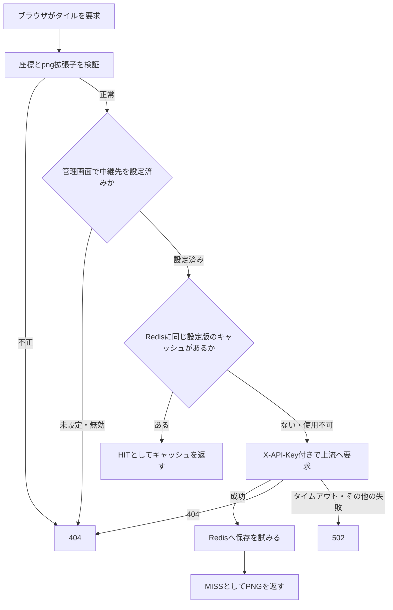

# タイル配信プロキシの導入・検証

`/tile/{z}/{x}/{y}.png`で上流タイルサーバのPNGを中継する。上流の`X-API-Key`はRustサーバから付与し、ブラウザへ渡さない。Redisを設定するとタイルを一定期間キャッシュする。

本体に組み込まれた[ローカル地図](LOCAL_TILES.md)は、完成DBから生成し、`/local-tiles/<dataset_id>/<render_id>/{z}/{x}/{y}.png`で配信する別経路である。ローカル側はRedisや上流接続を必要とせず、外部プロキシの設定・revision・上限ズーム19は維持する。ローカル背景を選んでも、ここで説明する外部プロキシ設定は自動変更しない。

## 現在の処理フロー

中継設定が有効な間は、同じ設定版で保存されたタイルをRedisから取得できる。管理画面で中継を無効にすると、Redisを参照せず404を返す。ブラウザのキャッシュとRedisのキャッシュは独立している。

## サーバ設定

中継先URLとAPIキーは管理画面から本体DBへ保存する。Tauri起動・サーバー単体モードとも、Redisの接続や中継先の例外許可には実行時設定JSONを使用する。

| 実行時設定JSON | 動作 |
|---|---|
| `tile_settings_encryption_key` | 管理設定のAPIキーを暗号化する鍵 |
| `tile_proxy_allowed_origins` | HTTP・LAN内の上流を利用する場合の許可オリジン |
| `redis_url` | 任意のRedis接続先 |
| `redis_connect_timeout_seconds` | 接続待機。既定3秒 |
| `tile_cache_ttl_seconds` | Redisの保持秒数。既定604800秒、0でキャッシュ無効 |
| `tile_cache_namespace` | キャッシュキーの名前空間。既定`default` |

サーバから上流へのHTTP(S)通信と、利用する場合はRedisへの通信を可能にする。上流への要求は10秒で打ち切る。実行時設定JSONを編集した場合は再起動して反映する。管理画面から適用する設定は、運転中のサーバーへ反映する。

地図からは`/tile/{z}/{x}/{y}.png`を背景地図のタイルURLとして使用する。管理者が登録する[重ね合わせタイル](TILE_OVERLAYS.md)のURLは絶対HTTPSを要求するため、相対URLの例をそのまま入力しない。

## API・キャッシュ

| メソッド・パス | 認証と用途 |
|---|---|
| GET `/tile/{z}/{x}/{y}.png` | 匿名要求も許容するタイル配信 |

`FlexibleCookieValidator`配下だが、アカウント必須のAPIではない。上流APIキーを隠すことと、下流の閲覧を認証で制限することは別。

座標は`z <= 19`、`x < 2^z`、`y < 2^z`の非負整数。拡張子不正・座標範囲外は404。上流404も404、タイムアウトやその他の取得失敗は502を返す。

中継設定が未登録・無効の場合は404と `Cache-Control: no-store` を返す。正常応答には `Content-Type: image/png` と `X-Tile-Cache: HIT` または `MISS` を付ける。

Redisキーは `tile:{namespace}:revision:{proxy_revision}:{z}:{x}:{y}`。読込失敗時は上流取得へ進み、書込失敗でも取得済み画像を返す。

`TILE_CACHE_TTL_SECONDS`はRedis用で、正常応答のブラウザキャッシュ期間を変更しない。上流変更時は名前空間に加えてブラウザ側に残るキャッシュも考慮する。TTLを0にすると共通Redis接続を使うライブマップの位置キャッシュにも影響する。

## 管理画面からの設定

管理画面の「タイルサーバ設定」で、ラスタ中継先・APIキーとベクタ配信元の接続許可を保存できる。起動時マイグレーション25で作成した `tile_server_settings` に保存する。ラスタ中継の初期状態は無効。

実行時設定JSONは通常のTauri起動・サーバー単体モードともに`~/.geocode-web-single/geocode-web-single.env.json`を使用する。`tile_settings_encryption_key`は32バイトのBase64暗号鍵として初回セットアップ時に生成し、既存JSONで項目省略・`null`の場合も生成・保存する。空文字列を含む不正な文字列は起動時に拒否する。DB内の管理設定を復元するため、SQLite DBと設定JSONを合わせて保管する。

1. 上流のベースURLと、上流で提供されるPNGの確認座標を入力する。同じURLのキーは空欄で引き継げる。URLを変える場合は新しいキーを入力する。
2. 「接続確認」で候補の画像を取得し、「中継設定を適用」で保存する。保存時にも取得を確認し、失敗時は現在の有効設定を使う。
3. 地図を開き直し、`/tile/{z}/{x}/{y}.png`を使用する背景や重ね合わせタイルを確認する。

「中継を無効にする」でラスタ中継設定を解除する。キーをDBに暗号化して保存し、設定取得APIではキーの設定有無だけを返す。設定更新は版を照合し、他の管理者による更新後は最新の設定を再取得してから適用する。

Tauri・サーバー単体の全起動経路で、DBへ保存した管理設定を読み込んでから配信を開始する。管理設定を適用したプロセスは直ちに切り替わり、他のプロセスは5秒間隔で再取得する。運転中のDB読み込みに失敗した場合は、直近の有効設定を使う。

管理設定の上流は公開HTTPSを使用する。HTTPやLANの上流を使う場合は、実行時設定JSONの`tile_proxy_allowed_origins`へ`http://tile-server:8080`のようなオリジンをカンマ区切りで指定し、再起動する。接続確認ではリダイレクトを追わず、PNGを4MiB・縦横各2048ピクセル以内に制限する。

中継設定の変更時は、Redisのキーを設定版ごとに切り替える。再読み込みした地図は描画用URLに `?v=<版>` を付ける。有効設定と版が一致する要求に `Cache-Control: public, max-age=604800, immutable` を付け、版なし・旧版の要求へは現在のタイルを `no-store` で返す。保存済み共有の背景定義を復元した場合も、中継画像は有効な上流から取得する。

「ベクタ配信元」には、スタイル・タイル・glyph・spriteが使うHTTPSオリジンを登録する。空の一覧を適用すると追加許可がなくなり、「接続許可先を環境変数に戻す」で実行時設定JSONの `vector_tile_allowed_origins` を使用する。地図を開き直すとCSPへ反映される。保存済み共有が使う配信元も許可一覧へ含める。配信元側のCORSにも対応が必要となる。

| 管理API | 用途 |
|---|---|
| `GET /admin/tile-server-settings` | 有効設定と版を取得 |
| `POST /admin/tile-server-settings/proxy/check` | 指定座標のPNGを取得して確認 |
| `PUT /admin/tile-server-settings/proxy` | 中継設定の適用（`mode: "apply"`）・無効化（`mode: "disable"`） |
| `PUT /admin/tile-server-settings/vector-origins` | ベクタ接続許可の適用・初期設定への復帰 |

## 旧設定からの移行

旧設定JSONの `tile_server_base_url`・`tile_server_api_key` または旧環境変数の `TILE_SERVER_BASE_URL`・`TILE_SERVER_API_KEY` で中継している場合は、更新前の版で「タイルサーバ設定」を開き、同じ中継先とキーを入力して「中継設定を適用」を実行する。DBへ保存した設定を更新後も使用する。移行せず更新済みの場合は、旧設定を参照して同画面へ中継先とキーを登録する。

## 導入順と戻し方

1. 上流接続先・キーを検証環境に設定し、RedisなしでPNGを取得する。
2. 必要ならRedisを設定して再起動し、同じ座標のMISSからHITへの変化を確認する。
3. 地図の背景タイルとして設定し、複数ズームと提供範囲を確認する。

キャッシュだけを無効にする場合は`TILE_CACHE_TTL_SECONDS=0`またはRedis設定を外して再起動する。既にブラウザへ配信した画像を即時に回収する操作ではない。プロキシ利用をやめる場合は地図の参照先も変更する。

## 検証手順

- 有効座標、不正座標、上流404、上流認証失敗、10秒のタイムアウトを確認する。
- Redisなし・接続失敗・稼働中の各状態で画像が取得できることを確認する。
- キャッシュHIT時に上流へ要求しないこと、有効期間後に再取得することを確認する。
- ブラウザの要求に上流キーが含まれず、匿名でもタイルを取得できる現行範囲を確認する。
- 名前空間と上流変更時のキャッシュ分離を確認する。

## 関連する実装

[配信ハンドラー](../src/handler/tiles.rs)、[ルートとHTTPクライアント](../src/router.rs)、[設定](../src/config.rs)、[現在位置共有](LIVE_LOCATION_SHARING.md)。
