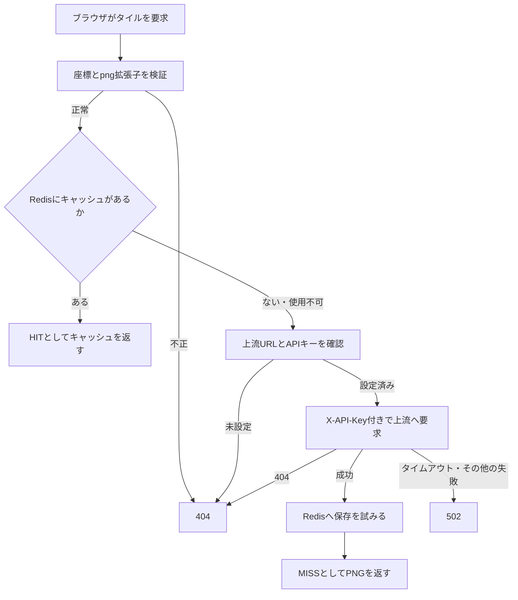

# タイル配信プロキシの導入・検証

`/tile/{z}/{x}/{y}.png`で上流タイルサーバのPNGを中継する。上流の`X-API-Key`はRustサーバから付与し、ブラウザへ渡さない。Redisを設定するとタイルを一定期間キャッシュする。

## 現在の処理フロー



キャッシュを先に参照するため、有効期間内に保存済みのタイルは、上流キーが無効な間も取得できる。ブラウザのキャッシュとRedisのキャッシュは別に働く。

## サーバ設定

```dotenv
TILE_SERVER_BASE_URL=https://tiles.example.com
TILE_SERVER_API_KEY=<上流用APIキー>
REDIS_URL=redis://redis:6379
REDIS_CONNECT_TIMEOUT_SECONDS=3
TILE_CACHE_TTL_SECONDS=604800
TILE_CACHE_NAMESPACE=default
```

例のURL・キーは実環境に置き換える。Redisを使わない場合は`REDIS_URL`を未設定とする。秘密はGitやWebアセットへ含めない。

| 設定 | 動作 |
|---|---|
| `TILE_SERVER_BASE_URL` | 上流のベースURL。末尾に`/{z}/{x}/{y}.png`を付ける |
| `TILE_SERVER_API_KEY` | 上流へ送るキー。キャッシュMISS時に必要 |
| `REDIS_URL` | 任意のRedis接続先 |
| `REDIS_CONNECT_TIMEOUT_SECONDS` | 接続待機。既定3秒 |
| `TILE_CACHE_TTL_SECONDS` | Redisの保持秒数。既定604800秒、0でキャッシュ無効 |
| `TILE_CACHE_NAMESPACE` | キャッシュキーの名前空間。既定`default` |

サーバから上流へのHTTP(S)通信と、利用する場合はRedisへの通信を可能にする。上流への要求は10秒で打ち切る。設定変更はサーバの全プロセスを再起動して反映する。

地図からは`/tile/{z}/{x}/{y}.png`を背景地図のタイルURLとして使用する。管理者が登録する[重ね合わせタイル](TILE_OVERLAYS.md)のURLは絶対HTTPSを要求するため、相対URLの例をそのまま入力しない。

## API・キャッシュ

| メソッド・パス | 認証と用途 |
|---|---|
| GET `/tile/{z}/{x}/{y}.png` | 匿名要求も許容するタイル配信 |

`FlexibleCookieValidator`配下だが、アカウント必須のAPIではない。上流APIキーを隠すことと、下流の閲覧を認証で制限することは別。

座標は`z <= 19`、`x < 2^z`、`y < 2^z`の非負整数。拡張子不正・座標範囲外は404。上流404も404、タイムアウトやその他の取得失敗は502を返す。

正常応答には以下を設定する。

```text
Content-Type: image/png
Cache-Control: public, max-age=604800, immutable
X-Tile-Cache: HIT または MISS
```

Redisのキーは`tile:{namespace}:{z}:{x}:{y}`。上流URLはキーに含まれないため、同じRedisで異なる上流を使う環境は名前空間を分ける。Redisの読み込み失敗は上流取得へ進み、書き込み失敗でも取得済み画像を返す。

`TILE_CACHE_TTL_SECONDS`はRedis用で、正常応答のブラウザキャッシュ期間を変更しない。上流変更時は名前空間に加えてブラウザ側に残るキャッシュも考慮する。TTLを0にすると共通Redis接続を使うライブマップの位置キャッシュにも影響する。

## 導入順と戻し方

1. 上流接続先・キーを検証環境に設定し、RedisなしでPNGを取得する。
2. 必要ならRedisを設定して再起動し、同じ座標のMISSからHITへの変化を確認する。
3. 地図の背景タイルとして設定し、複数ズームと提供範囲を確認する。

キャッシュだけを無効にする場合は`TILE_CACHE_TTL_SECONDS=0`またはRedis設定を外して再起動する。既にブラウザへ配信した画像を即時に回収する操作ではない。プロキシ利用をやめる場合は地図の参照先も変更する。

## 検証手順

- 有効座標、不正座標、上流404、上流認証失敗、10秒のタイムアウトを確認する。
- Redisなし・接続失敗・稼働中の各状態で画像が取得できることを確認する。
- キャッシュHIT時に上流へ要求しないこと、有効期間後に再取得することを確認する。
- ブラウザの要求に上流キーが含まれず、匿名でもタイルを取得できる現行範囲を確認する。
- 名前空間と上流変更時のキャッシュ分離を確認する。

## 関連する実装

[配信ハンドラー](../src/handler/tiles.rs)、[ルートとHTTPクライアント](../src/router.rs)、[設定](../src/config.rs)、[現在位置共有](LIVE_LOCATION_SHARING.md)。
