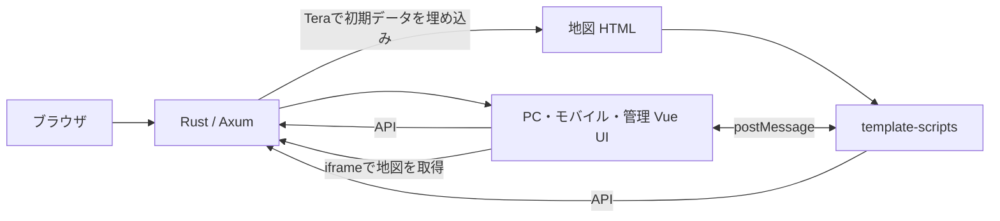
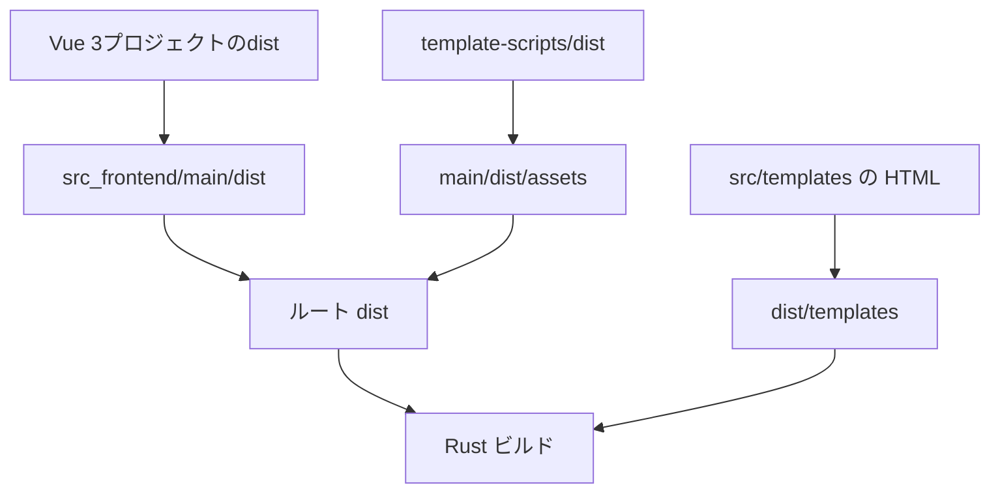

# フロントエンド全体構成

## 1. 対象と関連文書

この文書はフロントエンドの配置、画面間の責務、開発・配布の構成を説明する。アプリケーション全体の機能、権限、データモデル、APIの詳細は [ルート仕様書](../SPECIFICATION.md) を参照する。

| 領域 | 詳細仕様 | 役割 |
| --- | --- | --- |
| PC UI | [frontend](frontend/SPECIFICATION.md) | 一覧、設定、モーダルと編集地図の連携 |
| 管理 UI | [frontend-admin](frontend-admin/SPECIFICATION.md) | ユーザー、位置共有マップ、重ね合わせタイルの管理 |
| モバイル UI | [frontend-mobile](frontend-mobile/SPECIFICATION.md) | モバイル用の画面と編集地図の連携 |
| テンプレート用スクリプト | [template-scripts](template-scripts/SPECIFICATION.md) | 地図の表示・編集、公開フォーム、画像プレビュー |
| サーバー生成 HTML | [Tera templates](../src/templates/SPECIFICATION.md) | 初期データとDOM、資材の読み込み |

記述はソース・設定から確認した現行仕様である。実画面やOSの印刷ダイアログの動作保証を表すものではない。

## 2. ディレクトリ構成

```text
src_frontend/
├── frontend/          PC用Vueアプリ（独立したpackage.json）
├── frontend-admin/    管理用Vueアプリ（独立したpackage.json）
├── frontend-mobile/   モバイル用Vueアプリ（独立したpackage.json）
├── template-scripts/  Tera用TypeScript（独立したpackage.json）
├── scripts/           統合ビルド・配布用スクリプト
└── main/              統合時の作業場所。dist/は生成物
```

各プロジェクトが個別に依存関係とpackage-lock.jsonを持つ。共通のnpm workspaceによる一括管理ではない。PCとモバイルのVueコンポーネント、ストア、型定義は各プロジェクトに存在するため、片方の修正が自動で他方に反映されるとは限らない。

## 3. 実行時の関係



### 3.1 HTMLの選択と画面遷移

- `/` は `/index` にリダイレクトする。
- `/index` はUser-Agentに大文字小文字を区別した `Mobile` が含まれる場合、`index-mobile.html`、それ以外は `index.html` を返す。
- `/map` と一時共有地図もUser-AgentからPC／モバイルのテンプレートを選ぶ。Vue側の画面幅による切り替えではない。
- `/admin` はアクセストークンを必要とする。管理者には `index-admin.html`、管理者以外にはPCの `index.html` を返す。
- Vueアプリは `createWebHistory` を使用する。Vue内の `/mapview` や `/users/list` などと、RustがHTMLを返すURLは別に定義されている。
- Rustの未定義URLへのアクセスは `/index` にリダイレクトする。Vue内部URLを直接開く／再読み込みした場合に、その画面をそのまま再現する共通SPAフォールバックは実装されていない。

根拠: [src/lib.rs](../src/lib.rs)、[src/router.rs](../src/router.rs)、[管理者ハンドラー](../src/handler/admin.rs)。

### 3.2 UIと地図の分担

Vueは一覧、入力モーダル、アップロード、共有設定などを担当する。iframeの地図はLeafletを使用し、描画、クリック・タッチ操作、図形編集、ポップアップ、検索、計測を担当する。API通信はVueのAxiosと地図のfetchの両方に存在する。

Teraからの地図初期データとiframe間メッセージは [スクリプト仕様](template-scripts/SPECIFICATION.md) を参照する。管理UIが作成する公開URLはVueアプリを経由せずTera画面として閲覧できる。

## 4. 開発環境

VueアプリはVue 3、TypeScript、Vite、Vue Router、Pinia、Axiosを使用する。テストはVitestとjsdomを使用する。正確な依存バージョンは各package.jsonとlockfileを正とする。

各VueプロジェクトのVite設定は `base: "./"`、`envDir: "../../"`、`@` を `src/` に割り当てる。リポジトリルートの環境変数を参照する。

| 変数 | 用途 | 開発例 | 配布例 |
| --- | --- | --- | --- |
| `VITE_IP_ADDRESS` | APIと地図のバックエンドURL | `http://localhost:3000` | 空文字 |
| `VITE_ASSET_PATH` | UIアイコンなどのパス | `/` | `/assets/` |

Vite変数はビルド時に組み込まれる。API接続に必要なバックエンド・DBの準備は [README](../README.md) を参照する。開発サーバーだけではTera地図やAPIは動作しない。

Vueプロジェクトのディレクトリで実行する基本コマンド:

```sh
npm ci
npm run dev
npm run type-check
npm run test:run
npm run build
```

`build` は型チェックと `build-only` を並行実行する。`preview` は個別Vite成果物の確認用であり、統合配布の代替ではない。3つの開発サーバーを同時起動するとポートが変わる場合がある。バックエンドCORS、`/app-init` の許可オリジン、地図スクリプトの受信元判定を合わせて確認する。

`template-scripts` のコマンドは [個別仕様](template-scripts/SPECIFICATION.md) を参照する。開発・previewスクリプトは定義されていない。

## 5. ビルド・配布

### 5.1 成果物の流れ



統合スクリプトは既存の各distと統合先を削除して作り直す。PC、モバイル、管理、template-scriptsをビルドし、HTML内の一部資材パスを `/assets/` に置換する。モバイルHTMLは `index-mobile.html`、管理HTMLは `index-admin.html` に改名する。

Vue成果物を `main/dist/` に統合し、公開資材を `assets/` に集め、template-scriptsの成果物を同じassetsにコピーする。最後にルートdistへ配置し、Teraの `*.html` のみを `dist/templates/` にコピーする。仕様書はテンプレート配布の対象外である。

| 項目 | PowerShell版 | Shell版 |
| --- | --- | --- |
| ファイル | [frontends-builder.ps1](scripts/frontends-builder.ps1) | [frontends-builder.sh](scripts/frontends-builder.sh) |
| node_modulesがない場合 | `npm install` | `npm ci` |
| `-d` | node_modulesも削除して依存を再導入 | 同左 |
| Rustのビルド | 最後に `cargo build --release` を実行 | 実行しない。別途必要 |
| 資材移動 | js・mjs・css・json・svg等を移動 | js・css・svgと指定manifest等を移動 |

リポジトリルートから実行する:

```powershell
./src_frontend/scripts/frontends-builder.ps1
```

```sh
bash ./src_frontend/scripts/frontends-builder.sh
cargo build --release
```

スクリプト全体で各外部コマンドの失敗時停止を保証しているわけではないため、終了時の成果物だけでなく途中のビルドエラーも確認する。個別 `npm run build` は統合配置やRustの再ビルドを行わない。

### 5.2 共通資材の供給元

PCの [copy-vendor-assets.mjs](frontend/scripts/copy-vendor-assets.mjs) がLeaflet、MarkerCluster、marked、xss等をnpmから取り出す。Leaflet CSS内の画像参照を `/assets/` に書き換える。地図共通CSSなどはPCの `public/` にも配置されている。

このため、モバイル用地図・公開地図もPCプロジェクトが供給する資材に依存する。template-scriptsのビルドだけで地図配信に必要な全資材は揃わない。各Vueのpublicに同名資材がある場合、統合時のコピー順にも注意する。

Rustは `dist/`、`dist/assets/`、`dist/templates/` をrust-embedで参照する。配布用リリースでは、HTML・資材を整えてからRustバイナリを再ビルドする。

## 6. テストと変更時の確認

| 変更領域 | 確認先 |
| --- | --- |
| Vue画面・ストア・認証 | 対象プロジェクトの `src/**/__tests__/` |
| 地図の共通処理 | `template-scripts/tests/` |
| Tera・entry・vendorの接続 | `frontend/tests/template-js/` |
| 印刷 | PCのmapコンポーネントテスト、template-js、任意のPDF確認スクリプト |

新しい画面や資材を追加した際は、ソースだけでなく、HTML読み込み、Vite出力、統合コピー、Rust配信、関連テスト、対応する仕様書を確認する。機能差を意図せず生まないよう、PCとモバイルの両実装を確認する。

## 回答地図のCSV出力（PostgreSQL版・PC先行）

- 「地図を印刷」の隣に「CSV出力」を配置する。反映済みの回答条件・名前検索・レイヤ表示・マーカー／図形表示を満たす対象を固定する。画面外も対象とし、表示できない位置・形状は含めない。未反映の入力は使わず、地図の再読み込みは行わない。モバイル版は既存の回答一覧CSVを維持する。
- 1回答1行。履歴モードでは同じ対象でも条件に一致する回答ごとに出力する。一覧条件と地図追加条件はそれぞれ最大10件のANDで、同一回答に適用する。最新モードは最新回答を選んでから条件を適用し、過去回答で補わない。
- 認証必須のPOST /form-answers/map-csv-check（JSON）とPOST /form-answers/map-csv-download（フォームのqueryへJSON文字列）を追加する。要求はmap-filterと同じquery/as_of・対象ID・common_form_id・conditionsで、options_onlyはfalse。毎回所有権と条件を再検証する。本文・メモを解析せずsubmitted_valuesとform_snapshotを使用する。
- 地図iframeはanswer-map-csv-requestに対して表示中の対象IDだけを返す。親origin/window・地図要求ID・CSV要求ID・反映済み更新IDを照合する。初期対象外・重複ID・古い応答を拒否し、閉じた画面や再試行前の応答は破棄する。
- 出力名はgeocode-answer-map.csv。既存の回答一覧CSVと列順・値／状態列・UTF-8 BOM・CRLF・数式対策を共通化する。最大10,000回答・200種類の回答項目。超過はエラーとし切り捨てない。200回答単位でストリーム出力し、件数・列定義・全行は同一の読み取り専用REPEATABLE READトランザクションで取得する。事前確認と実出力のトランザクションは別で、実出力でも制限を確認する。
- 事前確認はapiClientを使い、ダウンロードはauthenticated-form.tsで期限切れ時に認証を更新して同じフォームを1回再送する。0件・通信失敗でも直前の地図を保持する。通常地図・地図印刷・回答一覧CSVのAPIと出力仕様、DBスキーマ、SQLite版は変更しない。

## 所有者によるフォームからの更新（PostgreSQL版）

- PC・モバイルの地図トップのName列から開く編集モーダル下部に「入力フォーム設定」「フォームで回答を登録」を配置し、「＋更新」はテキストエディタの右下に重ねて表示する。本文末尾がボタンに隠れないよう入力欄の下側に余白を確保する。保存済みフォームに入力項目がある場合だけ「フォームで回答を登録」を表示する。公開の有効・無効や公開用パスワードとは独立し、ログインした所有者が入力できる。
- 本文・メモ欄に「自由入力」と分析対象外の説明を常設し、「フォーム回答の分析対象にはなりません」を太字にする。PC版では説明をMarkdown操作ボタン列（map-object-edit-row）の後に配置する。追記済みの回答文を直接編集しても分析用の回答データは変更されないこと、分析するデータはフォームから登録することを案内する。案内中の「フォームで回答を登録」「入力フォーム設定」は太字にし、編集画面のボタン付近に回答保存・本文追記の説明を重複表示しない。フォーム回答のボタン名・入力画面名は「フォームで回答を登録」に統一し、回答データの保存と本文・メモへの追記を説明する。回答一覧の上部では内部入力・外部公開フォームの両方が分析対象で、本文・メモへの直接入力は含まれないことを常設表示する。確認モーダルは追加しない。
- 入力モーダルはマーカー・図形で共通。通常編集に未保存の変更がある場合は既存メッセージモーダルで確認し、保存成功後だけフォームを開く。キャンセル・保存失敗時は通常編集を保持する。背景クリックではフォーム入力を閉じない。
- 認証必須GET /marker/{id}/form/input、GET /shape/{id}/form/inputは現在のフォーム定義・設定照合トークン・引継ぎ値を返す。対象と適用元共通フォームID（個別フォームは対象単位）で最新の1回答だけを選び、form_snapshotの項目IDと型が現在定義に一致する値だけを引き継ぐ。過去回答の合成、本文・メモの再解析、定義がない回答の推測はしない。削除された選択肢は引き継がない。画像は新しい回答ごとに選択し、過去の画像は保持する。数値はブラウザへ文字列として返し、0・falseを未入力にしない。
- 認証必須POST /marker/{id}/form/submissions、POST /shape/{id}/form/submissionsは公開フォームと同じmultipart形式（submission JSONとimage__項目ID）を使用する。submissionにはconfig_tokenとvaluesを含める。apiClientで認証更新・再送信し、画像の縮小・サイズ上限・サーバー検証を既存処理と共通化する。要求上限は6MiB。公開URL・公開パスワードは使用せず、対象所有権を毎回確認する。
- 過去回答を変更せず、submitted_values・form_snapshot・source_form付きの新しい履歴を追加し、マーカー本文／図形メモへ既存方式のMarkdownを追記する。履歴・画像・本文／メモは同一トランザクションで保存し、設定変更は表示時のトークンと保存時の行ロックで検出して409を返す。所有者の画像容量制限・図形メモの上限も維持する。
- 保存APIは同じトランザクションで更新した対象情報を返す。ストア・編集欄・テーブル・地図の既存オブジェクト更新通知へ反映し、後続の通常編集で追記を消さない。保存成功後はフォーム入力モーダルと元の編集モーダルを両方閉じる。通常の成功経路では地図全体を再読込しない。フォームから名前・位置・レイヤ・形状・スタイルは変更しない。
- 送信中の二重操作を防ぎ、0件や通信失敗でも通常編集を使える。フォーム取得の古い応答・閉じた画面の応答は破棄する。設定競合時は入力を保持して再読み込みを案内する。読み取り・保存応答はno-store。
- 通常編集・公開フォームのAPIと入力仕様、回答一覧・分析検索・CSV・地図印刷の動作を維持する。DBマイグレーションは不要。SQLite版は変更しない。

## レイヤ管理の共通フォーム（PostgreSQL版）

- レイヤ設定に「共通フォームを設定」を追加する。未設定からの適用は既存・新規のマーカーと図形を対象とし、適用先にあるフォーム定義とパスワードを置き換える。公開URLと公開可否は既存対象で維持し、新規対象は公開無効を初期値とする。対象件数・置換・パスワードへの影響をメッセージモーダルで確認する。
- レイヤの適用元はlayer_model.common_form_id/common_form_version、競合確認はform_binding_revisionで保持する。対象のmanaged_layer_idで管理状態を明示する。source_formだけから管理状態を推測しない。masterの場合も実際にmasterへ所属する対象だけに適用し、集約表示される他レイヤへ波及させない。
- 共通フォームのタイトル・説明・項目変更はレイヤ管理中の対象だけへ自動反映する。従来の手動コピーの定義と適用元の版は変更しない。共通フォームの保存時に管理中レイヤ数・対象数を確認し、保存する版と件数をサーバーで再検証する。空レイヤへの設定も将来の作成へ有効。使用中の共通フォームの削除は拒否する。
- 管理中の入力フォーム設定では所定の案内を表示し、定義・適用元・個別パスワードの変更をUIとAPIの双方で拒否する。URLコピー・URL再発行・公開可否の変更だけを許可し、所有者の「フォームで回答を登録」は継続利用できる。
- 未設定への解除はフォーム設定を空にし、公開を無効にしてURLを失効させる。回答履歴・本文/メモ・画像は保持し、解除前の個別フォームを復元しない。別の管理レイヤへ移動すると移動先のフォームで置き換え、未設定レイヤへ移動すると適用済み定義を個別設定として保持する。同じレイヤ内の通常編集では再適用しない。
- 共通フォームのパスワードはハッシュのみ保存し、設定済みかどうかだけを返す。作成・編集で設定/再設定/解除できる。明示的なパスワード変更は手動コピー適用先も含めて現在同じsource_form.idを持つ対象へ反映し、手動コピーの項目定義は変えない。版・件数を確認して一括反映する。初回移行で既存対象のパスワードを変更しない。
- GET /layer/{id}/form（認証必須）は現在の適用元・版・revision・マーカー/図形件数を読み取り専用REPEATABLE READで返す。既存PUT /layer/update/{id}はupdate_common_form=trueのときだけcommon_form_id（nullで解除）・common_form_version・form_binding_revision・form_target_countを検証し、名前/アイコンと同じトランザクションで保存する。従来の引数だけならフォーム設定は変更しない。
- 共通フォームの保存はexpected_managed_countを、パスワード変更時はexpected_applied_countも検証する。影響する対象があるのに確認件数がない要求・古い版/件数は409。新規作成・移動・インポート・投稿・設定変更・削除は所有者の行ロックを先に取り、順序を統一する。一括適用中の追加も整合させ、途中の失敗は全体をロールバックする。地図表示の10,000件制限で適用対象を切り捨てない。
- 回答のsubmitted_values/form_snapshot/source_formは変更しない。必須化・項目追加/削除・選択肢変更は将来の回答だけに適用し、型変更時の新ID・削除済みIDの再使用拒否も維持する。フォームを開いた後に設定が変わった場合は照合トークンにより409を返す。公開フォームの新しいHTML/スクリプトも照合トークンを送るが、トークンがない従来の投稿形式は継続して受け付ける。
- マイグレーションは20261021120000_layer_common_forms.sql。PostgreSQL版は更新版の起動前に通常のsqlx migrate runで適用する。既存レイヤは未設定、既存対象は個別管理のまま導入し、既存URL・回答・パスワードに変更を加えない。SQLite版は変更しない。
