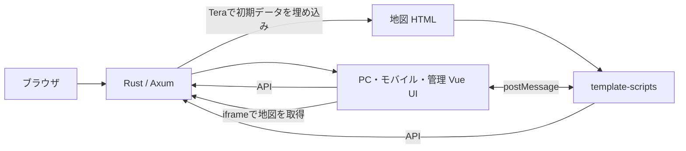
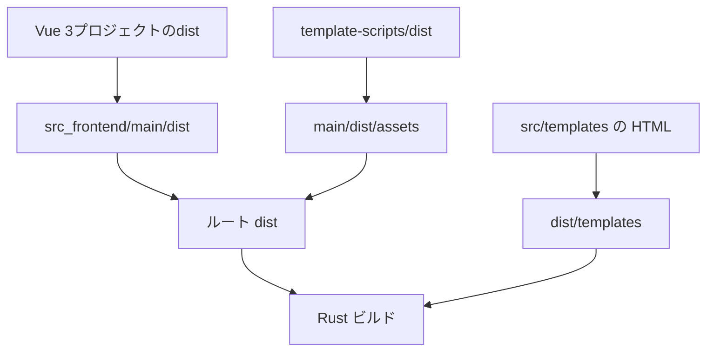

# フロントエンド全体構成

## 1. 対象と関連文書

この文書はフロントエンドの配置、画面間の責務、開発・配布の構成を説明する。アプリケーション全体の機能、権限、データモデル、APIの詳細は [ルート仕様書](../SPECIFICATION.md) を参照する。

| 領域 | 詳細仕様 | 役割 |
| --- | --- | --- |
| PC UI | [frontend](frontend/SPECIFICATION.md) | 一覧、設定、モーダルと編集地図の連携 |
| 管理 UI | [frontend-admin](frontend-admin/SPECIFICATION.md) | ユーザー、位置共有マップ、重ね合わせタイルの管理 |
| モバイル UI | [frontend-mobile](frontend-mobile/SPECIFICATION.md) | モバイル用の画面と編集地図の連携 |
| テンプレート用スクリプト | [template-scripts](template-scripts/SPECIFICATION.md) | 地図の表示・編集、公開フォーム、画像プレビュー |
| サーバー生成 HTML | [Tera templates](../src/templates/SPECIFICATION.md) | 初期データとDOM、資材の読み込み |

記述はソース・設定から確認した現行仕様である。実画面やOSの印刷ダイアログの動作保証を表すものではない。

## 2. ディレクトリ構成

```text
src_frontend/
├── frontend/          PC用Vueアプリ（独立したpackage.json）
├── frontend-admin/    管理用Vueアプリ（独立したpackage.json）
├── frontend-mobile/   モバイル用Vueアプリ（独立したpackage.json）
├── template-scripts/  Tera用TypeScript（独立したpackage.json）
├── scripts/           統合ビルド・配布用スクリプト
└── main/              統合時の作業場所。dist/は生成物
```

各プロジェクトが個別に依存関係とpackage-lock.jsonを持つ。共通のnpm workspaceによる一括管理ではない。PCとモバイルのVueコンポーネント、ストア、型定義は各プロジェクトに存在するため、片方の修正が自動で他方に反映されるとは限らない。

## 3. 実行時の関係



### 3.1 HTMLの選択と画面遷移

- `/` は `/index` にリダイレクトする。
- `/index` はUser-Agentに大文字小文字を区別した `Mobile` が含まれる場合、`index-mobile.html`、それ以外は `index.html` を返す。
- `/map` と一時共有地図もUser-AgentからPC／モバイルのテンプレートを選ぶ。Vue側の画面幅による切り替えではない。
- `/admin` はアクセストークンを必要とする。管理者には `index-admin.html`、管理者以外にはPCの `index.html` を返す。
- Vueアプリは `createWebHistory` を使用する。Vue内の `/mapview` や `/users/list` などと、RustがHTMLを返すURLは別に定義されている。
- Rustの未定義URLへのアクセスは `/index` にリダイレクトする。Vue内部URLを直接開く／再読み込みした場合に、その画面をそのまま再現する共通SPAフォールバックは実装されていない。

根拠: [src/lib.rs](../src/lib.rs)、[src/router.rs](../src/router.rs)、[管理者ハンドラー](../src/handler/admin.rs)。

### 3.2 UIと地図の分担

Vueは一覧、入力モーダル、アップロード、共有設定などを担当する。iframeの地図はLeafletを使用し、描画、クリック・タッチ操作、図形編集、ポップアップ、検索、計測を担当する。API通信はVueのAxiosと地図のfetchの両方に存在する。

Teraからの地図初期データとiframe間メッセージは [スクリプト仕様](template-scripts/SPECIFICATION.md) を参照する。管理UIが作成する公開URLはVueアプリを経由せずTera画面として閲覧できる。

### 3.3 全画面地図のスナップショット共有

PCの全画面地図は `/map-another` をiframeで表示する。「現在の地図を共有する」で、適用済みの絞り込み・検索と表示設定を満たす保持済みデータを固定し、`shareMapSnapshot` メッセージで親のVueへ渡す。親が送信元とデータを検証し、既存の共有設定・URL表示モーダルへ接続する。作成操作の詳細は [PC UI仕様](frontend/SPECIFICATION.md#全画面地図のスナップショット共有)、取得・通信・復元の契約は [地図スクリプト仕様](template-scripts/SPECIFICATION.md#全画面地図の共有スナップショット) を参照する。

共有URLは通常共有と共通のユーザーごとに1枠で、パスワード・期限・新規発行／URL更新・共有停止を共用する。絞り込みで除外したデータは共有へ送らず、画面外にある有効な対象は含める。0件の地図も保存できる。中心・ズーム・背景地図・色分け・グループとタイルの表示状態を保存し、外部配信のタイル画像自体は固定しない。

共有先はPC／モバイルのTera画面で保存済み状態を復元する。元データの再検索や閲覧端末の通常地図設定への書き戻しは行わない。スナップショットがない従来の共有は既存経路を維持する。モバイルVueには現在の地図をスナップショット共有する作成導線は追加していない。

### 3.4 全画面地図と一時共有地図の印刷・PDF出力

PCの全画面地図と一時共有地図は、地図内で `/assets/read-only-map-print.html` をiframeとして開く。地図の表示状態と、プレビューを開く時点の表示条件を満たす地物をブラウザ内で渡す。一時共有地図では、共有時に保存されて配信済みの地物が対象の上限となる。両画面とも共通の印刷プレビューで印刷・PDF出力する。画面間通信は [地図スクリプト仕様](template-scripts/SPECIFICATION.md#63-印刷通信)、利用・検証手順は [地図印刷・PDF出力](../docs/MAP_PRINTING.md) を参照する。

## 4. 開発環境

VueアプリはVue 3、TypeScript、Vite、Vue Router、Pinia、Axiosを使用する。テストはVitestとjsdomを使用する。正確な依存バージョンは各package.jsonとlockfileを正とする。

依存更新時はDockerのNode.js 22.22.0でも利用できることを確認する。Vitestと `@vitest/coverage-v8` は同じ版に固定し、更新時は [VMカバレッジprovider](template-scripts/tests/support/vm-coverage-server.mjs) のバージョンガードと [カバレッジ検証手順](../scripts/coverage/README.md) も確認する。

3つのVueプロジェクトでは、`@typescript-eslint/typescript-estree` と `editorconfig` 配下の `minimatch`、`js-beautify` 配下の `glob` を `overrides` で修正版へ更新している。親パッケージが修正版を許容するようになったらoverrideを解除して再監査する。`@vue/test-utils` は2.4.11に固定する。2.5系が導入する `nopt` 10はNode.js 22.22.2／24.15.0以降を要求するため、Node.jsの基準を更新する際に再検討する。

各VueプロジェクトのVite設定は `base: "./"`、`envDir: "../../"`、`@` を `src/` に割り当てる。リポジトリルートの環境変数を参照する。

| 変数 | 用途 | 開発例 | 配布例 |
| --- | --- | --- | --- |
| `VITE_IP_ADDRESS` | APIと地図のバックエンドURL | `http://localhost:3000` | 空文字 |
| `VITE_ASSET_PATH` | UIアイコンなどのパス | `/` | `/assets/` |

Vite変数はビルド時に組み込まれる。API接続に必要なバックエンド・DBの準備は [README](../README.md) を参照する。開発サーバーだけではTera地図やAPIは動作しない。

Vueプロジェクトのディレクトリで実行する基本コマンド:

```sh
npm ci
npm run dev
npm run type-check
npm run test:run
npm run build
```

`build` は型チェックと `build-only` を並行実行する。`preview` は個別Vite成果物の確認用であり、統合配布の代替ではない。3つの開発サーバーを同時起動するとポートが変わる場合がある。バックエンドCORS、`/app-init` の許可オリジン、地図スクリプトの受信元判定を合わせて確認する。

全画面地図から親へ共有データを送るoriginは、リリース版では同一originに限定する。Rustの開発ビルド（`debug_assertions`）は `http://localhost:5173` だけを追加で許可する。任意のViteポートやURLパラメーターを許可値として採用しないため、この導線の開発確認ではPCのViteを5173で起動する。

`template-scripts` のコマンドは [個別仕様](template-scripts/SPECIFICATION.md) を参照する。開発・previewスクリプトは定義されていない。

## 5. ビルド・配布

### 5.1 成果物の流れ



統合スクリプトはPC、モバイル、管理、template-scriptsをビルドし、HTML内の一部資材パスを `/assets/` に置換する。統合先ではモバイルHTMLを `index-mobile.html`、管理HTMLを `index-admin.html` として保存する。PowerShell版はコピー元HTMLを変更せず、4構成のビルド成功後に統合先を作り直す。フロントエンドの依存導入・ビルド失敗時は直前の配布成果物を残して停止する。最後のRustビルドが失敗した場合も異常終了するが、統合済みのdistは残る。

Vue成果物を `main/dist/` に統合し、公開資材を `assets/` に集め、template-scriptsの成果物を同じassetsにコピーする。最後にルートdistへ配置し、Teraの `*.html` のみを `dist/templates/` にコピーする。仕様書はテンプレート配布の対象外である。

| 項目 | PowerShell版 | Shell版 |
| --- | --- | --- |
| ファイル | [frontends-builder.ps1](scripts/frontends-builder.ps1) | [frontends-builder.sh](scripts/frontends-builder.sh) |
| node_modulesがない場合 | `npm ci` | `npm ci` |
| 依存定義の変更 | package.json・lockfile・.npmrcの指紋が変われば `npm ci` | `-d` を指定して `npm ci` |
| `-d` | 指紋にかかわらず `npm ci` | node_modulesの有無にかかわらず `npm ci` |
| Rustのビルド | 最後に `cargo build --release` を実行 | 実行しない。別途必要 |
| 資材移動 | js・mjs・css・json・svg等を移動 | js・css・svgと指定manifest等を移動 |

リポジトリルートから実行する:

```powershell
./src_frontend/scripts/frontends-builder.ps1
```

```sh
bash ./src_frontend/scripts/frontends-builder.sh
cargo build --release
```

スクリプト全体で各外部コマンドの失敗時停止を保証しているわけではないため、終了時の成果物だけでなく途中のビルドエラーも確認する。個別 `npm run build` は統合配置やRustの再ビルドを行わない。

### 5.2 共通資材の供給元

PCの [copy-vendor-assets.mjs](frontend/scripts/copy-vendor-assets.mjs) がLeaflet、MarkerCluster、marked、xss等をnpmから取り出す。Leaflet CSS内の画像参照を `/assets/` に書き換える。地図共通CSSなどはPCの `public/` にも配置されている。

このため、モバイル用地図・公開地図もPCプロジェクトが供給する資材に依存する。template-scriptsのビルドだけで地図配信に必要な全資材は揃わない。各Vueのpublicに同名資材がある場合、統合時のコピー順にも注意する。

Rustは `dist/`、`dist/assets/`、`dist/templates/` をrust-embedで参照する。配布用リリースでは、HTML・資材を整えてからRustバイナリを再ビルドする。

## 6. テストと変更時の確認

### SQLite版へのソース同期

`node src_frontend/scripts/sync-to-sqlite.mjs` で、プロジェクト直下の `GeoCode-Web-Single` へのフロントエンド同期をプレビューする。
冒頭でSQLite版の配置と独立したGitリポジトリを検証する。適用は `--apply`、コピー元にないファイルの削除は `--apply --delete` 指定時のみ。
アプリ自身のバージョン、生成物、コピー先の未コミット変更を保護する。対象・除外・保持箇所・失敗時の扱いは [同期コマンドの説明](scripts/README.md) を参照。
関連テストは `node --test tests/sync-to-sqlite.test.mjs` で実行する。

### フロントエンドの関連テスト

| 変更領域 | 確認先 |
| --- | --- |
| Vue画面・ストア・認証 | 対象プロジェクトの `src/**/__tests__/` |
| 地図の共通処理 | `template-scripts/tests/` |
| Tera・entry・vendorの接続 | `frontend/tests/template-js/` |
| 印刷 | PCのmapコンポーネントテスト、`read-only-pages-smoke.spec.ts`、template-scriptsの `read-only-print-*.spec.ts` と `map-print-snapshot-host.spec.ts`、PDF確認スクリプト |
| 全画面地図の共有 | PCのFullScreenMapModal・共有モーダル・MapView、template-scriptsのshare-snapshot・read-only-lazy-objects、バックエンドのonetime_snapshot |

新しい画面や資材を追加した際は、ソースだけでなく、HTML読み込み、Vite出力、統合コピー、Rust配信、関連テスト、対応する仕様書を確認する。機能差を意図せず生まないよう、PCとモバイルの両実装を確認する。

## 登録地図のCSV出力（PostgreSQL版・PC先行）

- 「地図を印刷」の隣に「CSV出力」を配置する。反映済みの登録条件・名前検索・レイヤ表示・マーカー／図形表示を満たす対象を固定する。画面外も対象とし、表示できない位置・形状は含めない。未反映の入力は使わず、地図の再読み込みは行わない。モバイル版は既存の登録一覧CSVを維持する。
- 1登録1行。履歴モードでは同じ対象でも条件に一致する登録ごとに出力する。一覧条件と地図追加条件はそれぞれ最大10件のANDで、同一登録に適用する。最新モードは最新登録を選んでから条件を適用し、過去登録で補わない。
- 認証必須のPOST /form-answers/map-csv-check（JSON）とPOST /form-answers/map-csv-download（フォームのqueryへJSON文字列）を追加する。要求はmap-filterと同じquery/as_of・対象ID・common_form_id・conditionsで、options_onlyはfalse。毎回所有権と条件を再検証する。本文・メモを解析せずsubmitted_valuesとform_snapshotを使用する。
- 地図iframeはanswer-map-csv-requestに対して表示中の対象IDだけを返す。親origin/window・地図要求ID・CSV要求ID・反映済み更新IDを照合する。初期対象外・重複ID・古い応答を拒否し、閉じた画面や再試行前の応答は破棄する。
- 出力名はgeocode-answer-map.csv。既存の登録一覧CSVと列順・値／状態列・UTF-8 BOM・CRLF・数式対策を共通化する。最大10,000登録・200種類の登録項目。超過はエラーとし切り捨てない。200登録単位でストリーム出力し、件数・列定義・全行は同一の読み取り専用REPEATABLE READトランザクションで取得する。事前確認と実出力のトランザクションは別で、実出力でも制限を確認する。
- 事前確認はapiClientを使い、ダウンロードはauthenticated-form.tsで期限切れ時に認証を更新して同じフォームを1回再送する。0件・通信失敗でも直前の地図を保持する。通常地図・地図印刷・登録一覧CSVのAPIと出力仕様、DBスキーマ、SQLite版は変更しない。

## 共通フォームの作成・保存（PostgreSQL版）

- 入力項目の上限は30件。PC・モバイルとも件数を表示し、一覧の上部・下部から項目を追加する。30件では両ボタンを無効化し、保存前とサーバー側でも検証する。追加後は新項目へスクロールし、項目名へフォーカスする。
- 作成・保存の成功、入力不備、通信失敗は既存の `MessageModal` で通知する。成功は一覧へ戻って表示し、失敗は編集内容を保持して理由を表示する。保存結果を専用の通知として扱い、画面内メッセージとの重複を防ぐ。
- この上限と通知・操作改善は本リポジトリのPostgreSQL版を対象とする。画像項目数などの別の制限とAPI・DB識別子は維持する。

## フォーム投稿とMarkdown表示の安全性（PostgreSQL版）

- 公開APIの新規投稿では、`text` / `textarea` の通常リンク・Markdownを保持し、危険なURLとHTMLをサーバで除去する。ログインCookieや要求内のフラグで除外しない。型・文字数などを処理前に検証し、処理後も必須・文字数制限を再検証する。登録値と生成Markdownには同じ処理済みの値を使う。
- 内部の新規登録・登録編集は認証と対象所有権を確認してから処理し、保存前の安全化を行わない。項目定義・型・文字数・画像・競合の既存検証は維持する。既存データとJSONインポートの原文、API・DB・JSON形式は変更せず、新しいマイグレーションも不要。
- PC・モバイルの登録詳細、編集地図、閲覧・共有・登録地図・印刷、ライブ地図の公開レイヤは、入力経路を問わず既存のXSSフィルターを適用する。その結果のリンク属性をHTMLパーサーで処理し、`opener`を除去し、別ウィンドウ・名前付きウィンドウのリンクに`noopener noreferrer`を設定する。本文や表の断片、メディア用の安全な属性は保持する。

## フォーム登録のMarkdown表示（PostgreSQL版）

- 画面・ボタン・通知・CSV見出しの呼称を「登録」に統一する。APIパス、JSONキー、DBの識別子は既存のものを利用する。
- `text` / `textarea` の登録値はMarkdown構文を保持し、新規登録・既存登録の更新の両方でマーカー本文・図形メモと登録詳細へ反映する。フォーム名・項目名・選択肢は文字として扱う。地図の既存Markdown描画と、PC・モバイルの登録詳細で表示時にHTMLを安全化する。
- 登録一覧のセルは最大200 Unicodeコードポイントの文字プレビューとし、Markdownを描画しない。検索・編集・CSVは登録値の原本を使う。既存データの一括変換・表示用本文の再生成は行わず、今後の新規登録・更新時に反映する。
- このMarkdown対応と新しい操作導線は本リポジトリのPostgreSQL版を対象とする。過去のSQLite版への移植・検証記録は各節の日付時点の仕様として保持する。

## PCのマーカー・図形編集UI（PostgreSQL版）

- 対象の編集モーダルと新規・既存登録入力は、対象専用の `desktop-data-modal.css` で枠を揃える。編集は最大1120px、登録は最大880pxとし、ウィンドウの左右・上下に余白を確保する。ヘッダーと操作フッターを残し、中央の内容だけを縦にスクロールする。
- 編集画面は「基本情報」を全幅で表示し、その下を本文・書式ツールと補助設定の2列にする。ウィンドウ幅900px以下は1列へ切り替え、600px以下では名前・所属レイヤも縦に並べる。名前・所属レイヤはラベルと関連付け、`min-width: 0` を含む幅制約で入力部品の押し出しを防ぐ。
- 本文欄へ保存ボタンを重ねず、下部の「変更を保存」を使う。11個の書式・ファイル操作は本文上の「書式・ファイル」に表示し、短い名前とアイコンを付け、幅に応じて折り返す。マーカーの「マーカーを削除」はフッターで保存と分離し、既存の確認モーダルで確定する。
- 図形の色・線種・矢印・太さは「図形の表示設定」へまとめ、折りたたみで表示を切り替える。「フォーム登録」では新規追加・既存登録の確認更新を主要操作、入力フォーム設定を補助操作とする。詳しい説明と反映済みの登録内容は折りたたみに入れ、入力制限・本文との対応確認・読み込み失敗の警告は常時表示する。
- 登録・登録内容編集は入力順を維持した1列構成で、フォーム名・説明・選択肢・エラーの長い英数字やURLも折り返す。日付・ファイル・セレクト・画像操作を含む入力部品は親幅内へ収める。保存・更新ボタンは既存の `form` 属性による関連付けを維持する。

## 所有者によるフォームからの更新（PostgreSQL版）

- PC・モバイルの地図オブジェクトテーブルの対象名から開く編集画面では、通常編集を下部の「変更を保存」で保存し、フォーム操作を独立した「フォーム登録」にまとめる。「新しい登録を追加」「登録内容を確認・更新」を主要操作、「入力フォーム設定」を補助操作として配置する。「新しい登録を追加」は現在のフォームに入力項目がある場合だけ表示し、公開状態・公開パスワードとは独立して利用できる。「登録内容を確認・更新」は現在のフォーム設定の有無に依存せず、対象に絞った登録一覧から修正する履歴を選ぶ。
- 本文・メモ欄に「自由入力」と分析対象外の短い説明を常設し、詳しい説明は折りたたむ。入力制限・読み込み失敗・本文との対応確認などの警告は常時表示する。分析用のデータは「新しい登録を追加」から入力し、既存の修正は「登録内容を確認・更新」から行うことを案内する。新規入力画面名は「フォーム登録」、編集画面名は「フォーム登録内容の編集」とする。登録一覧では内部入力・外部公開フォームの両方が分析対象で、本文・メモへの直接入力は含まれないことを表示する。
- 入力モーダルはマーカー・図形で共通。通常編集に未保存の変更がある場合は既存メッセージモーダルで確認し、保存成功後だけ、選択した新規入力または対象限定の登録一覧を開く。キャンセル・保存失敗時は通常編集を保持する。背景クリックではフォーム入力を閉じない。
- 認証必須GET /marker/{id}/form/input、GET /shape/{id}/form/inputは現在のフォーム定義・設定照合トークン・引継ぎ値を返す。対象と適用元共通フォームID（個別フォームは対象単位）で最新の1登録だけを選び、form_snapshotの項目IDと型が現在定義に一致する値だけを引き継ぐ。過去登録の合成、本文・メモの再解析、定義がない登録の推測はしない。削除された選択肢は引き継がない。画像は新しい登録ごとに選択し、過去の画像は保持する。数値はブラウザへ文字列として返し、0・falseを未入力にしない。
- 認証必須POST /marker/{id}/form/submissions、POST /shape/{id}/form/submissionsは公開フォームと同じmultipart形式（submission JSONとimage__項目ID）を使用する。submissionにはconfig_tokenとvaluesを含める。apiClientで認証更新・再送信し、画像の縮小・サイズ上限・サーバー検証を既存処理と共通化する。要求上限は6MiB。公開URL・公開パスワードは使用せず、対象所有権を毎回確認する。
- 新規登録では過去の登録を変更せず、submitted_values・form_snapshot・source_form付きの新しい履歴を追加し、マーカー本文／図形メモへ既存方式のMarkdownを追記する。履歴・画像・本文／メモは同一トランザクションで保存し、設定変更は表示時のトークンと保存時の行ロックで検出して409を返す。所有者の画像容量制限・図形メモの上限も維持する。
- 保存APIは同じトランザクションで更新した対象情報を返す。ストア・編集欄・テーブル・地図の既存オブジェクト更新通知へ反映し、後続の通常編集で追記を消さない。新規登録の成功後は入力モーダルと元の編集モーダルを両方閉じる。既存登録の更新では登録ID・件数・投稿日時を維持し、登録値と本文・メモを同時更新する。登録一覧を閉じた後も対象の編集画面を利用できる。通常の成功経路では地図全体を再読込しない。フォームから名前・位置・レイヤ・形状・スタイルは変更しない。
- 送信中の二重操作を防ぎ、0件や通信失敗でも通常編集を使える。フォーム取得の古い応答・閉じた画面の応答は破棄する。設定競合時は入力を保持して再読み込みを案内する。読み取り・保存応答はno-store。
- 通常編集・公開フォームのAPI、登録一覧・分析検索・CSV・地図印刷の既存経路を利用する。API・DB識別子は維持し、DBマイグレーションは不要。本節の新しい操作導線は本リポジトリのPostgreSQL版を対象とする。

## フォーム登録の個別削除（PostgreSQL版）

- PC・モバイルの登録一覧に「詳細を見る」「編集」「削除」を配置する。個別削除は赤背景（`#b42318`）・白文字で表示する。削除API対応を表す `deletion_supported` と項目定義による編集可否は別に扱う。
- 登録一覧のホバー背景だけを淡い青（`#e4f0f4`）にし、地図トップのホバー配色は変更しない。
- 確認モーダルの「閉じる」は標準のグレー背景・白文字で取り消し、「削除」は赤背景・白文字で対象登録を1件削除する。対象・登録日時と本文・メモからも登録部分が削除されることを示し、送信中は二重操作を防ぐ。モーダルは画面幅内に収め、必要な場合に縦スクロールする。
- 認証付き `DELETE /form-answers/{kind}/{answer_id}` に版番号と必要時の本文対応確認を送り、現在の地図オブジェクト所有者だけに許可する。登録と対応本文を同時に削除し、自由記述・他の登録・地図オブジェクト・フォーム設定・画像ファイルを保持する。曖昧な本文は既存編集と同様に残す自由記述を確認し、競合時は再確認する。
- 削除APIの成功直後に `MessageModal` で「削除しました。」を表示する。一覧の再取得完了を待たず、読み込みオーバーレイより前面に表示する。キャンセル・削除API失敗では成功通知を出さない。
- 成功後は件数・最新登録・検索候補と地図・テーブル・編集欄を更新する。再取得失敗は一覧内に別の案内を表示し、削除を再送しない。閉じた画面の古い応答を破棄する。DBマイグレーションとSQLite版への適用は含めない。

## レイヤ管理の共通フォーム（PostgreSQL版）

- レイヤ設定に「共通フォームを設定」を追加する。未設定からの適用は既存・新規のマーカーと図形を対象とし、適用先にあるフォーム定義とパスワードを置き換える。公開URLと公開可否は既存対象で維持し、新規対象は公開無効を初期値とする。対象件数・置換・パスワードへの影響をメッセージモーダルで確認する。
- レイヤの適用元はlayer_model.common_form_id/common_form_version、競合確認はform_binding_revisionで保持する。対象のmanaged_layer_idで管理状態を明示する。source_formだけから管理状態を推測しない。masterの場合も実際にmasterへ所属する対象だけに適用し、集約表示される他レイヤへ波及させない。
- 共通フォームのタイトル・説明・項目変更はレイヤ管理中の対象だけへ自動反映する。従来の手動コピーの定義と適用元の版は変更しない。共通フォームの保存時に管理中レイヤ数・対象数を確認し、保存する版と件数をサーバーで再検証する。空レイヤへの設定も将来の作成へ有効。使用中の共通フォームの削除は拒否する。
- 管理中の入力フォーム設定では所定の案内を表示し、定義・適用元・個別パスワードの変更をUIとAPIの双方で拒否する。URLコピー・URL再発行・公開可否の変更だけを許可し、所有者の「新しい登録を追加」は継続利用できる。
- 未設定への解除はフォーム設定を空にし、公開を無効にしてURLを失効させる。登録履歴・本文/メモ・画像は保持し、解除前の個別フォームを復元しない。別の管理レイヤへ移動すると移動先のフォームで置き換え、未設定レイヤへ移動すると適用済み定義を個別設定として保持する。同じレイヤ内の通常編集では再適用しない。
- 共通フォームのパスワードはハッシュのみ保存し、設定済みかどうかだけを返す。作成・編集で設定/再設定/解除できる。明示的なパスワード変更は手動コピー適用先も含めて現在同じsource_form.idを持つ対象へ反映し、手動コピーの項目定義は変えない。版・件数を確認して一括反映する。初回移行で既存対象のパスワードを変更しない。
- GET /layer/{id}/form（認証必須）は現在の適用元・版・revision・マーカー/図形件数を読み取り専用REPEATABLE READで返す。既存PUT /layer/update/{id}はupdate_common_form=trueのときだけcommon_form_id（nullで解除）・common_form_version・form_binding_revision・form_target_countを検証し、名前/アイコンと同じトランザクションで保存する。従来の引数だけならフォーム設定は変更しない。
- 共通フォームの保存はexpected_managed_countを、パスワード変更時はexpected_applied_countも検証する。影響する対象があるのに確認件数がない要求・古い版/件数は409。新規作成・移動・インポート・投稿・設定変更・削除は所有者の行ロックを先に取り、順序を統一する。一括適用中の追加も整合させ、途中の失敗は全体をロールバックする。地図表示の10,000件制限で適用対象を切り捨てない。
- 登録のsubmitted_values/form_snapshot/source_formは変更しない。必須化・項目追加/削除・選択肢変更は将来の登録だけに適用し、型変更時の新ID・削除済みIDの再使用拒否も維持する。フォームを開いた後に設定が変わった場合は照合トークンにより409を返す。公開フォームの新しいHTML/スクリプトも照合トークンを送るが、トークンがない従来の投稿形式は継続して受け付ける。
- マイグレーションは20261021120000_layer_common_forms.sql。PostgreSQL版は更新版の起動前に通常のsqlx migrate runで適用する。既存レイヤは未設定、既存対象は個別管理のまま導入し、既存URL・登録・パスワードに変更を加えない。SQLite版は変更しない。
